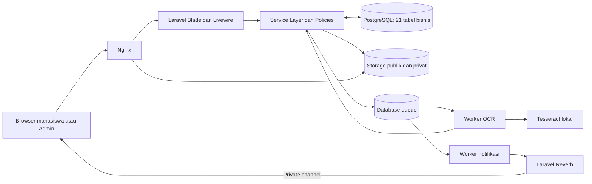
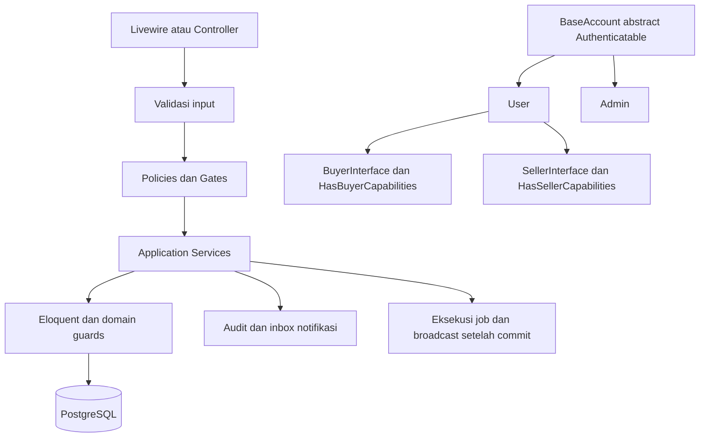
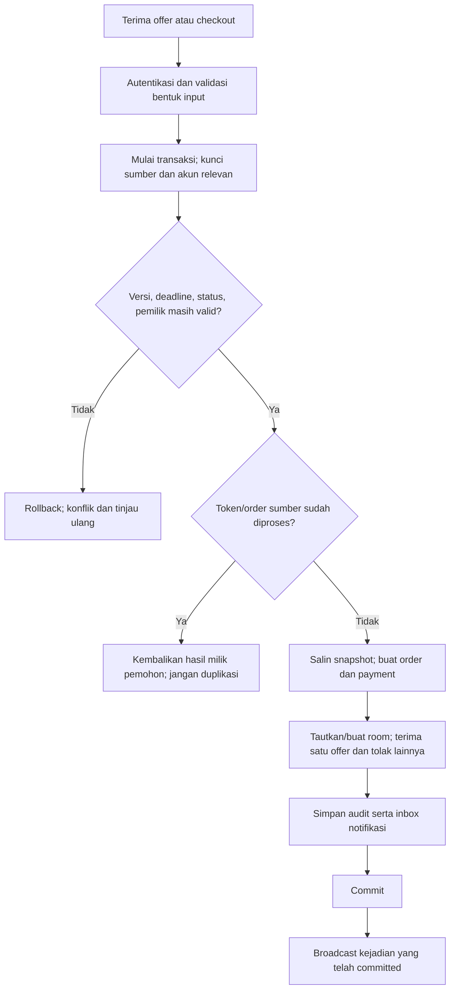
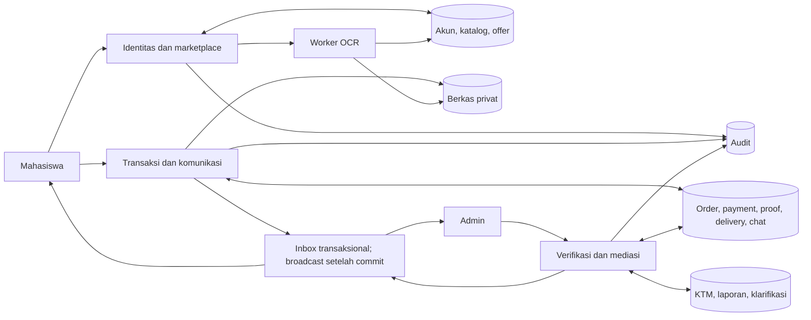
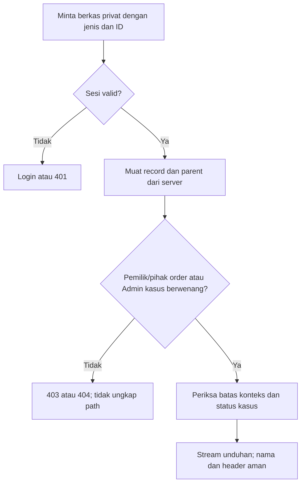

# GigKampus — ERD & Architecture

Status: **21 tabel bisnis, atribut, relasi, lima default akhir, dan arsitektur telah disetujui**, termasuk login terpadu dan Argon2id. Tanggal baseline: 18 November 2026. Dokumen bersifat spesifikasi; migration, kode aplikasi, seeder, dan pengujian runtime belum dibuat pada tahap dokumentasi.

Acuan produk: [PRD.md](PRD.md). Pilihan teknologi/versi: [TECH_STACK.md](TECH_STACK.md). Sumber awal: [Brief v4](docs/GigKampusMasterProjectBriefv4.pdf) dan [Figma Design Final](https://www.figma.com/design/AjhxCDraHEolOB1CCGg6Qp/GigKampus?node-id=229-759). Keputusan discovery yang disetujui merupakan acuan ketika berbeda dari brief.

## 1. Architecture Overview

Satu aplikasi modular Laravel melayani mahasiswa dan Admin melalui Blade/Livewire. Service Layer mengorkestrasikan transaksi lintas model; Policies memeriksa izin; model/domain methods menjaga transisi. PostgreSQL menyimpan seluruh data bisnis. Berkas berada pada filesystem terpisah publik/privat. Tesseract berjalan lokal melalui worker OCR. Reverb menyediakan broadcast privat setelah commit.

Runtime demo berupa Docker Compose lokal dengan data persisten, dua antrean, dan backup. Pemisahan worker adalah pemisahan proses dari codebase yang sama, tanpa memecah kepemilikan database.

Target sistem: satu instance untuk demo lima sesi bersamaan, dua jalur order, identitas KTM, komunikasi, histori, dan mediasi. Tidak ada bank API/escrow, SMTP wajib, cloud OCR, microservices, atau layanan matching otomatis.

## 2. Architecture Design Decisions

| ADR | Keputusan yang disetujui | Alasan/implikasi |
|---|---|---|
| ADR-01 | Laravel modular monolith, MVC + Service Layer | Sesuai PBO dan cakupan satu builder; transaksi tetap satu database |
| ADR-02 | Blade/Livewire + Alpine bawaan | UI mengikuti Figma tanpa aplikasi frontend terpisah |
| ADR-03 | users/admins terpisah, satu /login | Resolver memilih guard/provider di server; tidak ada pilihan peran |
| ADR-04 | Email unik lintas kedua tabel | Menghilangkan benturan identitas pada login terpadu; trigger + kunci transaksi |
| ADR-05 | Argon2id, password 8–128 karakter | Hash melalui Laravel; tidak ada penyimpanan password asli |
| ADR-06 | PostgreSQL, BIGSERIAL, NUMERIC(12,0), TIMESTAMPTZ | Integritas relasi, uang eksak, waktu konsisten |
| ADR-07 | VARCHAR + CHECK untuk status | Daftar nilai dibatasi; perpindahan status dijaga service/model |
| ADR-08 | RESTRICT untuk seluruh FK bisnis | Histori/bukti tidak hilang akibat penghapusan berantai; mengganti CASCADE brief |
| ADR-09 | Snapshot kesepakatan dan tujuan pembayaran | Edit sumber tidak mengubah kontrak order berjalan |
| ADR-10 | Histori proof/delivery/KTM/clarification terpisah | Tidak menimpa bukti sebelumnya; 21 tabel bisnis setelah tabel jawaban ditambahkan |
| ADR-11 | Satu payment/order, refund penuh | Tidak ada cicilan, overpay accounting, add-on, atau refund sebagian |
| ADR-12 | Komplain order berbeda dari report konten/chat | Hanya order_complaint membekukan order |
| ADR-13 | Dua database queues, inbox transaksional, broadcast setelah commit | OCR tidak menahan broadcast; rollback tidak meninggalkan notifikasi atau kejadian palsu |
| ADR-14 | Docker lokal utama, VPS opsional | Demo tidak bergantung koneksi internet atau layanan berbayar saat runtime |
| ADR-15 | Berkas privat terotorisasi, pesan/audit immutable | Perlindungan bukti dan pembatasan akses kasus |

Alternatif yang telah dipertimbangkan: Laravel + React/Inertia menambah state frontend; OCR cloud menambah ketergantungan eksternal; backend terpisah/microservices belum diperlukan. Pilihan alternatif tidak ditambahkan sebagai dependency.

## 3. System Architecture Diagram



Nginx hanya menyajikan aset publik langsung. Akses storage privat harus melewati Laravel/Policy, bukan alias filesystem publik. Queue dan bookkeeping framework bukan tambahan entitas bisnis pada ERD.

## 4. Component Architecture



Komponen layanan yang menjadi tanggung jawab implementasi: UnifiedLogin, Registration/Profile, KtmOcr/Verification, Catalog, OfferAcceptance, Order/Payment, Revision/Delivery, Cancellation/Refund, Chat, Report/Clarification, Moderation, Notification, dan Audit.

- BaseAccount memuat perilaku autentikasi bersama; User/Admin menentukan tabel dan provider masing-masing.
- Pemetaan password_hash dan timestamp nonstandar dikonfigurasi eksplisit.
- Buyer/Seller merupakan kemampuan kontekstual, bukan kolom role yang harus diubah saat navigasi.
- Method domain seperti pemeriksaan Payment.isVerified dan transisi Order dipanggil dalam transaksi Service; UI tidak mengubah status langsung.
- OOP composition menyatakan kepemilikan/lifecycle domain, tidak mengharuskan DELETE CASCADE. Histori tetap memakai RESTRICT.
- Repository hanya bila ada kebutuhan query/abstraksi nyata; tidak menambah lapisan yang sekadar membungkus Eloquent.

## 5. Entity Inventory

| Entitas | Jenis/purpose | Pembuat berwenang |
|---|---|---|
| `admins` | Akun pengelola; master akun terpisah dari mahasiswa. | Seeder pengembang. |
| `users` | Akun mahasiswa yang dapat menjadi Buyer dan Seller; master akun. | Registrasi mahasiswa atau seeder. |
| `categories` | Kategori satu tingkat, dipakai bersama oleh Gig dan Permintaan Jasa; referensi. | Seeder awal dan Admin. |
| `banks` | Daftar nama bank untuk dropdown; referensi statis demo. | Seeder. |
| `gigs` | Katalog jasa harga tetap; master layanan milik Seller. | Mahasiswa verified yang tidak disuspend dan memiliki metode pembayaran lengkap. |
| `service_requests` | Kebutuhan khusus Buyer, bukan lelang; transaksi permintaan. | Mahasiswa verified dan tidak disuspend. |
| `price_offers` | Satu penawaran Seller per Permintaan Jasa; transaksi penawaran privat. | Seller verified, tidak disuspend, memiliki metode pembayaran, bukan pemilik permintaan. |
| `orders` | Transaksi dari tepat satu sumber dan snapshot kesepakatan; transaksi utama. | Buyer melalui checkout atau penerimaan offer yang atomik. |
| `payments` | Satu pembayaran utama per order dan kewajiban refund. | Sistem bersama pembentukan order; keputusan Seller atau Admin melalui mediasi. |
| `payment_proofs` | Satu percobaan unggah, tanpa menimpa keputusan Seller sebelumnya. | Buyer terkait; Seller mengisi satu keputusan pemeriksaan. |
| `revisions` | Pengajuan revisi yang langsung mengonsumsi hak perbaikan. | Buyer pemilik order berstatus delivered. |
| `order_deliveries` | Versi hasil pertama/perbaikan; riwayat transaksi immutable. | Seller order dalam in_progress untuk pertama atau revision untuk perbaikan. |
| `reviews` | Penilaian Buyer setelah completed, dengan metadata moderasi. | Buyer order completed; metadata hide hanya Admin melalui kasus. |
| `chat_rooms` | Ruang privat dua mahasiswa; pra-pesan atau terhubung satu order. | Sistem saat Tanya Penjual/diskusi offer atau pembentukan order. |
| `chat_messages` | Pesan append-only dan lampiran; read receipt untuk peserta penerima. | Salah satu peserta; Admin bukan pengirim chat dua pihak. |
| `notifications` | Inbox kejadian aplikasi; salinan informasi bukan sumber kebenaran transaksi. | Sistem dalam transaksi bisnis; broadcast setelah commit; penerima menandai read. |
| `reports` | Satu laporan moderasi atau komplain transaksi; lima target yang saling eksklusif. | Mahasiswa verified sesuai kepemilikan/akses target; Admin mengambil dan memutus kasus. |
| `report_clarifications` | Satu pertanyaan Admin kepada satu pengguna dengan tenggat tetap. | Admin penangan kasus pending. |
| `report_clarification_responses` | Satu jawaban/bukti susulan immutable; transaksi tanggapan. | Penerima permintaan klarifikasi. |
| `ktm_verification_requests` | Satu unggahan KTM, hasil OCR, dan keputusan pemeriksaan; riwayat verifikasi privat. | Pemilik akun; OCR worker mengisi hasil; Admin memutus pending_review. |
| `audit_logs` | Rekaman perubahan penting dan alasan; log append-only, bukan data transaksi yang dapat diedit. | Sistem dalam transaksi yang sama dengan aksi User/Admin. |

price_offers juga menjadi penghubung Seller–Permintaan Jasa dengan atribut harga/proposal/status sendiri. chat_rooms menghubungkan tepat dua pengguna melalui buyer_id/seller_id; tidak memerlukan tabel participant M:N untuk demo dua peserta tetap.

## 6. Database Schema

- Namespace bisnis menggunakan tabel plural snake_case berbahasa Inggris.
- Semua 21 tabel memiliki id BIGSERIAL primary key; kolom relasi BIGINT.
- UUID hanya token idempotensi checkout/pesan, bukan penggantian strategi primary key.
- Nilai wajib memakai NOT NULL; opsional memakai NULL, tidak diisi string kosong sebagai pengganti.
- Uang disimpan NUMERIC(12,0), rentang per nominal maksimal 100.000.000; harga jasa positif; budget_min boleh 0.
- Teks tervalidasi karakter, bukan angka byte, kecuali ukuran file yang memang byte. Password tidak di-trim.
- Timestamp internal UTC dengan presisi yang mempertahankan batas akhir hari; seluruh konversi kalender input/output menggunakan Asia/Jakarta.
- Default waktu dibuat oleh server/database, bukan waktu browser.
- Tidak menambahkan deleted_at atau timestamp generik tanpa kebutuhan yang telah dipilih.
- Tidak ada migrasi/penyalinan data dari PostgreSQL host 16; proyek memakai database terisolasi.
- Tabel teknis migrations/jobs/failed_jobs dijelaskan pada TECH_STACK; tidak dicampur dengan 21 entitas bisnis.

| Tabel | Jumlah kolom |
|---|---:|
| `admins` | 6 |
| `users` | 17 |
| `categories` | 3 |
| `banks` | 2 |
| `gigs` | 13 |
| `service_requests` | 13 |
| `price_offers` | 11 |
| `orders` | 32 |
| `payments` | 16 |
| `payment_proofs` | 12 |
| `revisions` | 7 |
| `order_deliveries` | 10 |
| `reviews` | 11 |
| `chat_rooms` | 9 |
| `chat_messages` | 13 |
| `notifications` | 11 |
| `reports` | 23 |
| `report_clarifications` | 7 |
| `report_clarification_responses` | 10 |
| `ktm_verification_requests` | 15 |
| `audit_logs` | 13 |
| **Total** | **254** |

## 7. Detailed Entity Attributes

Contoh berikut adalah contoh **format masing-masing atribut**, bukan satu baris fixture yang seluruh nilainya dapat digabung begitu saja. Data seeder wajib memakai urutan waktu, status, aktor, dan relasi yang konsisten.

Path berkas dibentuk server. Seluruh metadata file harus hadir bersama saat file ada; format/ukuran diperiksa terhadap berkas sebenarnya. Biaya/nominal contoh adalah simulasi. Snapshot dan kolom immutable dilindungi dari update/delete yang tidak diizinkan.

### 7.1. `admins`

Akun pengelola; master akun terpisah dari mahasiswa. Pembuat/pengubah berwenang: Seeder pengembang.

| Kolom | Tipe | NULL? / default | Key / referensi | Validasi dan tujuan | Contoh format |
|---|---|---|---|---|---|
| `id` | `BIGSERIAL` | Tidak; sequence | PK | Identitas otomatis; tidak dapat diubah. | `1` |
| `name` | `VARCHAR(100)` | Tidak; tanpa default | — | Wajib 2–100 karakter setelah trim; tidak unik. | `Admin Demo` |
| `email` | `VARCHAR(254)` | Tidak; tanpa default | UK | Email valid, trim dan lowercase; boleh domain selain IPB; unik lintas admins/users. | `admin@gigkampus.test` |
| `password_hash` | `VARCHAR(255)` | Tidak; tanpa default | — | Hash Argon2id; password asli 8–128 karakter, tidak disimpan. | `hash Argon2id hasil Laravel` |
| `created_at` | `TIMESTAMPTZ` | Tidak; waktu pembuatan | — | Waktu pembuatan akun. | `2026-11-18T03:00:00Z` |
| `updated_at` | `TIMESTAMPTZ` | Tidak; waktu pembuatan | — | Awalnya sama dengan created_at; diperbarui saat data berubah. | `2026-11-18T03:00:00Z` |

Login menggunakan halaman /login yang sama, tetapi provider dan guard admin tersendiri.

### 7.2. `users`

Akun mahasiswa yang dapat menjadi Buyer dan Seller; master akun. Pembuat/pengubah berwenang: Registrasi mahasiswa atau seeder.

| Kolom | Tipe | NULL? / default | Key / referensi | Validasi dan tujuan | Contoh format |
|---|---|---|---|---|---|
| `id` | `BIGSERIAL` | Tidak; sequence | PK | Identitas otomatis; tidak dapat diubah. | `1` |
| `name` | `VARCHAR(100)` | Tidak; tanpa default | — | 2–100 karakter setelah trim; satu kata diperbolehkan; tidak unik. | `Mahasiswa Demo 01` |
| `email` | `VARCHAR(254)` | Tidak; tanpa default | UK | Trim, lowercase; domain persis @apps.ipb.ac.id; unik lintas users/admins; immutable setelah registrasi. | `buyer.demo@apps.ipb.ac.id` |
| `password_hash` | `VARCHAR(255)` | Tidak; tanpa default | — | Hash Argon2id; password 8–128 karakter dan konfirmasi. | `hash Argon2id hasil Laravel` |
| `phone_number` | `VARCHAR(16)` | Tidak; tanpa default | — | Wajib, '+' dan 10–15 digit; nomor Indonesia 08/+62 dinormalisasi +62; tidak unik. | `+6281234567890` |
| `nim` | `VARCHAR(20)` | Ya; NULL | UK | NIM final uppercase alfanumerik tanpa spasi, unik ketika terisi; hanya dari OCR yang disetujui. | `DEMOIPB001` |
| `avatar_path` | `TEXT` | Ya; NULL | — | Satu JPG/JPEG/PNG ≤5 MB; opsional, fallback inisial; publik. | `public/avatars/demo01.png` |
| `bio` | `VARCHAR(500)` | Ya; NULL | — | Teks biasa maksimal 500 karakter; publik, dapat diedit. | `Membantu desain poster kegiatan kampus.` |
| `is_verified` | `BOOLEAN` | Tidak; false | — | Hanya true setelah persetujuan KTM. | `false` |
| `is_suspended` | `BOOLEAN` | Tidak; false | — | Independen dari verifikasi; memblokir aktivitas baru, bukan kewajiban pesanan lama. | `false` |
| `bank_id` | `BIGINT` | Ya; NULL | FK → banks.id | Diisi ketika metode rekening digunakan. | `1` |
| `bank_account_number` | `VARCHAR(50)` | Ya; NULL | — | 1–50 digit, mempertahankan nol di depan; spasi/pemisah dibuang; tidak unik. | `001234567890` |
| `bank_account_holder_name` | `VARCHAR(100)` | Ya; NULL | — | Nama penerima 1–100 karakter; boleh pihak lain; wajib bersama rekening. | `Penerima Demo` |
| `qris_image_path` | `TEXT` | Ya; NULL | — | Gambar QRIS JPG/JPEG/PNG ≤5 MB, storage privat. | `private/qris/demo01.png` |
| `qris_holder_name` | `VARCHAR(100)` | Ya; NULL | — | Nama penerima/merchant 1–100 karakter; wajib bersama gambar QRIS. | `Merchant Demo` |
| `created_at` | `TIMESTAMPTZ` | Tidak; waktu pembuatan | — | Waktu registrasi; statistik pendaftaran. | `2026-11-18T03:00:00Z` |
| `updated_at` | `TIMESTAMPTZ` | Tidak; waktu pembuatan | — | Waktu pembaruan profil/identitas/status terakhir. | `2026-11-18T03:00:00Z` |

Foto KTM dan pemeriksa tidak diduplikasi di users; ditelusuri melalui ktm_verification_requests. Tidak ada kolom role Buyer/Seller karena peran mengikuti konteks.

### 7.3. `categories`

Kategori satu tingkat, dipakai bersama oleh Gig dan Permintaan Jasa; referensi. Pembuat/pengubah berwenang: Seeder awal dan Admin.

| Kolom | Tipe | NULL? / default | Key / referensi | Validasi dan tujuan | Contoh format |
|---|---|---|---|---|---|
| `id` | `BIGSERIAL` | Tidak; sequence | PK | Identitas otomatis; tidak dapat diubah. | `1` |
| `name` | `VARCHAR(100)` | Tidak; tanpa default | — | 2–100 karakter, trim; unik case-insensitive termasuk kategori nonaktif. | `Desain & UI/UX` |
| `is_active` | `BOOLEAN` | Tidak; true | — | Nonaktif melarang pilihan baru, tanpa menghentikan transaksi data lama. | `true` |

Seed: Desain & UI/UX, Pemrograman & Web, Olah Data, Video & Foto, Penulisan, Akademik, dan Lainnya. Chip lebih spesifik adalah pintasan keyword, bukan subkategori.

### 7.4. `banks`

Daftar nama bank untuk dropdown; referensi statis demo. Pembuat/pengubah berwenang: Seeder.

| Kolom | Tipe | NULL? / default | Key / referensi | Validasi dan tujuan | Contoh format |
|---|---|---|---|---|---|
| `id` | `BIGSERIAL` | Tidak; sequence | PK | Identitas otomatis; tidak dapat diubah. | `1` |
| `name` | `VARCHAR(100)` | Tidak; tanpa default | — | 2–100 karakter, trim, unik case-insensitive. | `BCA` |

### 7.5. `gigs`

Katalog jasa harga tetap; master layanan milik Seller. Pembuat/pengubah berwenang: Mahasiswa verified yang tidak disuspend dan memiliki metode pembayaran lengkap.

| Kolom | Tipe | NULL? / default | Key / referensi | Validasi dan tujuan | Contoh format |
|---|---|---|---|---|---|
| `id` | `BIGSERIAL` | Tidak; sequence | PK | Identitas otomatis; tidak dapat diubah. | `1` |
| `seller_id` | `BIGINT` | Tidak; tanpa default | FK → users.id | Pemilik layanan; peran Seller dalam konteks ini. | `1` |
| `category_id` | `BIGINT` | Tidak; tanpa default | FK → categories.id | Tepat satu kategori; pilihan baru harus aktif. | `1` |
| `title` | `VARCHAR(150)` | Tidak; tanpa default | — | Wajib 5–150 karakter setelah trim, tidak unik. | `Desain Poster Acara Kampus` |
| `description` | `TEXT` | Tidak; tanpa default | — | Wajib 20–5.000 karakter, teks biasa dan paragraf. | `Desain satu poster kegiatan berdasarkan brief dan materi dari Buyer.` |
| `base_price` | `NUMERIC(12,0)` | Tidak; tanpa default | — | Rupiah bulat, 1–100.000.000. | `150000` |
| `delivery_days` | `SMALLINT` | Tidak; tanpa default | — | Wajib 1–365; 1 hari = 24 jam kalender sejak verified; tanpa default. | `3` |
| `max_revisions` | `SMALLINT` | Tidak; tanpa default | — | Wajib 0–20; tanpa default. | `2` |
| `portfolio_path` | `TEXT` | Ya; NULL | — | Satu portofolio: JPG/JPEG/PNG ≤5 MB atau PDF ≤20 MB; opsional. | `public/portfolios/demo-poster.pdf` |
| `status` | `VARCHAR(16)` | Tidak; active | — | active, inactive, suspended; default hanya setelah syarat publikasi dipenuhi. | `active` |
| `version` | `INTEGER` | Tidak; 1 | — | Bilangan ≥1; increment konten/ketentuan berubah, diperiksa saat checkout. | `1` |
| `created_at` | `TIMESTAMPTZ` | Tidak; waktu pembuatan | — | Waktu publikasi awal, acuan sort terbaru. | `2026-11-18T03:00:00Z` |
| `updated_at` | `TIMESTAMPTZ` | Tidak; waktu pembuatan | — | Waktu perubahan terakhir. | `2026-11-18T03:00:00Z` |

### 7.6. `service_requests`

Kebutuhan khusus Buyer, bukan lelang; transaksi permintaan. Pembuat/pengubah berwenang: Mahasiswa verified dan tidak disuspend.

| Kolom | Tipe | NULL? / default | Key / referensi | Validasi dan tujuan | Contoh format |
|---|---|---|---|---|---|
| `id` | `BIGSERIAL` | Tidak; sequence | PK | Identitas otomatis; tidak dapat diubah. | `1` |
| `buyer_id` | `BIGINT` | Tidak; tanpa default | FK → users.id | Pemilik permintaan. | `1` |
| `category_id` | `BIGINT` | Tidak; tanpa default | FK → categories.id | Tepat satu kategori. | `1` |
| `title` | `VARCHAR(150)` | Tidak; tanpa default | — | 5–150 karakter setelah trim, wajib, tidak unik. | `Butuh desain poster seminar kampus` |
| `description` | `TEXT` | Tidak; tanpa default | — | 20–5.000 karakter, wajib, teks biasa. | `Membutuhkan satu poster seminar dengan materi yang telah disiapkan.` |
| `budget_min` | `NUMERIC(12,0)` | Tidak; tanpa default | — | Estimasi 0–100.000.000; wajib tanpa default. | `100000` |
| `budget_max` | `NUMERIC(12,0)` | Tidak; tanpa default | — | Batas keras 1–100.000.000 dan ≥budget_min; wajib. | `250000` |
| `deadline_date` | `DATE` | Tidak; tanpa default | — | Wajib, hari ini atau setelahnya dalam WIB ketika dibuat/tenggat diubah; akhir hari WIB. | `2026-11-22` |
| `status` | `VARCHAR(16)` | Tidak; open | — | open, closed, ordered. | `open` |
| `is_hidden` | `BOOLEAN` | Tidak; false | — | Penindakan konten oleh Admin; berbeda dari efek suspend akun. | `false` |
| `version` | `INTEGER` | Tidak; 1 | — | ≥1; increment ketika isi/ketentuan berubah; pemeriksaan saat offer dikirim. | `1` |
| `created_at` | `TIMESTAMPTZ` | Tidak; waktu pembuatan | — | Acuan urutan permintaan terbaru. | `2026-11-18T03:00:00Z` |
| `updated_at` | `TIMESTAMPTZ` | Tidak; waktu pembuatan | — | Perubahan terakhir. | `2026-11-18T03:00:00Z` |

### 7.7. `price_offers`

Satu penawaran Seller per Permintaan Jasa; transaksi penawaran privat. Pembuat/pengubah berwenang: Seller verified, tidak disuspend, memiliki metode pembayaran, bukan pemilik permintaan.

| Kolom | Tipe | NULL? / default | Key / referensi | Validasi dan tujuan | Contoh format |
|---|---|---|---|---|---|
| `id` | `BIGSERIAL` | Tidak; sequence | PK | Identitas otomatis; tidak dapat diubah. | `1` |
| `service_request_id` | `BIGINT` | Tidak; tanpa default | FK → service_requests.id | Permintaan induk. | `1` |
| `seller_id` | `BIGINT` | Tidak; tanpa default | FK → users.id | Seller pengirim. | `1` |
| `offered_price` | `NUMERIC(12,0)` | Tidak; tanpa default | — | 1–100.000.000 dan ≤budget_max induk; boleh di bawah budget_min. | `180000` |
| `max_revisions` | `SMALLINT` | Tidak; tanpa default | — | Wajib 0–20. | `2` |
| `proposal_note` | `TEXT` | Tidak; tanpa default | — | Wajib 20–3.000 karakter, teks biasa. | `Saya menyediakan satu desain utama dan dua kali perbaikan sesuai brief.` |
| `status` | `VARCHAR(16)` | Tidak; pending | — | pending, accepted, rejected, withdrawn. | `pending` |
| `status_reason` | `VARCHAR(255)` | Ya; NULL | — | Alasan otomatis rejected/withdrawn; NULL untuk pending/accepted. | `Buyer menerima penawaran lain.` |
| `version` | `INTEGER` | Tidak; 1 | — | ≥1, increment ketika berubah; dibandingkan saat penerimaan. | `1` |
| `offered_at` | `TIMESTAMPTZ` | Tidak; waktu pembuatan | — | Waktu pengajuan pertama, tidak direset ketika diedit. | `2026-11-18T03:00:00Z` |
| `updated_at` | `TIMESTAMPTZ` | Tidak; waktu pembuatan | — | Waktu perubahan terakhir. | `2026-11-18T03:00:00Z` |

### 7.8. `orders`

Transaksi dari tepat satu sumber dan snapshot kesepakatan; transaksi utama. Pembuat/pengubah berwenang: Buyer melalui checkout atau penerimaan offer yang atomik.

| Kolom | Tipe | NULL? / default | Key / referensi | Validasi dan tujuan | Contoh format |
|---|---|---|---|---|---|
| `id` | `BIGSERIAL` | Tidak; sequence | PK | PK otomatis dan immutable. | `1` |
| `creation_key` | `UUID` | Tidak; tanpa default | UK | Token idempotensi; unik, dibentuk sistem untuk pengiriman checkout. | `00000000-0000-4000-8000-000000000001` |
| `buyer_id` | `BIGINT` | Tidak; tanpa default | FK → users.id | Harus pemesan terautentikasi. | `1` |
| `seller_id` | `BIGINT` | Tidak; tanpa default | FK → users.id | Harus pemilik Gig atau offer; berbeda dari Buyer. | `1` |
| `transaction_type` | `VARCHAR(16)` | Tidak; tanpa default | — | direct_gig atau custom_request. | `direct_gig` |
| `gig_id` | `BIGINT` | Ya; NULL | FK → gigs.id | Wajib untuk direct_gig, NULL untuk custom_request. | `1` |
| `price_offer_id` | `BIGINT` | Ya; NULL | UK; FK → price_offers.id | Wajib untuk custom_request, NULL untuk direct_gig; satu offer satu order. | `1` |
| `title_snapshot` | `VARCHAR(150)` | Tidak; tanpa default | — | Judul Gig/permintaan saat order dibentuk; immutable. | `Desain Poster Acara Kampus` |
| `scope_description_snapshot` | `TEXT` | Tidak; tanpa default | — | Deskripsi lingkup sumber 20–5.000 karakter; immutable. | `Satu poster kegiatan dengan materi yang disediakan Buyer.` |
| `buyer_brief` | `TEXT` | Ya; NULL | — | direct_gig: wajib 20–5.000 setelah trim; custom_request: harus NULL. | `Gunakan warna biru dan cantumkan jadwal acara yang saya berikan.` |
| `seller_proposal_snapshot` | `TEXT` | Ya; NULL | — | custom_request: wajib 20–3.000; direct_gig: NULL. | `Satu desain utama dan dua revisi sesuai brief permintaan.` |
| `category_name_snapshot` | `VARCHAR(100)` | Tidak; tanpa default | — | Nama kategori saat order dibentuk. | `Desain & UI/UX` |
| `total_price` | `NUMERIC(12,0)` | Tidak; tanpa default | — | Harga kesepakatan 1–100.000.000; immutable. | `150000` |
| `max_revisions_snapshot` | `SMALLINT` | Tidak; tanpa default | — | 0–20; hak revisi immutable. | `2` |
| `delivery_days_snapshot` | `SMALLINT` | Ya; NULL | — | Wajib 1–365 untuk direct_gig; NULL custom. | `3` |
| `delivery_deadline_at` | `TIMESTAMPTZ` | Ya; NULL | — | Direct: NULL sebelum verified, lalu verified_at pertama + durasi. Custom: akhir tanggal tenggat WIB sejak order dibuat. | `2026-11-22T16:59:59.999999Z` |
| `status` | `VARCHAR(32)` | Tidak; awaiting_payment | — | awaiting_payment, awaiting_validation, in_progress, delivered, revision, completed, cancelled, disputed. | `awaiting_payment` |
| `stage_version` | `INTEGER` | Tidak; 1 | — | ≥1; naik pada transisi bisnis sah pada matriks §12.4, termasuk penolakan bukti dan siklus revisi; bukan saat masuk disputed/pemulihan tahap yang sama. | `1` |
| `bank_name_snapshot` | `VARCHAR(100)` | Ya; NULL | — | Nama bank tujuan saat order dibentuk. | `BCA` |
| `bank_account_number_snapshot` | `VARCHAR(50)` | Ya; NULL | — | Nomor tujuan; 1–50 digit sebagai teks. | `001234567890` |
| `bank_account_holder_name_snapshot` | `VARCHAR(100)` | Ya; NULL | — | Nama penerima rekening. | `Penerima Demo` |
| `qris_image_path_snapshot` | `TEXT` | Ya; NULL | — | Referensi gambar QRIS privat yang tetap dipertahankan. | `private/qris/demo01.png` |
| `qris_holder_name_snapshot` | `VARCHAR(100)` | Ya; NULL | — | Nama merchant/penerima QRIS. | `Merchant Demo` |
| `cancellation_status` | `VARCHAR(16)` | Tidak; none | — | none, pending, approved, rejected, withdrawn, voided. | `none` |
| `cancellation_requested_by_id` | `BIGINT` | Ya; NULL | FK → users.id | Pengaju harus Buyer atau Seller order. | `1` |
| `cancellation_reason` | `TEXT` | Ya; NULL | — | Wajib 5–1.000 saat pengajuan. | `Jadwal pelaksanaan tidak dapat disepakati.` |
| `cancellation_requested_at` | `TIMESTAMPTZ` | Ya; NULL | — | Dasar tenggat respons 24 jam. | `2026-11-18T03:00:00Z` |
| `cancellation_version` | `INTEGER` | Tidak; 0 | — | ≥0; increment setiap pengajuan baru agar respons lama ditolak. | `0` |
| `cancellation_response_reason` | `TEXT` | Ya; NULL | — | Wajib 5–1.000 pada rejection; alasan otomatis pada voided. | `Pekerjaan sudah siap dikirim sesuai brief.` |
| `cancellation_closed_at` | `TIMESTAMPTZ` | Ya; NULL | — | Waktu approved/rejected/withdrawn/voided. | `2026-11-18T03:00:00Z` |
| `order_date` | `TIMESTAMPTZ` | Tidak; waktu pembuatan | — | Waktu order dibuat. | `2026-11-18T03:00:00Z` |
| `updated_at` | `TIMESTAMPTZ` | Tidak; waktu pembuatan | — | Perubahan transaksi terakhir. | `2026-11-18T03:00:00Z` |

Sisa revisi dihitung dari jumlah revisions; first delivery dari MIN(order_deliveries.submitted_at). ID tampilan ORD dapat diturunkan dari id/tanggal tanpa kolom bisnis tambahan.

### 7.9. `payments`

Satu pembayaran utama per order dan kewajiban refund. Pembuat/pengubah berwenang: Sistem bersama pembentukan order; keputusan Seller atau Admin melalui mediasi.

| Kolom | Tipe | NULL? / default | Key / referensi | Validasi dan tujuan | Contoh format |
|---|---|---|---|---|---|
| `id` | `BIGSERIAL` | Tidak; sequence | PK; anggota FK komposit ke payment_proofs.payment_id | PK otomatis dan immutable; ikut membatasi bukti terpilih pada payment sendiri. | `1` |
| `order_id` | `BIGINT` | Tidak; tanpa default | UK; FK → orders.id | Unik; composite FK (order_id,amount) ke orders(id,total_price). | `1` |
| `amount` | `NUMERIC(12,0)` | Tidak; tanpa default | Anggota FK komposit ke orders.total_price | Harus persis total_price, 1–100.000.000; tidak ada cicilan/overpay. | `150000` |
| `payment_method` | `VARCHAR(16)` | Tidak; tanpa default | — | bank_transfer atau qris yang tersedia pada snapshot. | `bank_transfer` |
| `status` | `VARCHAR(16)` | Tidak; pending | — | pending, verified, rejected; pending juga dapat berarti belum ada bukti. | `pending` |
| `verified_proof_id` | `BIGINT` | Ya; NULL | FK → payment_proofs.id | Bukti terpilih harus milik pembayaran ini; composite FK (verified_proof_id,id) -> (id,payment_id). | `1` |
| `verified_by_user_id` | `BIGINT` | Ya; NULL | FK → users.id | Jika terisi harus Seller terkait. | `1` |
| `verified_by_admin_id` | `BIGINT` | Ya; NULL | FK → admins.id | Jika terisi harus Admin penangan kasus. | `1` |
| `verified_at` | `TIMESTAMPTZ` | Ya; NULL | — | Waktu verified pertama; tidak direset. | `2026-11-18T03:00:00Z` |
| `refund_status` | `VARCHAR(16)` | Tidak; none | — | none, pending, confirmed. | `none` |
| `refund_requested_at` | `TIMESTAMPTZ` | Ya; NULL | — | Waktu kewajiban refund terbentuk. | `2026-11-18T03:00:00Z` |
| `refund_confirmed_by_user_id` | `BIGINT` | Ya; NULL | FK → users.id | Jika terisi harus Buyer terkait. | `1` |
| `refund_confirmed_by_admin_id` | `BIGINT` | Ya; NULL | FK → admins.id | Admin penangan yang menetapkan refund diterima. | `1` |
| `refund_confirmed_at` | `TIMESTAMPTZ` | Ya; NULL | — | Waktu konfirmasi refund. | `2026-11-18T03:00:00Z` |
| `created_at` | `TIMESTAMPTZ` | Tidak; waktu pembuatan | — | Waktu pembayaran utama dibentuk. | `2026-11-18T03:00:00Z` |
| `updated_at` | `TIMESTAMPTZ` | Tidak; waktu pembuatan | — | Waktu perubahan terakhir. | `2026-11-18T03:00:00Z` |

### 7.10. `payment_proofs`

Satu percobaan unggah, tanpa menimpa keputusan Seller sebelumnya. Pembuat/pengubah berwenang: Buyer terkait; Seller mengisi satu keputusan pemeriksaan.

| Kolom | Tipe | NULL? / default | Key / referensi | Validasi dan tujuan | Contoh format |
|---|---|---|---|---|---|
| `id` | `BIGSERIAL` | Tidak; sequence | PK | PK otomatis dan immutable. | `1` |
| `payment_id` | `BIGINT` | Tidak; tanpa default | FK → payments.id | Pembayaran induk. | `1` |
| `attempt_no` | `INTEGER` | Tidak; tanpa default | — | Urutan ≥1 per payment. | `1` |
| `file_path` | `TEXT` | Tidak; tanpa default | — | Storage privat; JPG/JPEG/PNG ≤5 MB. | `private/demo/berkas.png` |
| `original_filename` | `VARCHAR(255)` | Tidak; tanpa default | — | Nama tampilan, bukan path penyimpanan. | `berkas-demo.png` |
| `mime_type` | `VARCHAR(100)` | Tidak; tanpa default | — | Jenis berkas diperiksa server. | `image/png` |
| `file_size` | `INTEGER` | Tidak; tanpa default | — | Ukuran positif byte; JPG/JPEG/PNG ≤5 MB. | `102400` |
| `seller_review_status` | `VARCHAR(16)` | Tidak; pending | — | pending, verified, rejected. | `pending` |
| `reviewed_by_seller_id` | `BIGINT` | Ya; NULL | FK → users.id | Harus Seller order; NULL sebelum diperiksa. | `1` |
| `rejection_reason` | `TEXT` | Ya; NULL | — | 5–1.000 wajib saat rejected; NULL selainnya. | `Nominal pada bukti tidak sesuai dengan tagihan.` |
| `submitted_at` | `TIMESTAMPTZ` | Tidak; waktu pembuatan | — | Waktu unggah; immutable. | `2026-11-18T03:00:00Z` |
| `reviewed_at` | `TIMESTAMPTZ` | Ya; NULL | — | Waktu keputusan Seller. | `2026-11-18T03:00:00Z` |

### 7.11. `revisions`

Pengajuan revisi yang langsung mengonsumsi hak perbaikan. Pembuat/pengubah berwenang: Buyer pemilik order berstatus delivered.

| Kolom | Tipe | NULL? / default | Key / referensi | Validasi dan tujuan | Contoh format |
|---|---|---|---|---|---|
| `id` | `BIGSERIAL` | Tidak; sequence | PK | PK otomatis dan immutable. | `1` |
| `order_id` | `BIGINT` | Tidak; tanpa default | FK → orders.id | Pesanan terkait. | `1` |
| `revision_no` | `SMALLINT` | Tidak; tanpa default | — | Urutan 1–20. | `1` |
| `revision_note` | `TEXT` | Tidak; tanpa default | — | 20–5.000 karakter setelah trim. | `Mohon perbaiki tanggal kegiatan dan posisi logo sesuai materi awal.` |
| `status` | `VARCHAR(16)` | Tidak; requested | — | requested, in_progress, completed. | `requested` |
| `requested_at` | `TIMESTAMPTZ` | Tidak; waktu pembuatan | — | Waktu pengajuan, kuota langsung terpakai. | `2026-11-18T03:00:00Z` |
| `completed_at` | `TIMESTAMPTZ` | Ya; NULL | — | Saat hasil revisi dikirim. | `2026-11-18T03:00:00Z` |

### 7.12. `order_deliveries`

Versi hasil pertama/perbaikan; riwayat transaksi immutable. Pembuat/pengubah berwenang: Seller order dalam in_progress untuk pertama atau revision untuk perbaikan.

| Kolom | Tipe | NULL? / default | Key / referensi | Validasi dan tujuan | Contoh format |
|---|---|---|---|---|---|
| `id` | `BIGSERIAL` | Tidak; sequence | PK | PK otomatis dan immutable. | `1` |
| `order_id` | `BIGINT` | Tidak; tanpa default | FK → orders.id | Pesanan terkait. | `1` |
| `revision_id` | `BIGINT` | Ya; NULL | UK; FK → revisions.id | NULL hasil pertama; unique untuk hasil perbaikan. Harus revisi order yang sama. | `1` |
| `file_path` | `TEXT` | Ya; NULL | — | Storage privat; format hasil kerja yang disepakati ≤20 MB. | `private/demo/berkas.png` |
| `original_filename` | `VARCHAR(255)` | Ya; NULL | — | Nama tampilan; tidak digunakan untuk path. | `berkas-demo.png` |
| `mime_type` | `VARCHAR(100)` | Ya; NULL | — | Diperiksa server dari berkas. | `image/png` |
| `file_size` | `INTEGER` | Ya; NULL | — | Byte positif; format hasil kerja yang disepakati ≤20 MB. | `102400` |
| `result_url` | `VARCHAR(2048)` | Ya; NULL | — | HTTPS; alternatif berkas, tidak di-fetch server. | `https://example.org/hasil-demo` |
| `delivery_note` | `TEXT` | Ya; NULL | — | Teks biasa maksimal 2.000 karakter. | `Hasil pertama sudah disiapkan sesuai brief.` |
| `submitted_at` | `TIMESTAMPTZ` | Tidak; waktu pembuatan | — | Waktu pengiriman; immutable. | `2026-11-18T03:00:00Z` |

### 7.13. `reviews`

Penilaian Buyer setelah completed, dengan metadata moderasi. Pembuat/pengubah berwenang: Buyer order completed; metadata hide hanya Admin melalui kasus.

| Kolom | Tipe | NULL? / default | Key / referensi | Validasi dan tujuan | Contoh format |
|---|---|---|---|---|---|
| `id` | `BIGSERIAL` | Tidak; sequence | PK | PK otomatis dan immutable. | `1` |
| `order_id` | `BIGINT` | Tidak; tanpa default | UK; FK → orders.id | Satu ulasan per order. | `1` |
| `reviewer_id` | `BIGINT` | Tidak; tanpa default | FK → users.id | Harus Buyer order. | `1` |
| `seller_id` | `BIGINT` | Tidak; tanpa default | FK → users.id | Harus Seller order. | `1` |
| `rating` | `SMALLINT` | Tidak; tanpa default | — | Wajib 1–5. | `5` |
| `comment` | `TEXT` | Ya; NULL | — | Opsional, maksimal 2.000 karakter. | `Hasil sesuai brief dan komunikasi jelas.` |
| `is_hidden` | `BOOLEAN` | Tidak; false | — | Jika true tidak ditampilkan atau dihitung ke rating publik. | `false` |
| `hidden_by_admin_id` | `BIGINT` | Ya; NULL | FK → admins.id | Wajib jika hidden. | `1` |
| `hide_reason` | `TEXT` | Ya; NULL | — | Wajib 5–1.000 ketika hidden. | `Komentar mengungkap informasi pribadi pengguna.` |
| `hidden_at` | `TIMESTAMPTZ` | Ya; NULL | — | Waktu penindakan. | `2026-11-18T03:00:00Z` |
| `review_date` | `TIMESTAMPTZ` | Tidak; waktu pembuatan | — | Waktu ulasan dibuat. | `2026-11-18T03:00:00Z` |

### 7.14. `chat_rooms`

Ruang privat dua mahasiswa; pra-pesan atau terhubung satu order. Pembuat/pengubah berwenang: Sistem saat Tanya Penjual/diskusi offer atau pembentukan order.

| Kolom | Tipe | NULL? / default | Key / referensi | Validasi dan tujuan | Contoh format |
|---|---|---|---|---|---|
| `id` | `BIGSERIAL` | Tidak; sequence | PK | PK otomatis dan immutable. | `1` |
| `buyer_id` | `BIGINT` | Tidak; tanpa default | FK → users.id | Pemesan dalam konteks sumber. | `1` |
| `seller_id` | `BIGINT` | Tidak; tanpa default | FK → users.id | Penyedia dalam konteks sumber; berbeda buyer. | `1` |
| `gig_id` | `BIGINT` | Ya; NULL | FK → gigs.id | Sumber Tanya Penjual, XOR price_offer_id. | `1` |
| `price_offer_id` | `BIGINT` | Ya; NULL | FK → price_offers.id | Sumber diskusi offer, XOR gig_id. | `1` |
| `order_id` | `BIGINT` | Ya; NULL | UK; FK → orders.id | NULL pra-pesan; unique setelah terhubung. | `1` |
| `status` | `VARCHAR(16)` | Tidak; active | — | active atau archived; arsip read-only. | `active` |
| `created_at` | `TIMESTAMPTZ` | Tidak; waktu pembuatan | — | Waktu ruang dibuat. | `2026-11-18T03:00:00Z` |
| `archived_at` | `TIMESTAMPTZ` | Ya; NULL | — | Diisi ketika order final. | `2026-11-18T03:00:00Z` |

### 7.15. `chat_messages`

Pesan append-only dan lampiran; read receipt untuk peserta penerima. Pembuat/pengubah berwenang: Salah satu peserta; Admin bukan pengirim chat dua pihak.

| Kolom | Tipe | NULL? / default | Key / referensi | Validasi dan tujuan | Contoh format |
|---|---|---|---|---|---|
| `id` | `BIGSERIAL` | Tidak; sequence | PK | PK otomatis dan immutable. | `1` |
| `chat_room_id` | `BIGINT` | Tidak; tanpa default | FK → chat_rooms.id | Ruang terkait. | `1` |
| `sender_id` | `BIGINT` | Tidak; tanpa default | FK → users.id | Harus peserta ruang. | `1` |
| `client_message_key` | `UUID` | Tidak; tanpa default | — | Token idempotensi per ruang. | `00000000-0000-4000-8000-000000000002` |
| `message_type` | `VARCHAR(16)` | Tidak; regular | — | regular atau refund_proof. | `regular` |
| `message_body` | `TEXT` | Ya; NULL | — | Teks biasa maksimal 5.000 karakter; tidak whitespace saja. | `Apakah tersedia untuk jadwal yang saya rencanakan?` |
| `file_path` | `TEXT` | Ya; NULL | — | Storage privat; regular ≤20 MB; refund_proof JPG/JPEG/PNG ≤5 MB. | `private/demo/berkas.png` |
| `original_filename` | `VARCHAR(255)` | Ya; NULL | — | Nama tampilan; tidak digunakan untuk path. | `berkas-demo.png` |
| `mime_type` | `VARCHAR(100)` | Ya; NULL | — | Diperiksa server dari berkas. | `image/png` |
| `file_size` | `INTEGER` | Ya; NULL | — | Byte positif; regular ≤20 MB; refund_proof JPG/JPEG/PNG ≤5 MB. | `102400` |
| `link_url` | `VARCHAR(2048)` | Ya; NULL | — | Tautan HTTPS alternatif lampiran. | `https://example.org/dokumentasi-demo` |
| `sent_at` | `TIMESTAMPTZ` | Tidak; waktu pembuatan | — | Waktu dikirim. | `2026-11-18T03:00:00Z` |
| `read_at` | `TIMESTAMPTZ` | Ya; NULL | — | Hanya penerima dapat menandai dibaca; Admin membaca kasus tidak mengubahnya. | `2026-11-18T03:00:00Z` |

### 7.16. `notifications`

Inbox kejadian aplikasi; salinan informasi bukan sumber kebenaran transaksi. Pembuat/pengubah berwenang: Sistem dalam transaksi bisnis yang sama; broadcast setelah commit; penerima menandai read.

| Kolom | Tipe | NULL? / default | Key / referensi | Validasi dan tujuan | Contoh format |
|---|---|---|---|---|---|
| `id` | `BIGSERIAL` | Tidak; sequence | PK | PK otomatis dan immutable. | `1` |
| `user_id` | `BIGINT` | Ya; NULL | FK → users.id | Penerima mahasiswa; XOR admin_id. | `1` |
| `admin_id` | `BIGINT` | Ya; NULL | FK → admins.id | Penerima Admin; XOR user_id. | `1` |
| `type` | `VARCHAR(64)` | Tidak; tanpa default | — | Kode kejadian yang ditentukan server. | `payment.rejected` |
| `title` | `VARCHAR(150)` | Tidak; tanpa default | — | Judul pemberitahuan. | `Bukti pembayaran ditolak` |
| `body` | `TEXT` | Tidak; tanpa default | — | Teks biasa 1–2.000 karakter. | `Periksa alasan penolakan dan unggah bukti pengganti.` |
| `order_id` | `BIGINT` | Ya; NULL | FK → orders.id | Konteks order jika relevan. | `1` |
| `report_id` | `BIGINT` | Ya; NULL | FK → reports.id | Konteks kasus jika relevan. | `1` |
| `data` | `JSONB` | Tidak; {} | — | Objek payload navigasi/display; bukan foreign key implisit. | `{"event_key":"demo-event","relative_url":"/pesanan/1"}` |
| `created_at` | `TIMESTAMPTZ` | Tidak; waktu pembuatan | — | Waktu kejadian. | `2026-11-18T03:00:00Z` |
| `read_at` | `TIMESTAMPTZ` | Ya; NULL | — | Status belum dibaca jika NULL. | `2026-11-18T03:00:00Z` |

### 7.17. `reports`

Satu laporan moderasi atau komplain transaksi; lima target yang saling eksklusif. Pembuat/pengubah berwenang: Mahasiswa verified sesuai kepemilikan/akses target; Admin mengambil dan memutus kasus.

| Kolom | Tipe | NULL? / default | Key / referensi | Validasi dan tujuan | Contoh format |
|---|---|---|---|---|---|
| `id` | `BIGSERIAL` | Tidak; sequence | PK | PK otomatis dan immutable. | `1` |
| `reporter_id` | `BIGINT` | Tidak; tanpa default | FK → users.id | Pelapor; order hanya pihak order, chat hanya peserta. | `1` |
| `report_type` | `VARCHAR(32)` | Tidak; tanpa default | — | gig_report, request_report, review_report, chat_report, order_complaint. | `order_complaint` |
| `gig_id` | `BIGINT` | Ya; NULL | FK → gigs.id | Target gig_report. | `1` |
| `service_request_id` | `BIGINT` | Ya; NULL | FK → service_requests.id | Target request_report. | `1` |
| `review_id` | `BIGINT` | Ya; NULL | FK → reviews.id | Target review_report. | `1` |
| `chat_room_id` | `BIGINT` | Ya; NULL | FK → chat_rooms.id | Target chat_report, tidak otomatis membekukan order. | `1` |
| `order_id` | `BIGINT` | Ya; NULL | FK → orders.id | Target order_complaint. | `1` |
| `category` | `VARCHAR(32)` | Tidak; tanpa default | — | academic_integrity, illegal_dangerous, copyright_privacy, misleading_spam, transaction_issue, harassment_sara, identity_feature_abuse. | `transaction_issue` |
| `description` | `TEXT` | Tidak; tanpa default | — | Wajib 20–5.000 karakter setelah trim. | `Bukti pembayaran ditolak meskipun dana telah dikirim sesuai tagihan.` |
| `file_path` | `TEXT` | Ya; NULL | — | Storage privat; bukti pendukung format lampiran ≤20 MB. | `private/demo/berkas.png` |
| `original_filename` | `VARCHAR(255)` | Ya; NULL | — | Nama tampilan, bukan path penyimpanan. | `berkas-demo.png` |
| `mime_type` | `VARCHAR(100)` | Ya; NULL | — | Diperiksa dari isi berkas. | `image/png` |
| `file_size` | `INTEGER` | Ya; NULL | — | Ukuran positif byte; bukti pendukung format lampiran ≤20 MB. | `102400` |
| `evidence_url` | `VARCHAR(2048)` | Ya; NULL | — | HTTPS alternatif berkas bukti. | `https://example.org/bukti-demo` |
| `status` | `VARCHAR(16)` | Tidak; pending | — | pending, resolved, dismissed; pengambilan kasus diwakili handled_by_admin_id. | `pending` |
| `handled_by_admin_id` | `BIGINT` | Ya; NULL | FK → admins.id | NULL sebelum diambil; hanya penangan boleh membuka bukti privat dan memutus. | `1` |
| `order_status_before_dispute` | `VARCHAR(32)` | Ya; NULL | — | Wajib order_complaint saja; status pemulihan. | `awaiting_validation` |
| `order_stage_version` | `INTEGER` | Ya; NULL | — | Wajib order_complaint, ≥1; salinan stage_version saat laporan. | `1` |
| `decision_code` | `VARCHAR(64)` | Ya; NULL | — | Kode hasil utama keputusan. | `verify_payment_continue` |
| `decision_note` | `TEXT` | Ya; NULL | — | Wajib 5–5.000 saat resolved/dismissed. | `Pembayaran sah berdasarkan pemeriksaan bukti dan klarifikasi.` |
| `created_at` | `TIMESTAMPTZ` | Tidak; waktu pembuatan | — | Waktu pengajuan. | `2026-11-18T03:00:00Z` |
| `decided_at` | `TIMESTAMPTZ` | Ya; NULL | — | Wajib ketika resolved/dismissed. | `2026-11-18T03:00:00Z` |

### 7.18. `report_clarifications`

Satu pertanyaan Admin kepada satu pengguna dengan tenggat tetap. Pembuat/pengubah berwenang: Admin penangan kasus pending.

| Kolom | Tipe | NULL? / default | Key / referensi | Validasi dan tujuan | Contoh format |
|---|---|---|---|---|---|
| `id` | `BIGSERIAL` | Tidak; sequence | PK | PK otomatis dan immutable. | `1` |
| `report_id` | `BIGINT` | Tidak; tanpa default | FK → reports.id | Kasus terkait. | `1` |
| `requested_by_admin_id` | `BIGINT` | Tidak; tanpa default | FK → admins.id | Harus sama dengan Admin penangan. | `1` |
| `recipient_user_id` | `BIGINT` | Tidak; tanpa default | FK → users.id | Pihak yang relevan dengan kasus. | `1` |
| `question` | `TEXT` | Tidak; tanpa default | — | Wajib 5–2.000 karakter. | `Mohon kirim bukti mutasi terkait transfer yang dilaporkan.` |
| `requested_at` | `TIMESTAMPTZ` | Tidak; waktu pembuatan | — | Saat permintaan dikirim dan notifikasi dibentuk. | `2026-11-18T03:00:00Z` |
| `due_at` | `TIMESTAMPTZ` | Tidak; tanpa default | — | Tepat requested_at + interval 24 jam. | `2026-11-18T03:00:00Z` |

### 7.19. `report_clarification_responses`

Satu jawaban/bukti susulan immutable; transaksi tanggapan. Pembuat/pengubah berwenang: Penerima permintaan klarifikasi.

| Kolom | Tipe | NULL? / default | Key / referensi | Validasi dan tujuan | Contoh format |
|---|---|---|---|---|---|
| `id` | `BIGSERIAL` | Tidak; sequence | PK | PK otomatis dan immutable. | `1` |
| `clarification_id` | `BIGINT` | Tidak; tanpa default | FK → report_clarifications.id | Pertanyaan yang dijawab. | `1` |
| `respondent_id` | `BIGINT` | Tidak; tanpa default | FK → users.id | Harus recipient pertanyaan. | `1` |
| `response_text` | `TEXT` | Ya; NULL | — | Maksimal 5.000 karakter, non-whitespace bila diisi. | `Bukti mutasi yang diminta telah saya lampirkan.` |
| `file_path` | `TEXT` | Ya; NULL | — | Storage privat; bukti pendukung format lampiran ≤20 MB. | `private/demo/berkas.png` |
| `original_filename` | `VARCHAR(255)` | Ya; NULL | — | Nama tampilan, bukan path penyimpanan. | `berkas-demo.png` |
| `mime_type` | `VARCHAR(100)` | Ya; NULL | — | Diperiksa dari isi berkas. | `image/png` |
| `file_size` | `INTEGER` | Ya; NULL | — | Ukuran positif byte; bukti pendukung format lampiran ≤20 MB. | `102400` |
| `evidence_url` | `VARCHAR(2048)` | Ya; NULL | — | HTTPS alternatif berkas. | `https://example.org/klarifikasi-demo` |
| `submitted_at` | `TIMESTAMPTZ` | Tidak; waktu pembuatan | — | Waktu jawaban; boleh lewat due_at jika kasus belum final. | `2026-11-18T03:00:00Z` |

### 7.20. `ktm_verification_requests`

Satu unggahan KTM, hasil OCR, dan keputusan pemeriksaan; riwayat verifikasi privat. Pembuat/pengubah berwenang: Pemilik akun; OCR worker mengisi hasil; Admin memutus pending_review.

| Kolom | Tipe | NULL? / default | Key / referensi | Validasi dan tujuan | Contoh format |
|---|---|---|---|---|---|
| `id` | `BIGSERIAL` | Tidak; sequence | PK | PK otomatis dan immutable. | `1` |
| `user_id` | `BIGINT` | Tidak; tanpa default | FK → users.id | Pemilik akun. | `1` |
| `name_snapshot` | `VARCHAR(100)` | Tidak; tanpa default | — | Nama lengkap saat pengajuan; immutable. | `Mahasiswa Demo 01` |
| `file_path` | `TEXT` | Tidak; tanpa default | — | Storage privat; JPG/JPEG/PNG ≤5 MB. | `private/demo/berkas.png` |
| `original_filename` | `VARCHAR(255)` | Tidak; tanpa default | — | Nama tampilan, bukan path penyimpanan. | `berkas-demo.png` |
| `mime_type` | `VARCHAR(100)` | Tidak; tanpa default | — | Diperiksa dari isi berkas. | `image/png` |
| `file_size` | `INTEGER` | Tidak; tanpa default | — | Ukuran positif byte; JPG/JPEG/PNG ≤5 MB. | `102400` |
| `ocr_nim_candidate` | `VARCHAR(20)` | Ya; NULL | — | Uppercase alfanumerik tanpa spasi; tidak unik dan tidak dikoreksi Admin. | `DEMOIPB001` |
| `status` | `VARCHAR(16)` | Tidak; processing | — | processing, ocr_failed, pending_review, approved, rejected. | `processing` |
| `ocr_error` | `VARCHAR(1000)` | Ya; NULL | — | Pesan kegagalan aman; bukan stack trace. | `NIM belum terbaca. Unggah foto yang lebih jelas.` |
| `reviewed_by_admin_id` | `BIGINT` | Ya; NULL | FK → admins.id | Pemeriksa; diisi pada approved/rejected. | `1` |
| `review_reason` | `TEXT` | Ya; NULL | — | Wajib 5–1.000 pada rejected; opsional approved. | `NIM hasil OCR tidak sesuai dengan foto KTM.` |
| `submitted_at` | `TIMESTAMPTZ` | Tidak; waktu pembuatan | — | Waktu pengajuan. | `2026-11-18T03:00:00Z` |
| `ocr_finished_at` | `TIMESTAMPTZ` | Ya; NULL | — | Saat OCR berhasil/gagal. | `2026-11-18T03:00:00Z` |
| `reviewed_at` | `TIMESTAMPTZ` | Ya; NULL | — | Saat keputusan Admin. | `2026-11-18T03:00:00Z` |

### 7.21. `audit_logs`

Rekaman perubahan penting dan alasan; log append-only, bukan data transaksi yang dapat diedit. Pembuat/pengubah berwenang: Sistem dalam transaksi yang sama dengan aksi User/Admin.

| Kolom | Tipe | NULL? / default | Key / referensi | Validasi dan tujuan | Contoh format |
|---|---|---|---|---|---|
| `id` | `BIGSERIAL` | Tidak; sequence | PK | PK otomatis dan immutable. | `1` |
| `actor_type` | `VARCHAR(8)` | Tidak; tanpa default | — | user, admin, system. | `admin` |
| `actor_user_id` | `BIGINT` | Ya; NULL | FK → users.id | Wajib actor_type user saja. | `1` |
| `actor_admin_id` | `BIGINT` | Ya; NULL | FK → admins.id | Wajib actor_type admin saja. | `1` |
| `action` | `VARCHAR(64)` | Tidak; tanpa default | — | Kode aksi terkontrol dari server. | `payment.admin_verified` |
| `entity_type` | `VARCHAR(64)` | Tidak; tanpa default | — | Jenis objek dalam snapshot audit; whitelist aplikasi. | `payments` |
| `entity_id` | `BIGINT` | Tidak; tanpa default | — | ID objek pada snapshot; referensi logis, bukan FK polimorfik. | `1` |
| `order_id` | `BIGINT` | Ya; NULL | FK → orders.id | Anchor transaksi jika relevan. | `1` |
| `report_id` | `BIGINT` | Ya; NULL | FK → reports.id | Anchor keputusan kasus jika relevan. | `1` |
| `before_data` | `JSONB` | Ya; NULL | — | Snapshot nilai penting sebelum aksi; tidak termasuk rahasia. | `{"status":"rejected"}` |
| `after_data` | `JSONB` | Ya; NULL | — | Snapshot sesudah aksi. | `{"status":"verified"}` |
| `reason` | `TEXT` | Ya; NULL | — | Wajib bila aksi mewajibkan alasan; disalin dari keputusan yang sah. | `Hasil mediasi menunjukkan pembayaran diterima.` |
| `occurred_at` | `TIMESTAMPTZ` | Tidak; waktu pembuatan | — | Waktu kejadian. | `2026-11-18T03:00:00Z` |

## 8. Primary Keys and Foreign Keys

Primary key setiap tabel adalah id BIGSERIAL. ID tidak dapat diganti; sequence dapat memiliki celah dan tidak dipakai sebagai bukti urutan kejadian—gunakan timestamp/audit.

Seluruh referensi nyata berikut menggunakan RESTRICT saat DELETE maupun UPDATE. NULL pada FK opsional tidak berarti SET NULL otomatis.

| Kolom anak | Tabel induk | NULL? | Pembatas tambahan |
|---|---|---|---|
| `users.bank_id` | `banks.id` | Ya | Lihat constraint/izin kepemilikan |
| `gigs.seller_id` | `users.id` | Tidak | Lihat constraint/izin kepemilikan |
| `gigs.category_id` | `categories.id` | Tidak | Lihat constraint/izin kepemilikan |
| `service_requests.buyer_id` | `users.id` | Tidak | Lihat constraint/izin kepemilikan |
| `service_requests.category_id` | `categories.id` | Tidak | Lihat constraint/izin kepemilikan |
| `price_offers.service_request_id` | `service_requests.id` | Tidak | Lihat constraint/izin kepemilikan |
| `price_offers.seller_id` | `users.id` | Tidak | Lihat constraint/izin kepemilikan |
| `orders.buyer_id` | `users.id` | Tidak | Lihat constraint/izin kepemilikan |
| `orders.seller_id` | `users.id` | Tidak | Lihat constraint/izin kepemilikan |
| `orders.gig_id` | `gigs.id` | Ya | Lihat constraint/izin kepemilikan |
| `orders.price_offer_id` | `price_offers.id` | Ya | Unik; paling banyak satu anak per referensi |
| `orders.cancellation_requested_by_id` | `users.id` | Ya | Lihat constraint/izin kepemilikan |
| `payments.order_id` | `orders.id` | Tidak | Unik; paling banyak satu anak per referensi |
| `payments.verified_proof_id` | `payment_proofs.id` | Ya | Lihat constraint/izin kepemilikan |
| `payments.verified_by_user_id` | `users.id` | Ya | Lihat constraint/izin kepemilikan |
| `payments.verified_by_admin_id` | `admins.id` | Ya | Lihat constraint/izin kepemilikan |
| `payments.refund_confirmed_by_user_id` | `users.id` | Ya | Lihat constraint/izin kepemilikan |
| `payments.refund_confirmed_by_admin_id` | `admins.id` | Ya | Lihat constraint/izin kepemilikan |
| `payment_proofs.payment_id` | `payments.id` | Tidak | Lihat constraint/izin kepemilikan |
| `payment_proofs.reviewed_by_seller_id` | `users.id` | Ya | Lihat constraint/izin kepemilikan |
| `revisions.order_id` | `orders.id` | Tidak | Lihat constraint/izin kepemilikan |
| `order_deliveries.order_id` | `orders.id` | Tidak | Lihat constraint/izin kepemilikan |
| `order_deliveries.revision_id` | `revisions.id` | Ya | Unik; paling banyak satu anak per referensi |
| `reviews.order_id` | `orders.id` | Tidak | Unik; paling banyak satu anak per referensi |
| `reviews.reviewer_id` | `users.id` | Tidak | Lihat constraint/izin kepemilikan |
| `reviews.seller_id` | `users.id` | Tidak | Lihat constraint/izin kepemilikan |
| `reviews.hidden_by_admin_id` | `admins.id` | Ya | Lihat constraint/izin kepemilikan |
| `chat_rooms.buyer_id` | `users.id` | Tidak | Lihat constraint/izin kepemilikan |
| `chat_rooms.seller_id` | `users.id` | Tidak | Lihat constraint/izin kepemilikan |
| `chat_rooms.gig_id` | `gigs.id` | Ya | Lihat constraint/izin kepemilikan |
| `chat_rooms.price_offer_id` | `price_offers.id` | Ya | Lihat constraint/izin kepemilikan |
| `chat_rooms.order_id` | `orders.id` | Ya | Unik; paling banyak satu anak per referensi |
| `chat_messages.chat_room_id` | `chat_rooms.id` | Tidak | Lihat constraint/izin kepemilikan |
| `chat_messages.sender_id` | `users.id` | Tidak | Lihat constraint/izin kepemilikan |
| `notifications.user_id` | `users.id` | Ya | Lihat constraint/izin kepemilikan |
| `notifications.admin_id` | `admins.id` | Ya | Lihat constraint/izin kepemilikan |
| `notifications.order_id` | `orders.id` | Ya | Lihat constraint/izin kepemilikan |
| `notifications.report_id` | `reports.id` | Ya | Lihat constraint/izin kepemilikan |
| `reports.reporter_id` | `users.id` | Tidak | Lihat constraint/izin kepemilikan |
| `reports.gig_id` | `gigs.id` | Ya | Lihat constraint/izin kepemilikan |
| `reports.service_request_id` | `service_requests.id` | Ya | Lihat constraint/izin kepemilikan |
| `reports.review_id` | `reviews.id` | Ya | Lihat constraint/izin kepemilikan |
| `reports.chat_room_id` | `chat_rooms.id` | Ya | Lihat constraint/izin kepemilikan |
| `reports.order_id` | `orders.id` | Ya | Lihat constraint/izin kepemilikan |
| `reports.handled_by_admin_id` | `admins.id` | Ya | Lihat constraint/izin kepemilikan |
| `report_clarifications.report_id` | `reports.id` | Tidak | Lihat constraint/izin kepemilikan |
| `report_clarifications.requested_by_admin_id` | `admins.id` | Tidak | Lihat constraint/izin kepemilikan |
| `report_clarifications.recipient_user_id` | `users.id` | Tidak | Lihat constraint/izin kepemilikan |
| `report_clarification_responses.clarification_id` | `report_clarifications.id` | Tidak | Lihat constraint/izin kepemilikan |
| `report_clarification_responses.respondent_id` | `users.id` | Tidak | Lihat constraint/izin kepemilikan |
| `ktm_verification_requests.user_id` | `users.id` | Tidak | Lihat constraint/izin kepemilikan |
| `ktm_verification_requests.reviewed_by_admin_id` | `admins.id` | Ya | Lihat constraint/izin kepemilikan |
| `audit_logs.actor_user_id` | `users.id` | Ya | Lihat constraint/izin kepemilikan |
| `audit_logs.actor_admin_id` | `admins.id` | Ya | Lihat constraint/izin kepemilikan |
| `audit_logs.order_id` | `orders.id` | Ya | Lihat constraint/izin kepemilikan |
| `audit_logs.report_id` | `reports.id` | Ya | Lihat constraint/izin kepemilikan |

Foreign key komposit yang memperkuat integritas:

| Anak | Induk / unique pendukung | Tujuan |
|---|---|---|
| payments(order_id, amount) | orders(id, total_price) | Jumlah pembayaran persis harga kesepakatan |
| payments(verified_proof_id, id) | payment_proofs(id, payment_id) | Bukti verifikasi milik payment yang sama |
| order_deliveries(revision_id, order_id) | revisions(id, order_id) | Hasil revisi tidak dapat dipasang pada order lain |

Tabel daftar FK di atas menunjukkan anggota relasinya; implementasi tidak perlu menduplikasi standalone FK ketika composite FK sudah menegakkan referensi yang sama.

Urutan migrasi:
1. Buat akun dan referensi, kemudian Gig/permintaan/offer/order.
2. Buat payments **tanpa FK verified_proof_id**.
3. Buat payment_proofs beserta UNIQUE(id,payment_id).
4. Jalankan **ALTER TABLE payments ADD CONSTRAINT** untuk composite verified-proof FK setelah keduanya tersedia.
5. Buat tabel turunan lain sesuai dependensi; reports setelah target-targetnya ada; notifications/audit setelah referensinya ada.
6. Rollback melepas FK verified-proof dahulu sebelum menghapus tabel terkait.

Email global tidak menggunakan CHECK lintas tabel. Trigger pada users/admins mengambil advisory lock transaksi untuk email ternormalisasi dan memeriksa benturan. Aplikasi memakai READ COMMITTED dan memperoleh lock sebelum insert/perubahan email; test dua koneksi harus membuktikan tidak ada write-skew lintas kedua tabel. Unique lokal tetap dipertahankan. [PostgreSQL advisory locking](https://www.postgresql.org/docs/current/explicit-locking.html)

## 9. Entity Relationship Diagram

Diagram lengkap memuat seluruh 21 entitas, 254 atribut, dan 56 relasi referensial. Marker UK menandai kolom unik tunggal; unique komposit/bersyarat dijelaskan pada bagian constraint. Label edge memakai kolom representatif; seluruh anggota FK komposit dijelaskan pada §8 dan ditandai FK pada atribut terkait. Referensi logis audit/payload JSON tidak digambar sebagai foreign key.

```mermaid
erDiagram
    admins {
        BIGSERIAL id PK
        VARCHAR name
        VARCHAR email UK
        VARCHAR password_hash
        TIMESTAMPTZ created_at
        TIMESTAMPTZ updated_at
    }
    users {
        BIGSERIAL id PK
        VARCHAR name
        VARCHAR email UK
        VARCHAR password_hash
        VARCHAR phone_number
        VARCHAR nim UK
        TEXT avatar_path
        VARCHAR bio
        BOOLEAN is_verified
        BOOLEAN is_suspended
        BIGINT bank_id FK
        VARCHAR bank_account_number
        VARCHAR bank_account_holder_name
        TEXT qris_image_path
        VARCHAR qris_holder_name
        TIMESTAMPTZ created_at
        TIMESTAMPTZ updated_at
    }
    categories {
        BIGSERIAL id PK
        VARCHAR name
        BOOLEAN is_active
    }
    banks {
        BIGSERIAL id PK
        VARCHAR name
    }
    gigs {
        BIGSERIAL id PK
        BIGINT seller_id FK
        BIGINT category_id FK
        VARCHAR title
        TEXT description
        NUMERIC base_price
        SMALLINT delivery_days
        SMALLINT max_revisions
        TEXT portfolio_path
        VARCHAR status
        INTEGER version
        TIMESTAMPTZ created_at
        TIMESTAMPTZ updated_at
    }
    service_requests {
        BIGSERIAL id PK
        BIGINT buyer_id FK
        BIGINT category_id FK
        VARCHAR title
        TEXT description
        NUMERIC budget_min
        NUMERIC budget_max
        DATE deadline_date
        VARCHAR status
        BOOLEAN is_hidden
        INTEGER version
        TIMESTAMPTZ created_at
        TIMESTAMPTZ updated_at
    }
    price_offers {
        BIGSERIAL id PK
        BIGINT service_request_id FK
        BIGINT seller_id FK
        NUMERIC offered_price
        SMALLINT max_revisions
        TEXT proposal_note
        VARCHAR status
        VARCHAR status_reason
        INTEGER version
        TIMESTAMPTZ offered_at
        TIMESTAMPTZ updated_at
    }
    orders {
        BIGSERIAL id PK
        UUID creation_key UK
        BIGINT buyer_id FK
        BIGINT seller_id FK
        VARCHAR transaction_type
        BIGINT gig_id FK
        BIGINT price_offer_id FK, UK
        VARCHAR title_snapshot
        TEXT scope_description_snapshot
        TEXT buyer_brief
        TEXT seller_proposal_snapshot
        VARCHAR category_name_snapshot
        NUMERIC total_price
        SMALLINT max_revisions_snapshot
        SMALLINT delivery_days_snapshot
        TIMESTAMPTZ delivery_deadline_at
        VARCHAR status
        INTEGER stage_version
        VARCHAR bank_name_snapshot
        VARCHAR bank_account_number_snapshot
        VARCHAR bank_account_holder_name_snapshot
        TEXT qris_image_path_snapshot
        VARCHAR qris_holder_name_snapshot
        VARCHAR cancellation_status
        BIGINT cancellation_requested_by_id FK
        TEXT cancellation_reason
        TIMESTAMPTZ cancellation_requested_at
        INTEGER cancellation_version
        TEXT cancellation_response_reason
        TIMESTAMPTZ cancellation_closed_at
        TIMESTAMPTZ order_date
        TIMESTAMPTZ updated_at
    }
    payments {
        BIGSERIAL id PK, FK
        BIGINT order_id FK, UK
        NUMERIC amount FK
        VARCHAR payment_method
        VARCHAR status
        BIGINT verified_proof_id FK
        BIGINT verified_by_user_id FK
        BIGINT verified_by_admin_id FK
        TIMESTAMPTZ verified_at
        VARCHAR refund_status
        TIMESTAMPTZ refund_requested_at
        BIGINT refund_confirmed_by_user_id FK
        BIGINT refund_confirmed_by_admin_id FK
        TIMESTAMPTZ refund_confirmed_at
        TIMESTAMPTZ created_at
        TIMESTAMPTZ updated_at
    }
    payment_proofs {
        BIGSERIAL id PK
        BIGINT payment_id FK
        INTEGER attempt_no
        TEXT file_path
        VARCHAR original_filename
        VARCHAR mime_type
        INTEGER file_size
        VARCHAR seller_review_status
        BIGINT reviewed_by_seller_id FK
        TEXT rejection_reason
        TIMESTAMPTZ submitted_at
        TIMESTAMPTZ reviewed_at
    }
    revisions {
        BIGSERIAL id PK
        BIGINT order_id FK
        SMALLINT revision_no
        TEXT revision_note
        VARCHAR status
        TIMESTAMPTZ requested_at
        TIMESTAMPTZ completed_at
    }
    order_deliveries {
        BIGSERIAL id PK
        BIGINT order_id FK
        BIGINT revision_id FK, UK
        TEXT file_path
        VARCHAR original_filename
        VARCHAR mime_type
        INTEGER file_size
        VARCHAR result_url
        TEXT delivery_note
        TIMESTAMPTZ submitted_at
    }
    reviews {
        BIGSERIAL id PK
        BIGINT order_id FK, UK
        BIGINT reviewer_id FK
        BIGINT seller_id FK
        SMALLINT rating
        TEXT comment
        BOOLEAN is_hidden
        BIGINT hidden_by_admin_id FK
        TEXT hide_reason
        TIMESTAMPTZ hidden_at
        TIMESTAMPTZ review_date
    }
    chat_rooms {
        BIGSERIAL id PK
        BIGINT buyer_id FK
        BIGINT seller_id FK
        BIGINT gig_id FK
        BIGINT price_offer_id FK
        BIGINT order_id FK, UK
        VARCHAR status
        TIMESTAMPTZ created_at
        TIMESTAMPTZ archived_at
    }
    chat_messages {
        BIGSERIAL id PK
        BIGINT chat_room_id FK
        BIGINT sender_id FK
        UUID client_message_key
        VARCHAR message_type
        TEXT message_body
        TEXT file_path
        VARCHAR original_filename
        VARCHAR mime_type
        INTEGER file_size
        VARCHAR link_url
        TIMESTAMPTZ sent_at
        TIMESTAMPTZ read_at
    }
    notifications {
        BIGSERIAL id PK
        BIGINT user_id FK
        BIGINT admin_id FK
        VARCHAR type
        VARCHAR title
        TEXT body
        BIGINT order_id FK
        BIGINT report_id FK
        JSONB data
        TIMESTAMPTZ created_at
        TIMESTAMPTZ read_at
    }
    reports {
        BIGSERIAL id PK
        BIGINT reporter_id FK
        VARCHAR report_type
        BIGINT gig_id FK
        BIGINT service_request_id FK
        BIGINT review_id FK
        BIGINT chat_room_id FK
        BIGINT order_id FK
        VARCHAR category
        TEXT description
        TEXT file_path
        VARCHAR original_filename
        VARCHAR mime_type
        INTEGER file_size
        VARCHAR evidence_url
        VARCHAR status
        BIGINT handled_by_admin_id FK
        VARCHAR order_status_before_dispute
        INTEGER order_stage_version
        VARCHAR decision_code
        TEXT decision_note
        TIMESTAMPTZ created_at
        TIMESTAMPTZ decided_at
    }
    report_clarifications {
        BIGSERIAL id PK
        BIGINT report_id FK
        BIGINT requested_by_admin_id FK
        BIGINT recipient_user_id FK
        TEXT question
        TIMESTAMPTZ requested_at
        TIMESTAMPTZ due_at
    }
    report_clarification_responses {
        BIGSERIAL id PK
        BIGINT clarification_id FK
        BIGINT respondent_id FK
        TEXT response_text
        TEXT file_path
        VARCHAR original_filename
        VARCHAR mime_type
        INTEGER file_size
        VARCHAR evidence_url
        TIMESTAMPTZ submitted_at
    }
    ktm_verification_requests {
        BIGSERIAL id PK
        BIGINT user_id FK
        VARCHAR name_snapshot
        TEXT file_path
        VARCHAR original_filename
        VARCHAR mime_type
        INTEGER file_size
        VARCHAR ocr_nim_candidate
        VARCHAR status
        VARCHAR ocr_error
        BIGINT reviewed_by_admin_id FK
        TEXT review_reason
        TIMESTAMPTZ submitted_at
        TIMESTAMPTZ ocr_finished_at
        TIMESTAMPTZ reviewed_at
    }
    audit_logs {
        BIGSERIAL id PK
        VARCHAR actor_type
        BIGINT actor_user_id FK
        BIGINT actor_admin_id FK
        VARCHAR action
        VARCHAR entity_type
        BIGINT entity_id
        BIGINT order_id FK
        BIGINT report_id FK
        JSONB before_data
        JSONB after_data
        TEXT reason
        TIMESTAMPTZ occurred_at
    }
    banks |o--o{ users : "bank_id"
    users ||--o{ gigs : "seller_id"
    categories ||--o{ gigs : "category_id"
    users ||--o{ service_requests : "buyer_id"
    categories ||--o{ service_requests : "category_id"
    service_requests ||--o{ price_offers : "service_request_id"
    users ||--o{ price_offers : "seller_id"
    users ||--o{ orders : "buyer_id"
    users ||--o{ orders : "seller_id"
    gigs |o--o{ orders : "gig_id"
    price_offers |o--o| orders : "price_offer_id"
    users |o--o{ orders : "cancellation_requested_by_id"
    orders ||--|| payments : "order_id"
    payment_proofs |o--o| payments : "verified_proof_id"
    users |o--o{ payments : "verified_by_user_id"
    admins |o--o{ payments : "verified_by_admin_id"
    users |o--o{ payments : "refund_confirmed_by_user_id"
    admins |o--o{ payments : "refund_confirmed_by_admin_id"
    payments ||--o{ payment_proofs : "payment_id"
    users |o--o{ payment_proofs : "reviewed_by_seller_id"
    orders ||--o{ revisions : "order_id"
    orders ||--o{ order_deliveries : "order_id"
    revisions |o--o| order_deliveries : "revision_id"
    orders ||--o| reviews : "order_id"
    users ||--o{ reviews : "reviewer_id"
    users ||--o{ reviews : "seller_id"
    admins |o--o{ reviews : "hidden_by_admin_id"
    users ||--o{ chat_rooms : "buyer_id"
    users ||--o{ chat_rooms : "seller_id"
    gigs |o--o{ chat_rooms : "gig_id"
    price_offers |o--o{ chat_rooms : "price_offer_id"
    orders |o--|| chat_rooms : "order_id"
    chat_rooms ||--o{ chat_messages : "chat_room_id"
    users ||--o{ chat_messages : "sender_id"
    users |o--o{ notifications : "user_id"
    admins |o--o{ notifications : "admin_id"
    orders |o--o{ notifications : "order_id"
    reports |o--o{ notifications : "report_id"
    users ||--o{ reports : "reporter_id"
    gigs |o--o{ reports : "gig_id"
    service_requests |o--o{ reports : "service_request_id"
    reviews |o--o{ reports : "review_id"
    chat_rooms |o--o{ reports : "chat_room_id"
    orders |o--o{ reports : "order_id"
    admins |o--o{ reports : "handled_by_admin_id"
    reports ||--o{ report_clarifications : "report_id"
    admins ||--o{ report_clarifications : "requested_by_admin_id"
    users ||--o{ report_clarifications : "recipient_user_id"
    report_clarifications ||--o{ report_clarification_responses : "clarification_id"
    users ||--o{ report_clarification_responses : "respondent_id"
    users ||--o{ ktm_verification_requests : "user_id"
    admins |o--o{ ktm_verification_requests : "reviewed_by_admin_id"
    users |o--o{ audit_logs : "actor_user_id"
    admins |o--o{ audit_logs : "actor_admin_id"
    orders |o--o{ audit_logs : "order_id"
    reports |o--o{ audit_logs : "report_id"
```



## 10. Cardinality Explanation

| Hubungan | Kardinalitas dan optionality |
|---|---|
| User → Gig/Request/Offer | User boleh belum memiliki anak; setiap anak wajib satu pemilik |
| Category → Gig/Request | Kategori boleh belum digunakan; setiap layanan/permintaan wajib satu kategori, bukan M:N |
| Bank → User | Bank boleh belum dipilih; User boleh tidak memilih bank jika menggunakan QRIS |
| Request → Offer | Request boleh tanpa offer; offer wajib satu request; maksimal satu accepted |
| Gig → Order | Gig boleh belum dipesan; direct order wajib satu Gig; custom tidak memakai Gig |
| Offer → Order | Offer boleh tidak menghasilkan order; accepted hanya maksimal satu order; request tidak dibuka kembali |
| Order → Payment | Tepat satu payment dibentuk bersama order; payment tidak dapat berdiri tanpa order |
| Payment → Proof | Payment boleh tanpa bukti; setiap proof wajib satu payment; verified_proof memilih satu dari anaknya |
| Order → Revision/Delivery | Order awal boleh tanpa keduanya; masing-masing wajib parent order |
| Revision → Delivery | Revisi boleh belum selesai; maksimal satu pengiriman penyelesaian; hasil pertama tidak memiliki revision |
| Order → Review | Order boleh belum berulasan; maksimal satu review, wajib completed saat dibuat |
| User → Room | Setiap room tepat dua User yang berbeda, dengan posisi Buyer/Seller dalam konteks |
| Order → Room | Setiap order memiliki satu room yang ditautkan/dibuat atomik; prechat belum memiliki order |
| Room → Message | Room boleh kosong; message wajib satu room dan sender peserta |
| Report → Target | Tepat satu target; setiap target dapat memiliki banyak riwayat report sesuai batas aktif |
| Admin → Report | Admin boleh belum menangani kasus; report belum diklaim boleh tanpa Admin; setelah diambil satu penangan |
| Report → Clarification → Response | Parent boleh belum memiliki anak; setiap anak wajib satu parent; beberapa jawaban tidak menimpa |
| User → KTM | Boleh tanpa pengajuan; banyak histori, maksimal satu belum selesai dan satu approved |
| User/Admin → Notification | Penerima tepat salah satu jenis akun; satu akun dapat banyak notification |
| Actor → Audit | User/Admin dapat banyak audit; aksi system tidak memerlukan actor manusia |

Tidak ada data anak yang dapat merujuk induk yang tidak ada. Kewajiban “Order langsung mempunyai payment dan room” dijaga oleh transaksi pembentukan; FK arah anak saja tidak menjamin jumlah minimum tersebut tanpa service.

## 11. Database Constraints

Semua nama, pilihan status, panjang, rentang, dan kebutuhan NULL pada dictionary menjadi constraint/validasi yang harus dipetakan saat migration. Nilai lintas baris dan hak aktor diperiksa Service dengan transaksi/row lock; immutable fields juga memperoleh pembatasan update/delete pada database.

### 11.0. Brief checkout kondisional

```sql
CHECK (
  (
    transaction_type = 'direct_gig'
    AND buyer_brief IS NOT NULL
    AND buyer_brief = btrim(buyer_brief, E' \t\n\r')
    AND char_length(buyer_brief) BETWEEN 20 AND 5000
  )
  OR
  (
    transaction_type = 'custom_request'
    AND buyer_brief IS NULL
  )
)
```

CHECK harus menangani NULL eksplisit: PostgreSQL menerima hasil CHECK true atau NULL. btrim menghapus whitespace tepi yang ditentukan, sedangkan char_length menghitung karakter. Baris baru internal tidak dibuang. [Constraints](https://www.postgresql.org/docs/current/ddl-constraints.html), [string functions](https://www.postgresql.org/docs/current/functions-string.html)

CHECK berbasis jam berjalan seperti deadline >= now() tidak dipakai untuk menilai keabsahan histori. Tanggal “hari ini” dan tenggat saat submit/accept diperiksa memakai jam server WIB saat aksi, sementara batas tanggal yang disalin ke order menjadi timestamp tetap.

### 11.1. `admins`

- Email unik secara case-insensitive setelah normalisasi, juga lintas users melalui trigger dan kunci transaksi.
- Tidak ada registrasi publik atau CRUD Admin pada demo.

Indeks/unique yang direncanakan: `PK(id)`; `UNIQUE(email)`.

### 11.2. `users`

- UNIQUE email dan UNIQUE NIM non-NULL; beberapa NIM NULL diperbolehkan.
- is_verified = true mengharuskan NIM final; NIM belum disetujui tetap NULL.
- Bank_id, nomor, dan nama penerima harus terisi bersama atau semuanya NULL; QRIS path dan nama penerima terisi bersama atau keduanya NULL.
- Minimal satu metode lengkap diperlukan sebelum publikasi Gig/pengajuan penawaran; metode terakhir tidak boleh dihapus ketika ada Gig aktif atau penawaran pending.
- Nama dikunci saat pengajuan KTM belum selesai dan setelah verified; email immutable; nomor/bio/avatar tetap dapat diperbarui.
- Tidak ada hard delete akun atau kolom deleted_at pada demo.

Indeks/unique yang direncanakan: `PK(id)`; `UNIQUE(email)`; `UNIQUE(nim)`; `INDEX(bank_id)`.

### 11.3. `categories`

- UNIQUE lower(name); larang string kosong/whitespace.
- Hanya tambah, ubah nama, aktifkan/nonaktifkan; tidak ada hapus permanen.
- Tidak menambah created_at/updated_at tanpa kebutuhan; perubahan penting masuk audit.

Indeks/unique yang direncanakan: `PK(id)`; `UNIQUE INDEX(lower(name))`.

### 11.4. `banks`

- Daftar nama bank diisi seeder; tidak ada CRUD Admin, kode transfer, status aktif, atau timestamp yang tidak diperlukan.

Indeks/unique yang direncanakan: `PK(id)`; `UNIQUE INDEX(lower(name))`.

### 11.5. `gigs`

- CHECK harga, durasi, kuota, panjang teks, nilai status, dan version ≥1.
- Tidak ada hard delete Gig; gunakan inactive.
- Seller boleh memperbaiki suspended, tetapi hanya Admin mencabut suspend; pencabutan menghasilkan inactive.
- Suspend akun menyembunyikan Gig tanpa menimpa status Gig; histori tetap tersedia kepada pihak berwenang.
- Snapshot pesanan tidak berubah oleh edit Gig.

Indeks/unique yang direncanakan: `PK(id)`; `INDEX(seller_id)`; `INDEX(category_id)`; `INDEX(created_at)`.

### 11.6. `service_requests`

- CHECK rentang anggaran, panjang teks, nilai status, version ≥1.
- Edit isi hanya saat open dan belum pernah ada penawaran, termasuk penawaran yang kemudian ditolak/ditarik.
- Tenggat lewat memblokir submit/accept offer saat aksi dilakukan; status tidak diubah job.
- closed dan ordered tidak dibuka kembali; ordered tetap ada ketika pesanan cancelled.
- Manual close menolak semua pending offer; pelanggaran ordered disembunyikan tanpa mengubah riwayat.
- Suspend pemilik memblokir penawaran/penerimaan dan menyembunyikan papan; status asli dipertahankan.

Indeks/unique yang direncanakan: `PK(id)`; `INDEX(buyer_id)`; `INDEX(category_id)`; `INDEX(deadline_date)`; `INDEX(created_at)`.

### 11.7. `price_offers`

- UNIQUE(service_request_id,seller_id), tetap berlaku pada rejected/withdrawn.
- UNIQUE bersyarat service_request_id WHERE status='accepted'.
- Edit/withdraw hanya pending, permintaan open dan belum lewat tenggat; accepted/rejected/withdrawn terminal.
- Penerimaan mengecek versi, kelayakan kedua pihak dan deadline, lalu membentuk order dan menolak offer pending lain secara atomik.
- Isi offer hanya Buyer pemilik, Seller pengirim, dan Admin yang berwenang.

Indeks/unique yang direncanakan: `PK(id)`; `UNIQUE(service_request_id,seller_id)`; `UNIQUE INDEX(service_request_id) WHERE status='accepted'`; `INDEX(seller_id)`.

### 11.8. `orders`

- CHECK buyer_id <> seller_id; tepat satu source sesuai transaction_type; UNIQUE(price_offer_id).
- CHECK buyer_brief direct: IS NOT NULL, sama dengan btrim(..., whitespace), panjang 20–5.000; custom: IS NULL. Internal newline dipertahankan.
- Proposal hanya custom; snapshot durasi hanya direct; semua snapshot kontrak/destinasi immutable.
- Bank snapshot tiga kolom lengkap bersama; QRIS dua kolom lengkap bersama; minimal satu metode lengkap.
- CHECK angka harga/kuota/durasi, status dan counter; pembatalan none memiliki kolom pengajuan kosong; pending mempunyai pengaju/alasan/waktu, belum closed.
- Pengajuan cancellation berbayar hanya dari in_progress/delivered/revision; persetujuan hanya pihak lawan, request version harus cocok.
- Pengajuan pending tidak membekukan transaksi. Terminal order membuat pengajuan pending voided; riwayat lama masuk audit sebelum pengajuan baru.
- UNIQUE(id,total_price) mendukung composite FK pembayaran. Tidak ada hard delete atau duplikasi total harga.

Indeks/unique yang direncanakan: `PK(id)`; `UNIQUE(creation_key)`; `UNIQUE(price_offer_id)`; `UNIQUE(id,total_price)`; `INDEX(buyer_id,status,order_date)`; `INDEX(seller_id,status,order_date)`; `INDEX(gig_id)`; `INDEX(cancellation_requested_by_id)`.

### 11.9. `payments`

- UNIQUE(order_id); composite FK amount menjamin pembayaran sama dengan harga order.
- verified mengharuskan proof, waktu, dan tepat satu verifier User/Admin; sebelum verified data verifier tetap NULL.
- refund pending/confirmed hanya jika payment verified. confirmed membutuhkan waktu dan tepat satu confirmer User/Admin.
- Pembayaran verified tidak dikembalikan menjadi pending/rejected; perubahan order/refund mengikuti keputusan mediasi.
- Refund penuh = amount, tidak perlu kolom nominal refund identik.
- Buat payments tanpa verified-proof FK dahulu, buat payment_proofs dan unique pendukungnya, baru ALTER TABLE ADD composite FK; rollback melepas FK terlebih dahulu.

Indeks/unique yang direncanakan: `PK(id)`; `UNIQUE(order_id)`; `INDEX(verified_proof_id)`; `INDEX(verified_by_user_id)`; `INDEX(verified_by_admin_id)`; `INDEX(refund_status)`; `INDEX(refund_confirmed_by_user_id)`; `INDEX(refund_confirmed_by_admin_id)`.

### 11.10. `payment_proofs`

- UNIQUE(payment_id,attempt_no); UNIQUE(id,payment_id) mendukung verified-proof composite FK.
- Maksimal satu pending per payment dengan partial unique index.
- Berkas/urutan/waktu unggah immutable; keputusan hanya pending -> verified/rejected, sekali.
- Admin tidak menimpa seller_review_status. Verifikasi administratif tercatat di payments/report/audit, sehingga penolakan asli tetap tersimpan.
- Pernah rejected diperoleh dari riwayat; tidak direset setelah upload baru.

Indeks/unique yang direncanakan: `PK(id)`; `UNIQUE(payment_id,attempt_no)`; `UNIQUE(id,payment_id)`; `UNIQUE INDEX(payment_id) WHERE seller_review_status='pending'`; `INDEX(reviewed_by_seller_id)`.

### 11.11. `revisions`

- UNIQUE(order_id,revision_no); UNIQUE(id,order_id) mendukung kepemilikan delivery revisi.
- Partial unique order_id WHERE status IN ('requested','in_progress') menjamin satu revisi belum selesai.
- Insert hanya delivered dan jumlah revisi < max_revisions_snapshot; row order dikunci.
- requested -> in_progress -> completed atau requested -> completed; in_progress informasional, bukan persetujuan Seller.
- Catatan/urutan/order tidak diedit setelah submit; pembatalan parent menghentikan aksi tetapi menyimpan riwayat revisi.

Indeks/unique yang direncanakan: `PK(id)`; `UNIQUE(order_id,revision_no)`; `UNIQUE(id,order_id)`; `UNIQUE INDEX(order_id) WHERE status IN ('requested','in_progress')`.

### 11.12. `order_deliveries`

- Tepat satu file_path atau result_url; metadata berkas lengkap/NULL bersama.
- UNIQUE bersyarat order_id WHERE revision_id IS NULL: satu hasil pertama.
- UNIQUE(revision_id) untuk non-NULL; composite FK (revision_id,order_id) -> revisions(id,order_id).
- Seluruh rekaman immutable; submit memperbarui order menjadi delivered, dan revisi terkait completed, secara atomik.

Indeks/unique yang direncanakan: `PK(id)`; `INDEX(order_id,submitted_at)`; `UNIQUE(revision_id)`; `UNIQUE INDEX(order_id) WHERE revision_id IS NULL`.

### 11.13. `reviews`

- UNIQUE(order_id); CHECK rating BETWEEN 1 AND 5.
- Rating, komentar, aktor, dan order immutable. Admin hanya dapat mengubah metadata penyembunyian dengan alasan dan audit.
- Harus completed; belum ada ulasan; ulasan hidden tidak membuka hak menulis ulasan pengganti.
- Rata-rata Seller berasal dari review tidak hidden pada order completed; tanpa review tampil Belum ada ulasan.

Indeks/unique yang direncanakan: `PK(id)`; `UNIQUE(order_id)`; `INDEX(reviewer_id)`; `INDEX(seller_id,is_hidden)`; `INDEX(hidden_by_admin_id)`.

### 11.14. `chat_rooms`

- CHECK buyer_id<>seller_id; tepat satu sumber gig_id/price_offer_id.
- UNIQUE(order_id); saat order dibuat harus ditautkan/dibuat satu ruang dalam transaksi yang sama.
- Partial unique (buyer_id,seller_id,gig_id) WHERE order_id IS NULL AND status='active' AND gig_id IS NOT NULL; padanan untuk price_offer_id.
- Order/sumber/peserta harus cocok; ruang yang sudah terhubung tidak digunakan untuk order lain.
- Autoarchived pada completed atau cancelled dengan refund none/confirmed; cancelled+pending atau disputed tetap dapat berkomunikasi.

Indeks/unique yang direncanakan: `PK(id)`; `UNIQUE(order_id)`; `UNIQUE INDEX pra-pesan Gig aktif`; `UNIQUE INDEX pra-pesan offer aktif`; `INDEX(buyer_id,created_at)`; `INDEX(seller_id,created_at)`; `INDEX(gig_id)`; `INDEX(price_offer_id)`.

### 11.15. `chat_messages`

- UNIQUE(chat_room_id,client_message_key); minimal teks/berkas/tautan; berkas dan link terstruktur tidak bersamaan.
- Isi, pengirim, waktu kirim, token, dan lampiran immutable; hanya read_at boleh berubah.
- refund_proof hanya Seller pada order dengan kewajiban refund; tetap dapat dikirim selama disputed.
- Ruang archived read-only; participant dan kelayakan akses selalu diperiksa server; tidak ada endpoint edit/hapus pesan.

Indeks/unique yang direncanakan: `PK(id)`; `UNIQUE(chat_room_id,client_message_key)`; `INDEX(chat_room_id,sent_at)`; `INDEX(sender_id)`; `INDEX(chat_room_id,read_at)`.

### 11.16. `notifications`

- CHECK tepat satu recipient user_id/admin_id; JSONB harus object.
- Hanya recipient dapat membaca/menandai read; URL tujuan tetap diproteksi Policies.
- Tidak ada pengiriman email/WhatsApp otomatis pada demo; event/broadcast setelah commit.
- Isi notifikasi dibuat server; marking read tidak mengubah data bisnis.

Indeks/unique yang direncanakan: `PK(id)`; `INDEX(user_id,read_at,created_at)`; `INDEX(admin_id,read_at,created_at)`; `INDEX(order_id)`; `INDEX(report_id)`.

### 11.17. `reports`

- CHECK tepat satu dari lima target dan cocok report_type; field snapshot tahap order hanya untuk order_complaint.
- File atau evidence_url opsional tetapi tidak bersamaan; metadata file lengkap jika ada.
- Partial UNIQUE order_id WHERE order_id IS NOT NULL AND status='pending': satu komplain aktif global/order.
- Untuk setiap target non-order, partial UNIQUE(reporter_id,target_id) WHERE status='pending': satu aktif/pelapor/target.
- Dismissing order complaint menyimpan tahap; pelapor dilarang kasus baru di stage_version yang sama meskipun status sempat disputed.
- Pengambilan kasus atomic; penangan tunggal; putusan final tidak diedit/dibuka ulang.
- Order masuk disputed dan report terbentuk atomik; penutupan memulihkan atau menerapkan outcome dan audit bersama.
- Admin mengakses chat hanya saat kasus ditangani dan masih pending; keputusan/riwayat ringkas tersimpan setelah penutupan.

Indeks/unique yang direncanakan: `PK(id)`; `INDEX(reporter_id,created_at)`; `INDEX(handled_by_admin_id,status,created_at)`; `INDEX(order_id,order_stage_version,reporter_id)`; `UNIQUE INDEX(order_id) WHERE order_id IS NOT NULL AND status='pending'`; `UNIQUE INDEX(reporter_id,gig_id) WHERE gig_id IS NOT NULL AND status='pending'`; `UNIQUE INDEX(reporter_id,service_request_id) WHERE service_request_id IS NOT NULL AND status='pending'`; `UNIQUE INDEX(reporter_id,review_id) WHERE review_id IS NOT NULL AND status='pending'`; `UNIQUE INDEX(reporter_id,chat_room_id) WHERE chat_room_id IS NOT NULL AND status='pending'`; `INDEX(gig_id)`; `INDEX(service_request_id)`; `INDEX(review_id)`; `INDEX(chat_room_id)`.

### 11.18. `report_clarifications`

- CHECK due_at = requested_at + INTERVAL '24 hours'; pertanyaan/penerima/tenggat immutable.
- Privat bagi recipient dan Admin penangan; jawaban susulan tidak mengubah due_at.
- Indicator overdue dihitung saat dibaca, tanpa job penutupan atau keputusan otomatis.

Indeks/unique yang direncanakan: `PK(id)`; `INDEX(report_id,requested_at)`; `INDEX(requested_by_admin_id)`; `INDEX(recipient_user_id,due_at)`.

### 11.19. `report_clarification_responses`

- Minimal teks/file/tautan; file dan evidence_url tidak bersamaan; metadata utuh jika file ada.
- Respondent harus recipient dan kasus masih pending; boleh beberapa jawaban, tidak menimpa.
- Seluruh rekaman immutable; keterlambatan setiap jawaban dapat dihitung, tidak mereset tenggat.

Indeks/unique yang direncanakan: `PK(id)`; `INDEX(clarification_id,submitted_at)`; `INDEX(respondent_id)`.

### 11.20. `ktm_verification_requests`

- Partial UNIQUE(user_id) WHERE status IN ('processing','pending_review').
- Partial UNIQUE(user_id) WHERE status='approved'; satu persetujuan final per akun.
- pending_review/approved membutuhkan kandidat valid dan OCR selesai; approved/rejected membutuhkan Admin dan waktu.
- OCR gagal -> ocr_failed dan unggah ulang, tanpa antrean Admin. Kandidat ada -> pending_review.
- Approval menyalin NIM ke users dan is_verified=true secara atomik; unique NIM final diperiksa dalam transaksi.
- Riwayat foto/nama/kandidat lama immutable; tidak menyimpan salinan raw OCR yang tidak dibutuhkan.

Indeks/unique yang direncanakan: `PK(id)`; `INDEX(user_id,submitted_at)`; `INDEX(reviewed_by_admin_id)`; `UNIQUE INDEX satu pengajuan belum selesai per user`; `UNIQUE INDEX satu approved per user`.

### 11.21. `audit_logs`

- CHECK actor_type/actor FK: tepat satu User/Admin untuk manusia; system keduanya NULL.
- UPDATE/DELETE ditolak oleh perlindungan database; audit ikut rollback bila transaksi gagal.
- Password/hash, cookie/token sesi, rahasia aplikasi, dan isi biner berkas tidak dicatat.
- entity_type/entity_id tidak digambar sebagai FK; FK order/report/actor merupakan relasi nyata.
- Akses audit disesuaikan konteks otorisasi; bukan endpoint eksplorasi umum data privat.

Indeks/unique yang direncanakan: `PK(id)`; `INDEX(entity_type,entity_id,occurred_at)`; `INDEX(order_id,occurred_at)`; `INDEX(report_id,occurred_at)`; `INDEX(actor_user_id)`; `INDEX(actor_admin_id)`.

## 12. Business Rules Related to Data

### 12.1. State machine order

| Dari | Ke | Aktor dan prasyarat |
|---|---|---|
| awaiting_payment | awaiting_validation | Buyer mengunggah proof baru; metode dari snapshot |
| awaiting_validation | awaiting_payment | Seller menolak dengan alasan; proof rejected/payment rejected |
| awaiting_validation | in_progress | Seller memvalidasi bukti/nominal/penerima; payment verified |
| awaiting_payment | cancelled | Buyer; atau Seller hanya jika belum pernah ada proof rejected; refund none |
| awaiting_validation | cancelled | **Dilarang**; validasi atau penolakan dahulu |
| in_progress | delivered | Seller mengirim hasil pertama; timestamp delivery menjadi acuan ketepatan waktu |
| delivered | revision | Buyer, catatan valid dan kuota tersedia; pengajuan langsung memakai satu kuota |
| revision | delivered | Seller mengirim hasil revisi; revision completed |
| delivered | completed | Buyer mengonfirmasi; final dan review terbuka |
| in_progress/delivered/revision | cancelled | Pengajuan paid disetujui pihak lawan; payment verified; refund pending |
| Tahap yang dapat disengketakan | disputed | Pihak order membuka satu komplain sah; simpan status/tahap sebelumnya |
| disputed | Tahap sebelum sengketa | Admin dismissed atau penyelesaian yang mempertahankan tahap; riwayat/kuota tidak direset |
| disputed | in_progress | Admin memverifikasi pembayaran yang diperselisihkan dan kedua pihak siap lanjut |
| disputed | cancelled | Admin memutus penghentian paid dengan refund pending, atau menyelesaikan sengketa refund |
| disputed | completed | Admin membuktikan hasil delivered sesuai; alasan dan bukti pemeriksaan |
| completed | Semua status lain | **Dilarang** |
| cancelled + refund none/confirmed | disputed | **Dilarang** |
| cancelled + refund pending | disputed | Boleh untuk sengketa refund; penyelesaiannya tidak menghidupkan pekerjaan kembali |

Order complaint pada awaiting_payment relevan setelah penolakan bukti; kasus tanpa pembayaran/pekerjaan tidak dipakai untuk membuka kembali transaksi final. Semua eligibility diambil dari state server dan kepemilikan, bukan jenis status yang dikirim browser.

### 12.2. Pengajuan pembatalan

- none → pending: salah satu pihak paid mengajukan alasan.
- pending → approved: hanya pihak lawan; order cancelled/refund pending secara atomik.
- pending → rejected: hanya pihak lawan, alasan wajib; transaksi tidak otomatis disputed.
- pending → withdrawn: hanya pengaju, belum disputed.
- pending → voided: order telah completed/ditutup oleh keputusan akhir Admin.
- Pending tidak membekukan transaksi; jika tidak direspons 24 jam pengaju boleh mengadukan ketidakresponsifan.
- Selama disputed seluruh aksi cancellation dibekukan; penutupan sengketa oleh Admin.
- Sebelum pengajuan baru mengganti kolom request saat ini, audit menyimpan nilai lama. cancellation_version mencegah jawaban halaman lama berlaku pada pengajuan baru.

### 12.3. Pembayaran/refund dan keputusan Admin

- Satu payment/order; satu proof pending; retry upload membentuk attempt baru.
- Method hanya dapat berubah saat awaiting_payment dan harus berasal dari snapshot.
- Keputusan Seller pada proof disimpan apa adanya. Admin dapat menetapkan payment verified dengan selected proof milik payment dan alasan kasus, tanpa mengubah penolakan Seller.
- Verifikasi pertama menentukan deadline direct sekali, termasuk jika Admin langsung menghentikan order dengan refund.
- Refund pending hanya verified, sebesar 100% amount. Seller membuktikan lewat chat; Buyer mengonfirmasi dana yang diterima. Saat disputed hanya Admin dapat menutup status dan menetapkan refund confirmed berdasarkan pemeriksaan.
- Konfirmasi refund Buyer tidak disamakan dengan sekadar menerima gambar; maknanya dana benar-benar telah diterima. Bukti transfer sendiri tidak mengonfirmasi otomatis.
- Bukti Buyer tidak sah: dismissed, tanpa kewajiban refund baru. Keputusan tidak menghapus histori percobaan.
- Admin tidak otomatis mengesahkan screenshot Buyer; meminta klarifikasi/mutasi Seller. Setelah 24 jam, dapat memutus manual; bukti terlambat sebelum final tetap dapat ditinjau.
- completed final; cancelled hanya belum final jika refund pending. Laporan konten/Gig setelah order final tidak membuka order.

### 12.4. Konkurensi, snapshot, dan immutability

Aturan kenaikan `stage_version` berikut bersifat eksplisit. Counter dimulai dari 1 saat order dibentuk dan naik **tepat satu** untuk satu transisi sah; bukan berdasarkan banyaknya field atau SQL update.

| Peristiwa | Dampak `stage_version` |
|---|---|
| Unggah bukti: awaiting_payment → awaiting_validation | +1, termasuk unggah pengganti setelah penolakan |
| Tolak bukti: awaiting_validation → awaiting_payment | +1; ini tahap baru dengan keputusan/bukti yang berbeda, bukan pemulihan sengketa |
| Validasi pembayaran: awaiting_validation → in_progress | +1 |
| Hasil pertama: in_progress → delivered | +1 |
| Pengajuan revisi: delivered → revision | +1 |
| Hasil revisi: revision → delivered | +1; delivered setelah perbaikan berbeda dari delivered sebelumnya |
| Konfirmasi selesai: delivered → completed | +1 |
| Pembatalan sah menuju cancelled | +1 |
| Masuk disputed | Tidak berubah; simpan nilainya pada laporan |
| Dismissed atau resolved yang memulihkan tahap sebelumnya tanpa mengubah tahap bisnis | Tidak berubah |
| Putusan Admin mengubah tahap dasar menjadi in_progress, cancelled, atau completed | +1 dibanding tahap sebelum sengketa, jika tahap tujuan memang berbeda |
| Konfirmasi refund pada cancelled, termasuk penutupan disputed kembali ke cancelled | Tidak berubah; refund confirmed membuat order final sehingga tidak membuka hak komplain baru |
| Chat, pembacaan pesan, klarifikasi, pengajuan/respons/penarikan pembatalan tanpa perubahan status order, atau metadata lain | Tidak berubah; cancellation_version mengendalikan versi pengajuan pembatalan sendiri |

Contoh: delivered tahap 4 → disputed → dismissed kembali ke delivered tetap tahap 4, sehingga pelapor yang ditolak belum boleh mengulang. Jika Buyer kemudian mengajukan revisi dan Seller mengirim hasil, tahap menjadi 5 lalu 6; komplain atas hasil baru diperbolehkan sesuai izin dan batas kasus aktif. Penolakan/unggah ulang bukti juga dihitung sebagai transisi sah, bukan celah yang disamakan dengan keluar-masuk disputed.

Notifikasi inbox **diinsert dalam transaksi bisnis yang sama** dengan data/audit sehingga ikut rollback bila transaksi gagal. Baris tersebut baru terlihat setelah commit. Pengiriman broadcast/efek realtime dilakukan setelah commit; retry tidak menginsert inbox kedua. Pemisahan ini berlaku konsisten pada seluruh modul.



Urutan lock dibuat konsisten untuk mengurangi deadlock; retry transaksi terbatas tidak boleh menggandakan hasil. Unique/partial index menjadi perlindungan terakhir ketika dua request lolos validasi awal.

Trigger/pembatasan database:
- Tolak perubahan snapshot order setelah insert, kecuali deadline direct yang diisi satu kali dari verified.
- Tolak perubahan isi message, delivery, respons klarifikasi, dan audit; message read_at serta metadata hide review merupakan pengecualian eksplisit.
- Tolak perubahan konten review, file/nomor proof, atau keputusan Seller yang sudah final.
- FK RESTRICT menjaga baris historis; lifecycle file juga dijaga aplikasi/storage—FK tidak menjamin berkas fisik masih ada.
- Jangan menyebut sesuatu append-only tetapi tetap menyediakan endpoint edit/delete di belakang UI.

## 13. Data Flow Diagram



### Pemicu notifikasi

| Kejadian | Penerima / tampilan |
|---|---|
| KTM siap diperiksa | Antrean/notifikasi Admin; tanpa membuka KTM kepada mahasiswa lain |
| OCR gagal atau keputusan KTM | Pemilik pengajuan |
| Offer baru | Buyer pemilik permintaan |
| Offer accepted/rejected | Seller terkait; acceptance menautkan order |
| Seller withdraw | Buyer terkait |
| Proof baru | Seller order |
| Proof ditolak/divalidasi | Buyer; keputusan Admin diberitahukan kepada kedua pihak |
| Hasil dikirim / revisi diajukan | Buyer / Seller masing-masing |
| Order completed / cancellation request-response-withdraw | Pihak lawan/terdampak, sesuai aksi |
| Refund pending / proof refund / confirmed | Pihak yang perlu bertindak; proof juga merupakan pesan chat |
| Komplain baru | Antrean Admin dan pihak order yang relevan |
| Permintaan klarifikasi | Hanya recipient yang diminta |
| Jawaban klarifikasi | Admin penangan |
| Putusan/sanction/unsuspend/hide review | Pelapor dan/atau pemilik/pihak terkait sesuai hasil, tanpa membuka bukti privat lawan |
| Pesan chat baru | Badge/read state chat dan pemberitahuan realtime penerima |

Badge chat berasal dari chat_messages.read_at. Tidak perlu menyalin setiap isi pesan ke notification body; event harus memakai ID/state server agar reconnect/retry tidak menggandakan tampilan. Semua pesan dan event tetap mengikuti hak recipient.

### Seeder yang diminta

Seeder adalah Must Have implementasi berikutnya, bukan file kode yang dibuat pada tahap dokumentasi ini.

| Fixture | Cakupan |
|---|---|
| SD-01 | Admin dan mahasiswa verified/unverified/pending/rejected/suspended |
| SD-02 | Kategori Figma + Lainnya, kategori nonaktif; daftar bank dropdown |
| SD-03 | Gig digital/luring active/inactive/suspended, dengan/tanpa portofolio |
| SD-04 | Request open/closed/ordered/expired/hidden dan offer pending/accepted/rejected/withdrawn |
| SD-05 | Kedua tipe order dan seluruh status yang sah, snapshot konsisten |
| SD-06 | Proof pertama/ditolak/pengganti, verifikasi Seller dan Admin tanpa menimpa keputusan asli |
| SD-07 | Revisi 0/habis/tersedia, hasil pertama dan hasil perbaikan |
| SD-08 | Cancellation pending/rejected/withdrawn/approved/voided dan refund none/pending/confirmed |
| SD-09 | Chat pra-pesan/per order/archived; pesan/read receipt/bukti refund |
| SD-10 | Review visible/hidden; notifikasi read/unread |
| SD-11 | Kasus pending/resolved/dismissed; status sebelum sengketa dan stage_version konsisten |
| SD-12 | Klarifikasi <24 jam/>24 jam, jawaban tepat waktu/terlambat/susulan |
| SD-13 | Foto kartu uji berlabel DEMO, OCR berhasil/gagal, NIM fiktif sesuai format |
| SD-14 | Audit aktor/tindakan/hasil yang sesuai seluruh skenario di atas |

Identitas tidak memakai data pribadi nyata. QRIS contoh tidak dapat dipakai untuk transfer. File fixture tersedia lokal; tanggal relatif terhadap waktu seed agar demo tidak bergantung tanggal kalender lama. Seeder harus idempotent atau menolak penggunaan tidak aman, tidak mereset database host/lingkungan lain, dan tidak menyisipkan status yang melanggar constraint.

## 14. API Architecture

Endpoint berikut adalah boundary first-party yang direncanakan; aksi UI dapat dipetakan ke Livewire. Tidak membangun API publik terpisah.

| Boundary | Izin dan perilaku |
|---|---|
| GET /, /jasa, /jasa/{gig}, /permintaan, /permintaan/{request} | Publik read-only atas konten yang layak; hidden/history mengikuti policy |
| GET/POST /login | Satu form mahasiswa/Admin; email valid domain mana pun; guard dipilih server |
| GET/POST /register | Mahasiswa saja; @apps.ipb.ac.id dan global uniqueness |
| POST /logout | Akhiri identitas aktif dan sesi |
| /profil, /verifikasi-ktm | Pemilik auth; penguncian identitas/pengajuan |
| /pesanan dan /pesanan/{order} | Pihak order; setiap action tetap divalidasi state/policy |
| /chat dan aksi pesan | Peserta verified; existing order/suspend/archive/dispute mengikuti policy |
| /admin dan antrean KTM/kategori/laporan | auth admin; evidence chat hanya kasus pending yang diambil |
| GET /berkas/{jenis}/{id} | Jenis whitelist dan ID domain record, tidak menerima raw storage path |
| POST /broadcasting/auth | Guard dan channel policy sesuai identitas |
| Endpoint Livewire yang dihasilkan paket | Semua aksi memanggil policy/service; tidak menganggap properti client aman |

Pemetaan kegagalan:
- Belum login: redirect login untuk halaman, 401 untuk request yang memerlukan respons mesin.
- Tidak berhak/akun tidak layak: 403; data privat yang tidak boleh diungkap keberadaannya dapat menggunakan 404.
- Payload/berkas/format tidak valid: 422 dengan pesan per field.
- Versi/status berubah, token respons lama, atau konflik bisnis: 409; input aman dipertahankan.
- Rate limit: 429.
- Error internal: pesan aman dengan konteks diagnosis lokal, bukan stack trace/rahasia.

Server tidak menerima total_price, owner_id, verifier_id, status, atau snapshot finansial sebagai nilai otoritatif dari browser.

## 15. Security and Authorization Architecture

### Autentikasi tunggal

1. Normalisasi email.
2. Cari identitas unik pada users/admins, tanpa role input dari client.
3. Gunakan provider/guard yang cocok; hash Argon2id diverifikasi Laravel.
4. Regenerasi sesi, hanya satu identitas aktif.
5. Arahkan Admin ke dashboard; mahasiswa ke aplikasi/status KTM sesuai kelayakan.
6. Logout menginvalidasi sesi dan kedua guard.

Validasi login tidak boleh memakai aturan domain mahasiswa sehingga memblokir Admin domain lain. Pesan gagal tidak mengungkap jenis akun. Perubahan password membutuhkan password lama, konfirmasi, dan validasi 8–128 karakter; lupa password tetap hold.

### Privasi dan kepemilikan

| Data | Akses |
|---|---|
| Avatar, bio, nama, reputasi, Gig/portofolio yang layak | Publik sesuai tampilan yang disepakati |
| Email, NIM, WhatsApp, KTM | Pemilik dan Admin sesuai tugas; tidak publik |
| Rekening/QRIS profil | Pemilik; snapshot pembayaran kepada pihak order dan Admin berwenang |
| Proof/delivery/order/chat | Pihak terkait; Admin hanya dalam konteks berwenang |
| Klarifikasi dan mutasi privat | Recipient dan Admin penangan |
| Putusan/reason | Pihak yang terdampak; bukan seluruh bukti privat |
| Audit | Akses terbatas konteks; tidak ada browser audit publik |



Tidak ada akses privat hanya karena URL berkas diketahui. Bukan isi message yang diubah untuk menandai read; Admin membaca kasus tidak menandai chat seolah dibaca lawan. Arsip tetap dapat dilaporkan oleh peserta yang berhak, tanpa membuka kembali order final.

CSRF, escaping, batas ukuran/MIME, path buatan server, rate limit login, dan secret server diperlukan. Worker memanggil Tesseract dengan argumen terkontrol; unggahan tidak diperlakukan sebagai command atau kode aplikasi.

## 16. Important Technical Considerations

### Perbedaan yang telah disetujui terhadap brief v4

| Area | Hasil discovery final |
|---|---|
| Daftar entitas | 21 tabel bisnis, termasuk referensi dan histori baru |
| Anggaran | budget_min/budget_max, maksimum keras; mengganti budget_estimate |
| Akun | Bio/avatar/bank terstruktur; foto dan pemeriksa KTM dipindahkan ke pengajuan |
| Login | Satu /login, guard/tabel terpisah, email unik lintas tabel |
| Nominal | NUMERIC(12,0), Rupiah bulat, maksimum Rp100 juta |
| Histori | Proof/delivery/KTM/klarifikasi dan audit dipertahankan |
| FK | RESTRICT mengganti CASCADE komposisi pada brief |
| Status/aksi | Offer withdrawn, refund terpisah, cancellation columns, disputed guards, finalitas yang disepakati |
| Kategori | CRUD terbatas tambah/rename/aktif/nonaktif; tidak ada delete |
| Deployment | Docker lokal utama, VPS opsional |
| Pembayaran | Simulasi demo; validasi tetap melalui alur aplikasi |
| Prioritas | Pelaporan review/chat Should Have pertama; lupa password hold |

### Batas dan keputusan implementasi

- File_size/MIME adalah metadata yang diisi server, bukan bukti pemeriksaan jika berasal dari client. MB operasional = 1.048.576 byte.
- Input uang pecahan ditolak aplikasi sebelum konversi ke NUMERIC(12,0); PostgreSQL dapat membulatkan nilai saat menyesuaikan scale, sehingga CHECK rentang memeriksa nilai tersimpan, bukan format mentah input.
- Antrean validasi Seller mengikuti order awaiting_validation, bukan semua proof berstatus seller_review_status=pending. Proof yang tidak diperiksa Seller namun diselesaikan Admin tetap merupakan histori, bukan pekerjaan aktif baru.
- Untuk tanggal custom, simpan akhir hari WIB sebagai UTC dengan presisi memadai; hasil tepat setelah pergantian hari terlambat. Direct memakai kelipatan 24 jam dari verified pertama.
- Semua clock aksi menggunakan server, bukan jam perangkat; indikator tidak mengubah status sendiri.
- Parser NIM memilih kandidat yang tidak ambigu dari hasil OCR; normalisasi huruf/spasi tidak sama dengan menebak karakter salah. Hasil ambigu/gagal meminta ulang, dan keputusan identitas tetap Admin.
- Satu instance memakai file session/cache; skala multi-instance memerlukan review arsitektur berikutnya.
- Tidak ada purge otomatis. Backup harus mencakup file yang dirujuk snapshot, bukan hanya tabel.
- Tidak memakai text search service eksternal. Pencarian judul/deskripsi/nama Seller di PostgreSQL memadai untuk dataset demo; indeks tambahan dievaluasi setelah pengukuran.
- Target performa dan OCR pada PRD belum hasil benchmark. Build/engine, ketepatan OCR fixture, SQL migrations/rollback, dan seluruh acceptance diuji ketika implementasi tersedia.
- Versi patch/runtime image yang belum diverifikasi tetap TBD pada TECH_STACK. Tidak mengklaim dependency resolution sudah lulus.
- Tiga dokumen ini merupakan keluaran fase spesifikasi. Implementasi aplikasi dan seeder mengikuti rancangan yang disetujui, tanpa menambahkan dokumentasi lain secara otomatis.

### Checklist verifikasi implementasi

1. Migration fresh dan rollback, termasuk FK melingkar, dapat dijalankan pada PostgreSQL.
2. Semua 21 tabel/254 atribut bisnis dan 56 referensi dipetakan benar; tidak ada FK ke nama kolom/tabel yang hilang.
3. SQL langsung yang melanggar CHECK/unique/immutability/RESTRICT ditolak.
4. Dua koneksi tidak menghasilkan email global, accepted offer/order, revisi aktif, kasus aktif, atau review ganda.
5. Guard/Admin login tunggal tidak menyebabkan akun dari provider salah terautentikasi.
6. Snapshot tidak berubah; bukti/kuota/tenggat tetap ada setelah sengketa.
7. Semua aksi forbidden saat disputed/final/suspended dibuktikan server-side, bukan hanya UI.
8. Seeder mematuhi constraint, state, waktu, dan relasi; pembayaran/QRIS/data identitas jelas simulasi.
9. Fixture OCR, realtime, unduhan privat, dan backup diuji.
10. Hasil pengujian/performa dilaporkan aktual; keberhasilan dokumentasi tidak dinyatakan sebagai keberhasilan aplikasi.

