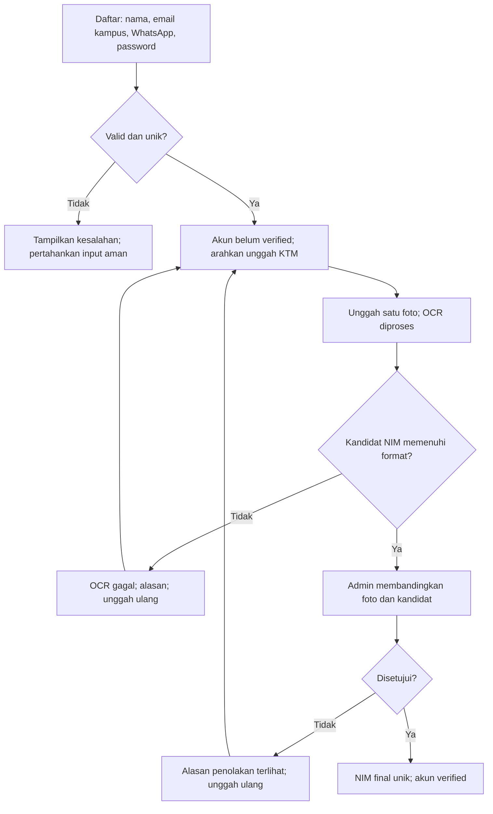
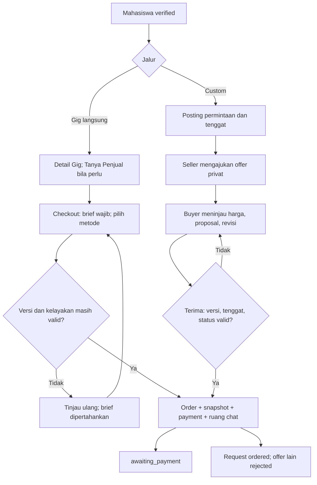
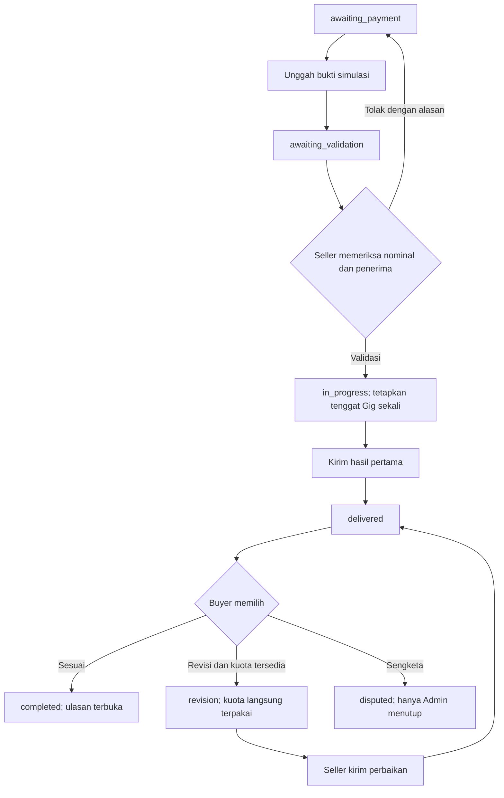
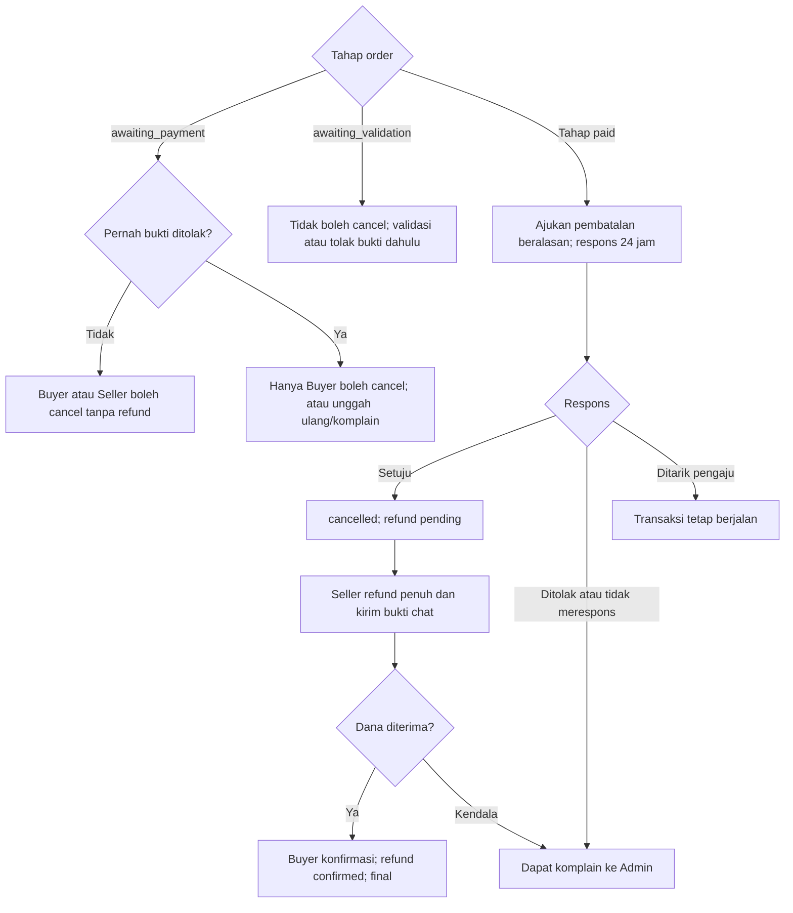
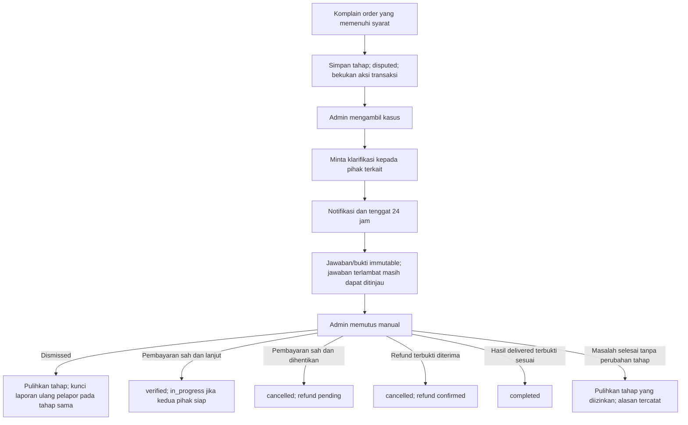

# GigKampus — Product Requirements Document

Status: disetujui untuk dokumentasi pada 18 November 2026. Target demo siap: **22 November 2026 malam**; presentasi: **25 November 2026**. Bahasa produk: Indonesia; mata uang: Rupiah bulat; zona tampilan: WIB.

Dokumen ini menjadi acuan produk bersama [TECH_STACK.md](TECH_STACK.md) dan [ERD_ARCHITECTURE.md](ERD_ARCHITECTURE.md). Sumber awal: [Master Project Brief v4](docs/GigKampusMasterProjectBriefv4.pdf) dan [Figma Design Final](https://www.figma.com/design/AjhxCDraHEolOB1CCGg6Qp/GigKampus?node-id=229-759). Keputusan discovery yang telah disetujui menggantikan bagian brief yang berubah; inventaris perubahan dicatat pada ERD_ARCHITECTURE.

## 1. Product Overview

GigKampus adalah web marketplace jasa antar-mahasiswa IPB yang menyatukan pencarian, pemesanan, penawaran, percakapan, hasil pekerjaan, dan rekam transaksi. Satu akun mahasiswa terverifikasi dapat bertindak sebagai Buyer maupun Seller berdasarkan transaksi, tanpa akun atau role switcher terpisah.

Dua jalur tersedia: pembelian Gig harga tetap dan Permintaan Jasa dengan Penawaran Harga privat. Pemilihan penawaran dilakukan Buyer; tidak ada lelang, penawaran pesaing terbuka, atau pemenang otomatis berdasarkan harga.

Rilis pertama adalah demo mata kuliah RKPL, APPL, SBD, dan PBO. Pembayaran/refund menggunakan **data simulasi tanpa transfer uang sungguhan**, tetapi unggahan, validasi, izin, dan perpindahan status tetap berjalan melalui aturan aplikasi.

## 2. Background & Problem Statement

Pencarian dan transaksi jasa mahasiswa sebelumnya tersebar di WhatsApp serta media sosial. Brief, harga, jadwal, bukti bayar, hasil, dan penyelesaian perselisihan sulit ditelusuri sebagai satu kesepakatan.

Masalah utama: pencarian tidak terstruktur; kebutuhan khusus sulit dibandingkan; identitas penyedia belum konsisten diperiksa; bukti transaksi dan hasil tercecer; serta tidak ada alur mediasi yang memiliki alasan dan riwayat keputusan yang jelas.

Verifikasi KTM meningkatkan akuntabilitas akun, tetapi bukan pemeriksaan otomatis ke basis data mahasiswa kampus atau pembuktian keaslian dokumen secara forensik. OCR membantu membaca NIM; persetujuan tetap dilakukan Admin.

## 3. Product Goals & Objectives

1. Mendemonstrasikan kedua jalur pemesanan sampai selesai dan berulasan.
2. Menjaga kesepakatan awal, tujuan pembayaran, dan riwayat bukti tetap dapat ditelusuri.
3. Memisahkan hak revisi teknis, kesepakatan pembatalan, dan mediasi sengketa.
4. Menegakkan izin per pemilik, verifikasi, status akun, dan tahap transaksi.
5. Menyediakan demo lokal yang dapat dipulihkan melalui seeder dan backup.
6. Menjaga keselarasan kebutuhan, Figma, model data, dan penerapan OOP untuk empat mata kuliah.

Kesiapan demo diukur melalui acceptance test, bukan jumlah halaman yang selesai.

## 4. Target Users & Personas

| Persona berbasis kebutuhan yang disepakati | Tujuan | Kebutuhan utama |
|---|---|---|
| Mahasiswa pemesan | Memperoleh jasa dengan harga dan lingkup jelas | Pencarian, pembandingan, brief, pembayaran, hasil, revisi |
| Mahasiswa penyedia | Menawarkan keahlian dan mengelola pekerjaan | Gig, penawaran, tujuan pembayaran, validasi, chat, pengiriman |
| Admin platform | Memeriksa identitas dan menyelesaikan laporan | KTM/OCR, antrean kasus, klarifikasi, penindakan, audit |

Persona ini merangkum kebutuhan discovery; tidak menambahkan klaim demografi atau hasil penelitian baru.

## 5. User Roles

| Aksi | Pengunjung | Akun belum verified | Mahasiswa verified | Akun disuspend | Admin |
|---|---|---|---|---|---|
| Katalog/filter/detail jasa/papan permintaan | Boleh | Boleh | Boleh | Boleh atas konten yang tersedia | Boleh |
| Mengelola profil sendiri | Tidak | Boleh sesuai penguncian identitas | Boleh | Boleh sesuai batas identitas | Akun Admin disiapkan pengembang |
| Mengajukan KTM | Tidak | Boleh, satu pengajuan belum selesai | Tidak perlu mengulang | Mengikuti pembatasan akun; kasus terkait tetap dapat diklarifikasi | Memeriksa |
| Membuat pesanan/permintaan/penawaran | Tidak | Tidak | Boleh sesuai kepemilikan dan syarat Seller | Tidak | Bukan aktor Buyer/Seller |
| Publikasi Gig/chat pra-pesan baru | Tidak | Tidak | Boleh; kedua peserta chat verified | Tidak | Tidak menjadi peserta chat mahasiswa |
| Menyelesaikan transaksi lama/refund | Tidak | Tidak memiliki transaksi yang memenuhi syarat | Pihak terkait | Tetap boleh; batas disputed/final tetap berlaku | Melalui kasus berwenang |
| Memeriksa bukti privat/chat | Tidak | Data sendiri yang diizinkan | Pihak terkait | Transaksi/kasus terkait | Hanya akses berwenang; chat melalui kasus pending yang ditangani |
| Menindak konten/akun | Tidak | Tidak | Melaporkan jika memenuhi syarat | Hak terkait transaksi/kasus lama tetap tersedia | Boleh dengan alasan dan audit |

Buyer dan Seller adalah konteks akun yang sama. Pengguna tidak boleh membeli Gig atau menawar permintaannya sendiri. Seller harus memiliki minimal satu tujuan pembayaran lengkap sebelum publikasi Gig/pengajuan penawaran.

## 6. Product Scope

| Prioritas | Cakupan |
|---|---|
| Must Have | Registrasi/login terpadu, profil/ubah password, verifikasi KTM OCR + Admin, rekening/QRIS |
| Must Have | Kategori, katalog/filter, Gig, Permintaan Jasa, Penawaran Harga privat, dua jalur order |
| Must Have | Pembayaran simulasi, bukti berulang, hasil kerja, revisi, pembatalan bersama, refund penuh |
| Must Have | Chat, ulasan, notifikasi aplikasi, komplain pesanan, klarifikasi, keputusan Admin |
| Must Have | Laporan Gig/Permintaan Jasa, suspend/pencabutan, riwayat/audit, seeder demo |
| Should Have — pertama setelah inti stabil | Laporan ulasan dan percakapan, termasuk chat pra-pesan; penyembunyian ulasan |
| Should Have — hold | Lupa password mandiri; diputuskan implementasinya setelah menilai sisa waktu |
| Could Have | Publikasi VPS setelah lingkungan dan alur inti stabil; provider/budget belum dipilih |
| Out of Scope demo | Email/WhatsApp otomatis, verifikasi kepemilikan email, payment gateway/escrow, refund sebagian, add-on biaya, lelang |
| Out of Scope demo | Slot jadwal/verifikasi lokasi, CMS aturan, subkategori, CRUD bank/Admin, hapus akun/Gig permanen |

Jasa digital dan luring sama-sama didukung. Waktu/tempat koordinasi melalui chat. Hasil luring tetap berupa berkas/tautan dokumentasi atau materi sesi.

## 7. Functional Requirements

| ID | Prioritas / aktor | Masukan, hasil, dan ketergantungan |
|---|---|---|
| FR-01 | Must / mahasiswa | Nama, email kampus, WhatsApp, password/konfirmasi menghasilkan akun belum verified dan pengalihan ke pengajuan KTM; email unik lintas akun |
| FR-02 | Must / mahasiswa, Admin | Satu /login menerima email/password; sistem memilih identitas/guard, logout mengakhiri sesi; tidak ada pilihan peran publik |
| FR-03 | Must / pemilik akun | Profil dan ubah password; email immutable, nama mengikuti penguncian KTM; avatar/bio opsional |
| FR-04 | Must / mahasiswa, Admin | Foto KTM → OCR → kandidat NIM → keputusan Admin atau gagal OCR; pengajuan ulang tidak menimpa riwayat |
| FR-05 | Must / Seller | Pilihan bank/nomor/nama penerima dan/atau QRIS/nama merchant; minimal satu lengkap untuk menawarkan jasa |
| FR-06 | Must / Admin | Tambah/rename/aktifkan/nonaktifkan kategori; bank dari seeder; tidak ada hapus kategori |
| FR-07 | Must / Seller | Judul, deskripsi, harga tetap, durasi, kuota, kategori, portofolio opsional → Gig langsung aktif bila layak |
| FR-08 | Must / publik | Keyword judul/deskripsi/nama Seller, kategori, harga, durasi, sort → daftar layanan layak tampil |
| FR-09 | Must / Buyer | Judul, brief, kategori, anggaran min/maks, tenggat → permintaan open; kunci isi sejak offer pertama |
| FR-10 | Must / Seller, Buyer | Satu proposal/penawaran per Seller per permintaan; edit/withdraw pending, versi tervalidasi, satu penerimaan |
| FR-11 | Must / Buyer | Checkout Gig dengan brief atau terima offer → order, snapshot, satu pembayaran utama, satu ruang chat; idempotent |
| FR-12 | Must / Buyer, Seller | Unggah bukti → awaiting_validation; validasi atau penolakan beralasan; riwayat setiap percobaan dipertahankan |
| FR-13 | Must / pihak order | Hasil pertama/perbaikan berkas atau tautan; Buyer mengajukan revisi sesuai kuota/brief atau menyelesaikan |
| FR-14 | Must / pihak order | Pembatalan sesuai tahap, pengajuan/respons 24 jam, refund penuh manual dan konfirmasi |
| FR-15 | Must / peserta | Chat pra-pesan/per order, lampiran, bukti refund, tanda belum dibaca; isi append-only |
| FR-16 | Must / Buyer | Satu rating 1–5 dan komentar opsional setelah completed; dikunci setelah submit |
| FR-17 | Must / sistem | Pemberitahuan kejadian yang berhasil, badge belum dibaca, realtime; tidak memakai SMTP/WhatsApp |
| FR-18 | Must / pihak order, Admin | Komplain sah → disputed dan pembekuan aksi; satu kasus aktif; keputusan/restore terjaga |
| FR-19 | Must / Admin, penerima | Pertanyaan klarifikasi + 24 jam, beberapa jawaban/bukti immutable, terlambat dapat ditinjau sebelum final |
| FR-20 | Must / mahasiswa, Admin | Laporan Gig/permintaan dengan kategori terstruktur; penindakan proporsional dan alasan terlihat |
| FR-21 | Must / pengembang | Seeder fiktif lengkap menyiapkan akun, referensi, kedua jalur, kondisi normal/gagal/sengketa |
| FR-22 | Should / mahasiswa, Admin | Laporkan ulasan/chat tanpa membuka order final; Admin hanya membaca percakapan kasusnya; hide ulasan melanggar |
| FR-23 | Should hold / pemilik | Pemulihan password mandiri belum menjadi syarat demo dan mekanismenya belum dipilih |

## 8. Non-Functional Requirements

| ID | Kebutuhan / target pengujian |
|---|---|
| NFR-01 | Halaman utama ≤3 detik pada lima sesi demo bersamaan dalam lingkungan demo; belum merupakan hasil pengukuran |
| NFR-02 | OCR fixture jelas ≤15 detik sebagai target; kegagalan ditampilkan dan dapat diunggah ulang; tidak ada janji akurasi foto lapangan |
| NFR-03 | Pemeriksaan mobile 390×844 dan desktop 1440 px; navigasi/form utama dapat digunakan tanpa overflow yang menghalangi aksi |
| NFR-04 | Izin server melindungi setiap aksi dan unduhan; mengganti ID pada request tidak membuka data pihak lain |
| NFR-05 | Aksi uang/status/kuota/penawaran bersamaan atomik; tidak terbentuk order, review, revisi aktif, atau kasus aktif ganda |
| NFR-06 | Teks ditampilkan aman, mempertahankan paragraf; berkas divalidasi jenis/ukuran, tidak dieksekusi sebagai kode |
| NFR-07 | Inti demo dapat berjalan lokal tanpa internet saat runtime; fixture hasil memakai file lokal; tautan eksternal tetap bergantung jaringan |
| NFR-08 | Data dan berkas persisten; backup sebelum presentasi; kegagalan worker terlihat pada log dan dapat dipulihkan pengembang |
| NFR-09 | Error validasi jelas dan mempertahankan input yang aman; kondisi kosong, memuat, gagal, stale, tidak berwenang, dan sukses tersedia |
| NFR-10 | Riwayat penting tidak diedit/hapus melalui aplikasi; tidak ada pembersihan otomatis bukti demo |
| NFR-11 | Password/rahasia tidak muncul dalam audit/log; data KTM, NIM, kontak, rekening, dan bukti tidak dibuka publik |
| NFR-12 | Label form, navigasi keyboard, fokus, dan pesan kesalahan jelas; pengujian browser utama Chromium/Chrome/Edge modern |

## 9. User Stories

| ID | Cerita pengguna | Acuan |
|---|---|---|
| US-01 | Sebagai pengunjung, saya ingin mencari jasa sebelum membuat akun | FR-08 |
| US-02 | Sebagai mahasiswa, saya ingin mengunggah KTM tanpa mengetik NIM | FR-01/04 |
| US-03 | Sebagai Admin, saya ingin membandingkan foto dengan kandidat OCR dan memberi alasan penolakan | FR-04 |
| US-04 | Sebagai Seller, saya ingin memasang jasa tanpa antrean persetujuan awal | FR-05/07 |
| US-05 | Sebagai Buyer, saya ingin bertanya ketersediaan sebelum memesan | FR-15 |
| US-06 | Sebagai Buyer, saya ingin memilih satu penawaran privat yang ketentuannya sudah saya tinjau | FR-09/10/11 |
| US-07 | Sebagai Buyer, saya ingin mengunggah pengganti bukti yang ditolak pada order yang sama | FR-12 |
| US-08 | Sebagai Seller, saya ingin memastikan nominal/penerima sesuai sebelum bekerja | FR-12 |
| US-09 | Sebagai Buyer, saya ingin memakai hak revisi tanpa menunggu persetujuan Seller | FR-13 |
| US-10 | Sebagai pihak order, saya ingin membatalkan bersama tanpa kehilangan riwayat | FR-14 |
| US-11 | Sebagai Buyer, saya ingin menerima refund penuh dan mengonfirmasikannya | FR-14 |
| US-12 | Sebagai Admin, saya ingin memutus kasus setelah klarifikasi atau tenggat lewat | FR-18/19 |
| US-13 | Sebagai pihak order, saya ingin bukti chat/hasil/keputusan lama tidak dimanipulasi | FR-13/15/18 |
| US-14 | Sebagai Buyer, saya ingin menilai Seller setelah pekerjaan final | FR-16 |
| US-15 | Sebagai pengembang/presenter, saya ingin memuat skenario demo yang konsisten | FR-21 |

## 10. Acceptance Criteria

| ID | Kondisi dan hasil yang harus diuji |
|---|---|
| AC-01 | Registrasi email non-@apps.ipb.ac.id, duplikat termasuk email Admin, atau password/konfirmasi tidak valid ditolak; registrasi valid diarahkan ke KTM tanpa SMTP |
| AC-02 | /login dapat mengautentikasi mahasiswa maupun Admin domain lain; guard/provider cocok; kegagalan memakai pesan generik; satu identitas aktif per sesi |
| AC-03 | Akun belum verified dapat browse, tetapi order/offer/request/publikasi/chat diblokir server |
| AC-04 | OCR valid masuk pending_review; gagal masuk ocr_failed; NIM salah ditolak Admin dengan alasan; tidak ada edit NIM manual atau dua pengajuan belum selesai |
| AC-05 | Approval KTM mengisi NIM unik dan verified secara atomik; kandidat duplikat yang belum disetujui tidak mengambil keunikan |
| AC-06 | Metode pembayaran parsial ditolak; metode terakhir tidak dapat dihapus ketika Gig aktif/offer pending; snapshot order tidak berubah ketika profil diubah |
| AC-07 | Gig milik sendiri tidak dapat dibeli; akun disuspend/Gig tidak aktif tidak dapat menghasilkan order baru, termasuk dari URL lama |
| AC-08 | Checkout dengan versi lama ditolak dan brief tetap ada; submit ulang dengan token sama tidak membuat order kedua |
| AC-09 | Permintaan lewat tenggat, non-open, hidden, atau pemilik disuspend tidak menerima offer/accept; isi terkunci sejak offer pertama |
| AC-10 | Offer di atas anggaran maksimum ditolak, di bawah minimum diperbolehkan; self-offer/duplikat permanen ditolak |
| AC-11 | Dua penerimaan offer bersamaan menghasilkan satu order; pending lain rejected; versi offer/request lama ditolak |
| AC-12 | Bukti ditolak memberi alasan, payment rejected dan order awaiting_payment; bukti pengganti membuat percobaan baru |
| AC-13 | Seller tidak dapat membatalkan awaiting_validation atau awaiting_payment yang pernah rejected; Buyer tetap mempunyai opsi yang disepakati |
| AC-14 | Hanya pembayaran dengan nominal persis dan bukti terkait yang dapat verified; direct deadline dihitung sekali dari verified pertama |
| AC-15 | Pengiriman file/HTTPS tersimpan immutable; delivery revisi harus milik order/revisi yang tepat; pengiriman pertama menjadi acuan keterlambatan |
| AC-16 | Revisi hanya delivered, catatan wajib, kuota langsung terpakai, satu belum selesai; kuota 0/habis menutup revisi tetapi tidak pembatalan bersama |
| AC-17 | Permintaan pembatalan pending tidak membekukan pengerjaan; respons/withdraw harus sesuai pihak/versi; sesudah completed permintaan lama voided |
| AC-18 | Pembatalan paid disetujui kedua pihak menghasilkan cancelled/refund pending; nominal refund 100%; refund tidak pending tanpa verified |
| AC-19 | Disputed memblokir seluruh perubahan transaksi termasuk refund/review; chat dan bukti klarifikasi tetap tersedia; kasus ganda diblokir |
| AC-20 | Dismissal mengembalikan tahap tanpa mengembalikan kuota/menghapus riwayat; pelapor yang sama tidak dapat mengulang pada tahap sama |
| AC-21 | Admin dapat verify+continue, cancel+refund, confirm refund, atau complete hasil sesuai aturan; alasan dan pelaksana tercatat; screenshot Buyer saja tidak otomatis dipercaya |
| AC-22 | Klarifikasi terlambat berindikator dan tetap dapat dikirim sebelum keputusan; tidak ada keputusan otomatis setelah 24 jam |
| AC-23 | Completed dan cancelled+refund none/confirmed tidak menerima komplain pesanan baru; chatnya archived; cancelled+pending tetap menerima komplain |
| AC-24 | Review hanya Buyer completed satu kali, konten tidak dapat diubah/hapus; hidden tidak dihitung pada rata-rata Seller |
| AC-25 | ID chat/berkas/kasus pihak lain ditolak; Admin hanya melihat chat melalui kasus pending yang diambilnya |
| AC-26 | Pesan immutable, read_at hanya penerima; token pengiriman ulang tidak membuat pesan ganda |
| AC-27 | Kategori nonaktif tidak menghentikan transaksi lama; close request menolak offer pending; ordered tidak dibuka kembali setelah cancel |
| AC-28 | Seed memuat semua fixture normal/gagal dan kondisi klarifikasi >24 jam; seluruh constraint/relasi tetap valid |
| AC-S1 | Jika Should pelaporan dikerjakan: report review/chat mematuhi izin, limit aktif, dan tidak membuka order final; hide menjaga isi asli |

## 11. User Flows

### Registrasi dan verifikasi

### Dua jalur pemesanan

### Pembayaran dan pengerjaan

### Pembatalan dan refund

### Mediasi

## 12. Business Rules

### Identitas dan izin

- BR-01: Registrasi mahasiswa hanya email persis @apps.ipb.ac.id, valid/unik/lowercase; tidak memakai tautan verifikasi email pada demo.
- BR-02: Email unik lintas mahasiswa/Admin. Satu /login memilih guard di server; domain Admin boleh berbeda.
- BR-03: Verifikasi mahasiswa wajib KTM/OCR/Admin; tidak ada input NIM manual atau koreksi Admin. Nama terkunci saat pengajuan belum selesai dan setelah approved.
- BR-04: Satu pengajuan KTM belum selesai; OCR gagal atau rejected membuka unggah ulang; approved tidak diulang.
- BR-05: Guest/unverified hanya read-only marketplace. Seller memerlukan tujuan pembayaran lengkap; self-buy dan self-offer dilarang.
- BR-06: Suspend memblokir aktivitas baru, menyembunyikan Gig/permintaan, tetapi tidak menghapus hak/kewajiban transaksi lama. Pencabutan manual dengan alasan.

### Penawaran dan kontrak

- BR-07: Maksimal satu offer per Seller/request sepanjang riwayat; rejected/withdrawn tidak dapat diajukan ulang.
- BR-08: Offer privat; maksimum anggaran batas keras, minimum estimasi; satu accepted, satu order/request.
- BR-09: Offer hanya diedit/ditarik saat pending, request open, belum lewat tenggat. Penerimaan dan submit memeriksa versi.
- BR-10: Request dikunci sejak offer pertama; closed/ordered final untuk request. Close menolak pending; cancelled order tidak menghidupkan request.
- BR-11: Checkout direct memerlukan brief trimmed 20–5.000; custom tanpa brief tambahan. Snapshot seluruh kesepakatan dan tujuan pembayaran immutable.
- BR-12: Gig harga tetap langsung awaiting_payment; tidak ada tahap penerimaan Seller sebelum bayar. Ingatkan jadwal luring lewat chat.

### Pembayaran, hasil, revisi

- BR-13: Pembayaran tepat tagihan; seller validasi sebelum kerja. awaiting_validation hanya validate/reject; penolakan beralasan mengembalikan awaiting_payment.
- BR-14: Bukti pengganti membuat riwayat baru. Setelah pernah rejected, Seller kehilangan hak cancel sepihak di awaiting_payment.
- BR-15: Durasi Gig 1–365 hari kalender dari verified pertama. Custom akhir hari tanggal deadline WIB. Tenggat hanya hasil pertama dan hanya indikator, bukan auto-cancel.
- BR-16: Kuota 0–20 snapshot; satu pengajuan revisi valid langsung memakai satu kuota; hanya delivered; tidak ada dua belum selesai.
- BR-17: Revisi hanya brief awal; lingkup tambahan order baru; tidak ada add-on. Hasil/revisi/chat/bukti lama tidak ditimpa.
- BR-18: Kuota habis/0 menutup revisi, tetapi pembatalan bersama dan komplain yang sah tetap tersedia.

### Pembatalan, finalitas, sengketa

- BR-19: awaiting_payment tanpa rejected: kedua pihak boleh cancel tanpa refund; setelah rejected hanya Buyer. awaiting_validation tidak dapat cancel.
- BR-20: in_progress/delivered/revision: cancel harus pengajuan beralasan dan persetujuan lawan; satu pending, dapat withdraw, tenggat respons 24 jam.
- BR-21: Pending cancellation tidak membekukan transaksi. Completed/putusan akhir yang menutup transaksi membuat pengajuan pending voided.
- BR-22: Pembatalan verified langsung cancelled/refund pending. Refund selalu 100%; pending tidak pernah terbentuk dari pembayaran belum verified.
- BR-23: Completed final. Cancelled final jika refund none/confirmed; hanya refund pending dapat dikomplainkan.
- BR-24: Satu order complaint aktif global/order. Non-order report: satu aktif/pelapor/target. Dismissed mengunci pelapor pada tahap sama. Unggah/penolakan bukti dan siklus revisi yang benar-benar mengubah tahap membuka tahap baru; chat, metadata, serta masuk/pulih dari disputed tidak melakukannya. Matriks teknis tercantum pada ERD_ARCHITECTURE §12.4.
- BR-25: Disputed membekukan upload/validate/reject bukti, delivery, revisi, complete, cancellation, konfirmasi refund, dan review. Chat/bukti klarifikasi tetap terbuka.
- BR-26: Hanya Admin penangan menutup kasus dengan alasan; perdamaian atau refund selama disputed tetap memerlukan keputusan Admin.
- BR-27: Admin memeriksa klarifikasi/mutasi Seller, bukan otomatis percaya screenshot Buyer. Pihak tidak kooperatif dapat diputus setelah tenggat klarifikasi.
- BR-28: Admin dapat verify+continue atau cancel+refund, menetapkan refund confirmed, serta complete hasil delivered yang sesuai. Bukti Buyer tidak sah: dismissed tanpa kewajiban refund baru.
- BR-29: Tenggat klarifikasi simetris 24 jam; hanya indikator dan izin putus manual. Jawaban terlambat boleh sebelum final; kasus final tidak dibuka ulang.

### Reputasi dan konten

- BR-30: Satu ulasan/Buyer/order completed; konten immutable. Hidden tetap disimpan dan dikeluarkan dari rating publik.
- BR-31: Rating katalog adalah rata-rata Seller dari ulasan visible atas kedua jalur; tanpa ulasan tampil Belum ada ulasan.
- BR-32: Admin dapat suspend Gig, menutup/menghilangkan permintaan melanggar, dan suspend akun berat/berulang; semua alasan tercatat/terlihat bagi pihak terkait.
- BR-33: Gig suspended dapat diperbaiki Seller, tidak diaktifkan sendiri. Unsuspend menghasilkan inactive; seller memilih aktivasi.
- BR-34: Tidak ada penghapusan akun/Gig/kategori; kategori nonaktif tidak menghentikan transaksi lama. Ordered request melanggar disembunyikan tanpa mengubah order otomatis.

Tujuh pilihan alasan terstruktur:

| Kategori | Cakupan |
|---|---|
| Integritas akademik | Joki ujian/kuis/UTS/UAS dan pengerjaan penuh skripsi/TA; les, mentoring, proofreading, formatting diperbolehkan |
| Ilegal, asusila, berbahaya | Pemalsuan KTM/dokumen, peretasan ilegal, judi, pornografi, pelanggaran tata tertib |
| Hak cipta dan privasi | Akun/software bajakan, pencurian karya, penyalahgunaan data |
| Fiktif, menyesatkan, spam | Jasa palsu, harga pancingan, spam di luar jasa mahasiswa |
| Masalah transaksi/dugaan manipulasi | Bukti bayar/refund palsu, penolakan sah tanpa dasar, hasil kosong/palsu; konteks kendala pembatalan/refund untuk mediasi |
| Pelecehan dan SARA | Intimidasi, ancaman, umpatan kasar, konten SARA pada chat/profil/deskripsi/ulasan |
| Identitas dan penyalahgunaan fitur | KTM palsu, impersonasi, spam laporan, ulasan palsu |

Pemilihan kategori adalah dugaan untuk diperiksa, bukan penetapan bersalah. Ringkasan larangan ditampilkan statis; tidak ada CMS.

## 13. UI/UX Requirements

- Acuan Figma: mobile-first, 390×844 dan desktop 1440; putih/abu lembut, soft sky blue, primary blue, electric yellow untuk sorotan.
- Navigasi utama: Beranda, Eksplorasi Jasa, Papan Permintaan, Pesanan Saya, Studio Seller; tidak ada toggle Buyer/Seller.
- Pesanan Saya: Pembelian Saya, Pesanan Masuk, Riwayat. Studio Seller: Antrean & Validasi, Katalog Gig, Riwayat Penawaran, Rekening & QRIS.
- Satu /login untuk mahasiswa/Admin, tanpa pilihan peran. Tujuan setelah login mengikuti identitas; mahasiswa belum verified diarahkan ke status/pengajuan KTM dengan akses browse tetap tersedia.
- Kartu Gig ringkas: gambar/fallback kategori, nama Seller, centang verifikasi, judul, harga tetap. NIM, kuota revisi, dan teks panjang verifikasi tidak memenuhi kartu.
- Harga tetap tidak menampilkan paket/add-on yang tidak tersedia. Jika label Figma mengisyaratkan harga mulai, copy implementasi disesuaikan untuk memperjelas harga tetap per pesanan.
- Kategori satu tingkat; kategori baru menggunakan ikon/fallback umum. Portofolio PDF berupa tautan unduh, bukan syarat thumbnail.
- Filter harga: semua, <Rp100.000, Rp100.000–Rp250.000 inklusif, >Rp250.000. Durasi: semua, ≤3 hari, ≤7 hari. Sort: rating Seller tertinggi/harga rendah/harga tinggi/terbaru; default terbaru.
- Papan default open dan belum lewat tenggat, terbaru; cari judul/deskripsi dan filter kategori.
- Tombol Chat eksplisit dengan badge pesan belum dibaca. Kembali tersedia pada detail/order/pembayaran/QRIS/chat.
- Nama/avatar/bio/reputasi/Gig/portofolio adalah informasi publik yang diizinkan. Email, NIM, WhatsApp, KTM, rekening, QRIS, dan bukti bukan informasi publik.
- Tujuan pembayaran hanya pemilik, Buyer order terkait, Seller terkait, dan Admin berwenang. Label nama penerima wajib jelas; boleh berbeda dari Seller.
- Preview OCR merupakan hasil baca, bukan input NIM. Status proses/gagal/rejected/approved dan alasan tampil jelas.
- Saat stale, jelaskan perubahan dan minta tinjau ulang; brief/proposal yang diketik tetap tersedia. Saat tidak punya izin jangan tampilkan konten privat.
- Contoh empty state: katalog kosong, belum ada offer/order/chat/notifikasi, kuota habis, tidak ada kasus, belum ada ulasan. Sertakan aksi yang sesuai izin.
- Demo pembayaran menampilkan penanda simulasi agar presenter/penguji tidak mentransfer uang sungguhan.

| Unggahan | Kebijakan |
|---|---|
| KTM, avatar, QRIS, bukti bayar | JPG/JPEG/PNG ≤5 MB; KTM satu per pengajuan |
| Bukti refund formal melalui chat | JPG/JPEG/PNG ≤5 MB |
| Portofolio Gig | Opsional satu JPG/JPEG/PNG ≤5 MB atau PDF ≤20 MB |
| Chat/hasil/bukti pendukung | Satu berkas ≤20 MB: PDF, DOCX, XLSX, PPTX, TXT, CSV, JPG/JPEG, PNG, ZIP; tautan HTTPS sebagai alternatif |
| Hasil besar/video | Tautan HTTPS; berkas sumber .fig dapat dibungkus ZIP atau dikirim melalui tautan |

Batas MB operasional menggunakan 1 MB = 1.048.576 byte; pesan UI tetap memakai label MB. Tidak menambah unggahan HEIC/SVG/berkas eksekusi sebagai format tersendiri.

## 14. Assumptions & Constraints

- Pengerjaan: satu pemilik proyek bersama assistant builder; lima anggota pada brief tidak diasumsikan menjadi lima programmer aktif.
- Platform, data, dan alur adalah demo; tidak ada integrasi mutasi bank, identitas kampus, escrow, atau QRIS dinamis.
- Admin menetapkan fakta kasus dari bukti/ketidakkooperatifan dan alasan yang tercatat; sistem tidak otomatis membuktikan uang masuk.
- Jadwal luring dan durasi revisi disepakati chat; tidak ada kalender slot atau deadline revisi baru.
- Tidak ada auto-cancel, auto-complete, auto-refund, atau keputusan otomatis setelah tenggat.
- Seeder menggunakan identitas/berkas fiktif berlabel DEMO; QRIS contoh bukan tujuan pembayaran nyata.
- Docker engine, build paket, hasil performa, akurasi OCR, dan seluruh acceptance test harus diuji pada implementasi; persetujuan rancangan tidak berarti hasil tersebut telah lulus.
- Nomor patch yang belum diverifikasi tetap TBD. Provider/budget VPS dan mekanisme lupa password belum dipilih karena bukan penghambat demo lokal.
- Tidak ada purge otomatis bukti pada demo. Kebijakan produksi mengenai retensi, anonimisasi, skala, dan pemulihan bencana merupakan pengembangan berikutnya.
- Should Have pelaporan diusahakan pertama setelah alur inti stabil; status ini tidak diubah menjadi janji semua fitur pasti selesai sebelum pengujian.

## 15. Success Metrics

| Ukuran | Target demo / bukti |
|---|---|
| Must Have | 100% acceptance terkait lulus sebelum dinyatakan siap |
| Jalur langsung dan custom | Masing-masing dapat didemonstrasikan sampai completed + ulasan |
| Kasus berisiko | Stale offer/Gig/request, double submit, self-action, akses lintas pengguna, duplikasi review/revisi/kasus ditolak |
| Penyelesaian | Minimal skenario revisi, pembatalan bersama, refund penuh, dismissed/restore, override pembayaran Admin, konfirmasi refund Admin |
| Klarifikasi | Kasus belum dijawab >24 jam dan jawaban terlambat dapat didemonstrasikan tanpa menunggu sehari |
| OCR | Fixture jelas berhasil diekstrak/diperiksa; fixture tidak terbaca memberikan jalur ulang; target waktu NFR-02 |
| Realtime | Dua peserta menerima chat/notifikasi sesuai izin; read receipt dan arsip berfungsi |
| Pemulihan demo | Seeder menghasilkan data konsisten; backup database dan file tersedia |
| UI/performa | Viewport dan target NFR diuji; hasil aktual dilaporkan terpisah saat implementasi |
| Integritas dokumentasi | Semua fitur persisten dipetakan ke skema; tidak ada FK ke entitas yang tidak ada; diagram Mermaid tervalidasi |

