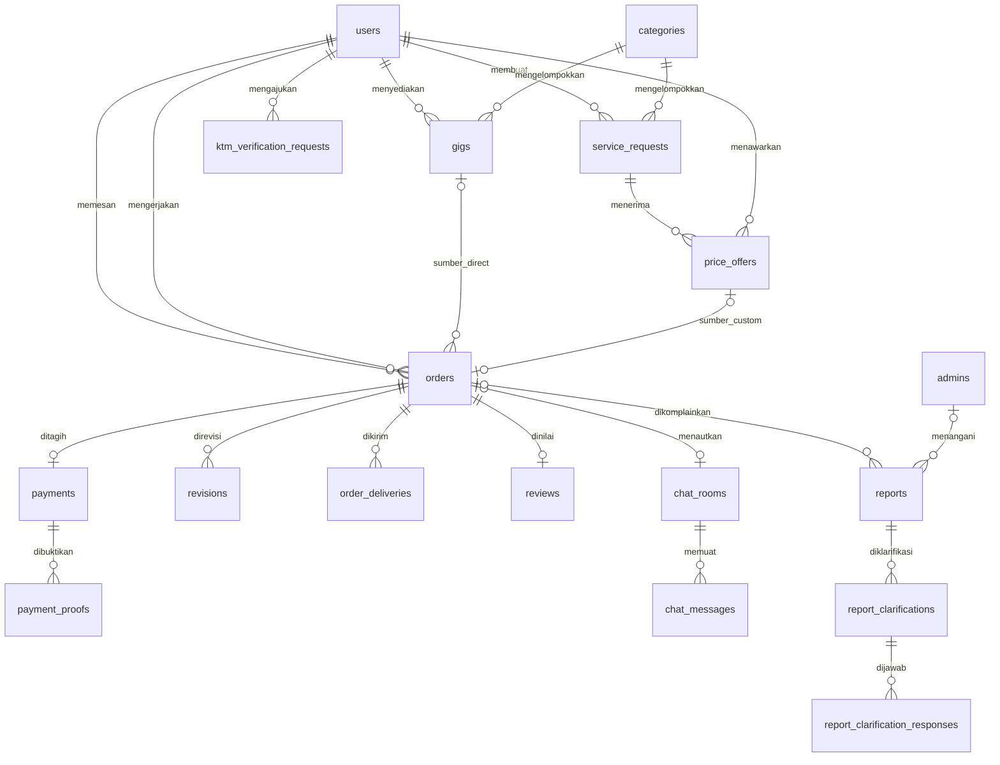

# GigKampus — Master Project Brief v5 (Final)

**Pedoman konsistensi presentasi RKPL, APPL, SBD, dan PBO**

**Kelompok 12 · 2026**

**Baseline implementasi** `04b18d9` · **Verifikasi dokumentasi** 23 November 2026

## 1. Rumusan Masalah

1. **Penemuan jasa.** Bagaimana mahasiswa IPB menemukan penyedia yang relevan saat penawaran jasa tersebar di kanal percakapan dan media sosial?
2. **Kesepakatan pekerjaan.** Bagaimana kebutuhan yang sudah memiliki harga tetap dan kebutuhan khusus dapat diproses dalam satu platform dengan catatan lingkup, harga, tenggat, dan kuota revisi yang dapat dirujuk kembali?
3. **Identitas dan pembayaran.** Bagaimana platform mencatat hasil pemeriksaan identitas, instruksi pembayaran, bukti bayar, dan keputusan validasi secara tertib sambil membatasi akses data sensitif?
4. **Penyelesaian masalah.** Bagaimana hasil kerja, pembatalan, refund, ulasan, dan sengketa ditangani dengan kewenangan yang jelas dan riwayat yang dapat ditelusuri?

## 2. Tujuan Proyek

1. Mendemonstrasikan pemesanan langsung dari Gig dan pemesanan dari Penawaran Harga hingga penyelesaian pekerjaan dan ulasan.
2. Menyediakan publikasi layanan mandiri bagi mahasiswa terverifikasi, pemeriksaan KTM oleh Admin, dan moderasi yang mencatat alasan.
3. Menjaga konsistensi kesepakatan, tujuan pembayaran, perubahan status, dan akses bukti melalui aturan domain dan constraint PostgreSQL.
4. Menghubungkan kebutuhan dan use case RKPL, rancangan serta UX APPL, integritas data SBD, dan penerapan OOP PBO pada aplikasi dan lingkungan demo yang sama.

## 3. Gambaran Umum Sistem

GigKampus adalah marketplace jasa mahasiswa IPB berbasis web responsif. **Buyer** dan **Seller** adalah konteks aktivitas satu akun `User` mahasiswa. **Admin Platform** memakai akun `Admin` dengan otorisasi sendiri. Pengunjung dapat menelusuri katalog dan papan permintaan yang layak tampil. Mahasiswa yang belum terverifikasi dapat menelusuri katalog dan mengelola profil serta pengajuan KTM sesuai izin. Aktivitas baru seperti checkout, menawarkan jasa, dan memulai chat pra-pesan memerlukan verifikasi dan akun aktif.

Registrasi menerima nama, email `@apps.ipb.ac.id`, nomor WhatsApp, dan kata sandi. OCR lokal menghasilkan kandidat NIM dari KTM digital atau foto KTM fisik untuk diperiksa Admin. Seller yang memenuhi syarat dapat langsung memublikasikan Gig setelah memiliki minimal satu tujuan pembayaran lengkap. Pembayaran dan refund pada presentasi memakai **data simulasi**. Berkas bukti, validasi, penolakan, dan perpindahan status tetap diproses oleh aplikasi.

| Prioritas | Cakupan final |
|---|---|
| Must Have · FR-01–FR-06 | Registrasi, login terpadu, profil dan ubah password, verifikasi KTM/OCR/Admin, pengaturan rekening/QRIS, serta tambah, ubah nama, aktifkan dan nonaktifkan kategori. Bank berasal dari seeder. |
| Must Have · FR-07–FR-11 | Publikasi dan pengelolaan Gig, pencarian/filter/sort katalog dan portofolio, papan Permintaan Jasa, Penawaran Harga privat, checkout Direct Gig dan Custom Request. |
| Must Have · FR-12–FR-17 | Pembayaran simulasi dan riwayat bukti, pengiriman hasil, revisi, pembatalan dan refund penuh, chat pra-pesan/pesanan, ulasan, notifikasi dalam aplikasi. |
| Must Have · FR-18–FR-21 | Komplain pesanan, klarifikasi dan putusan Admin, laporan Gig/Permintaan Jasa, moderasi konten dan akun, audit, data dan berkas demo fiktif. |
| Should Have #1 · FR-22 | **Terimplementasi.** Pelaporan ulasan dan chat, termasuk chat pra-pesan, serta penyembunyian ulasan melalui penanganan kasus. Laporan konten dapat ditangani dengan status pesanan final tetap berlaku. |
| Should Have · FR-23 | **Hold, di luar cakupan demo.** Lupa Password mandiri belum tersedia. Ubah password bagi pemilik akun yang sudah masuk tersedia. |
| Could Have | VPS opsional. Presentasi memakai Docker Compose lokal. |
| Out of Scope | Email/WhatsApp otomatis, verifikasi kepemilikan email atau integrasi basis data kampus, mutasi bank otomatis, pembayaran riil dalam demo, payment gateway/escrow dan QRIS dinamis, refund sebagian, biaya tambahan, lelang, kalender slot dan verifikasi lokasi, CMS aturan, subkategori, CRUD bank/Admin, serta penghapusan permanen akun, Gig, atau kategori. |

Rujukan kebutuhan dan implementasi ada pada [PRD](../PRD.md), [route aplikasi](../routes/), [layanan domain](../app/Services/), dan [seeder](../database/seeders/DemoSeeder.php).

## 4. Alur Utama Sistem (End-to-End Workflow)

| Tahap | Nama tahap | Perilaku aplikasi final |
|---|---|---|
| 0 | Registrasi, KTM dan persiapan Seller | Mahasiswa mendaftar dan mengunggah foto KTM. Worker melakukan OCR, Admin meninjau foto dan kandidat. Hasil gagal atau penolakan membuka pengajuan ulang. Persetujuan menautkan NIM unik dan menandai akun terverifikasi. Seller melengkapi transfer bank dan/atau QRIS. |
| 1A | Pemesanan langsung (`direct_gig`) | Buyer memilih Gig harga tetap, meninjau ketentuan, mengisi brief checkout, dan memilih metode bayar. Aplikasi memeriksa versi Gig dan kunci idempotensi. |
| 1B | Permintaan Jasa (`custom_request`) | Buyer memasang brief, kategori, `budget_min`, `budget_max`, dan tenggat. Penawaran privat berisi harga, proposal dan kuota revisi. Pemilik request memilih satu penawaran yang masih sah. Request menjadi `ordered` dan penawaran lain yang masih `pending` ditolak. |
| 2 | Pembayaran dan validasi | Kedua jalur menghasilkan satu order `awaiting_payment`, satu pembayaran utama, dan satu chat pesanan. Buyer melihat rekening/QRIS dari snapshot dan mengunggah bukti simulasi. Order menjadi `awaiting_validation`. Seller memeriksa nominal dan penerima, lalu mengonfirmasi validasi atau penolakan dalam dialog terpisah. Penolakan mewajibkan alasan, mengembalikan order ke `awaiting_payment`, dan menyimpan bukti lama. Validasi yang sah memindahkan order ke `in_progress`. |
| 3 | Pengerjaan, chat dan pengiriman hasil | Peserta dapat bertukar teks, berkas, atau tautan HTTPS sesuai izin. Seller mengirim hasil melalui aksi pengiriman dengan berkas atau tautan HTTPS. Sistem menyimpan riwayat pengiriman dan memindahkan order ke `delivered`. Jasa luring dikoordinasikan lewat chat dan hasilnya dapat berupa materi atau dokumentasi sesi. |
| 4 | Konfirmasi, revisi, pembatalan atau sengketa | Buyer dapat menyelesaikan hasil atau memakai kuota revisi untuk lingkup yang disepakati. Pembatalan dan komplain tersedia sesuai tahap dan kondisi pembayaran. Pengembalian dana dilakukan secara manual dalam simulasi dan bukti formal dikirim lewat chat pesanan. |
| 5 | Ulasan dan finalitas | Pesanan `completed` membuka satu ulasan Buyer. Status final mengarsipkan chat pesanan sehingga histori tetap bisa dibaca peserta. Ulasan yang disembunyikan tetap tersimpan dan dikeluarkan dari reputasi publik. |

Alur utama pesanan adalah `awaiting_payment` → `awaiting_validation` → `in_progress` → `delivered` → `completed`. Penolakan bukti kembali ke `awaiting_payment`. Pengajuan revisi memindahkan `delivered` ke `revision`, lalu pengiriman pengganti mengembalikannya ke `delivered`. Pembatalan yang sah menuju `cancelled`. Komplain yang sah menempatkan pesanan di `disputed` sampai putusan diterapkan. Inbox menyimpan notifikasi aksi yang berhasil, menampilkan indikator belum dibaca, dan menerima pembaruan melalui Reverb.

### 4.1 Pembatalan, refund, dan finalitas

- Di `awaiting_payment`, Buyer dapat membatalkan langsung tanpa refund. Seller hanya dapat melakukannya selama bukti sebelumnya belum pernah ditolak. Di `awaiting_validation`, aksi pembatalan biasa tidak tersedia.
- Pada `in_progress`, `delivered`, atau `revision` dengan pembayaran terverifikasi, salah satu pihak mengajukan pembatalan beralasan. Pihak lawan dapat menyetujui atau menolak. Pemohon dapat menarik pengajuan. Satu permohonan dapat berstatus `pending`, dan `cancellation_version` mencegah respons dari formulir lama berlaku terhadap permohonan baru. Indikator 24 jam menunjukkan keterlambatan. Pengerjaan tetap berjalan selama permohonan menunggu keputusan. Penyelesaian pesanan dapat membuat pengajuan lama `voided`.
- Persetujuan pembatalan berbayar menghasilkan `cancelled` dan `refund_status = pending`. Nilai refund adalah **100% dari pembayaran terverifikasi**. Saat refund menunggu, Seller dapat mengirim bukti formal `refund_proof` melalui chat pesanan. Buyer mengonfirmasi penerimaan dana. Pada kasus refund yang disengketakan, Admin penangan dapat menetapkannya melalui putusan.
- `completed` serta `cancelled` dengan refund `none` atau `confirmed` bersifat final. Pesanan `cancelled` dengan refund `pending` masih dapat menerima komplain. Tenggat kerja, pembatalan, dan klarifikasi tidak menjalankan putusan otomatis.

### 4.2 Komplain, klarifikasi, dan mediasi Admin

Komplain tersedia bagi pihak pesanan terverifikasi di `awaiting_validation`, di `awaiting_payment` sesudah pernah ada bukti ditolak, selama tahap kerja dengan pembayaran terverifikasi, atau selama refund pembatalan masih `pending`. Satu komplain aktif berlaku per pesanan. Sistem mencatat tahap sebelum sengketa dan menyalin `stage_version` ke laporan. Selama `disputed`, aksi bukti bayar, pengiriman, revisi, penyelesaian, pembatalan, konfirmasi refund, dan ulasan dibekukan. Chat peserta dan pengumpulan bukti klarifikasi tetap tersedia sesuai izin.

Admin mengambil kasus sebelum memeriksa bukti dan mengambil keputusan. Admin dapat meminta klarifikasi kepada pihak kasus dengan tenggat **24 jam**. Penerima dapat menambahkan jawaban dan bukti, termasuk jawaban bertanda terlambat selama kasus masih terbuka. Apabila klarifikasi belum dijawab dan tenggatnya belum lewat, sistem menahan putusan. Penolakan laporan (`dismiss_restore` untuk komplain) memulihkan tahap sebelumnya. Pelapor yang sama baru dapat mengajukan komplain lagi setelah tahap transaksi berubah. Masuk dan pulih dari `disputed` mempertahankan `stage_version` apabila tahap awal dikembalikan.

| Putusan komplain (`resolved`) | Hasil dan batas penerapan |
|---|---|
| `restore_previous` | Pulihkan tahap sebelum sengketa. Histori transaksi dan kuota yang sudah terpakai tetap tersimpan. |
| `verify_payment_continue` | Sahkan bukti milik pembayaran dan lanjutkan ke `in_progress` dari tahap pembayaran. Admin mengonfirmasi pemeriksaan bukti atau klarifikasi Seller dan kesiapan kedua pihak. |
| `cancel_and_refund` | Hentikan pesanan dan wajibkan refund penuh. Bila pembayaran belum terverifikasi, Admin harus memilih bukti terkait dan menyelesaikan pemeriksaan pembayaran terlebih dahulu. |
| `confirm_refund` | Tetapkan refund diterima pada komplain atas order `cancelled` dengan refund `pending`. |
| `complete_delivery` | Tetapkan hasil sesuai dan selesaikan pesanan dari tahap `delivered`. |

Laporan konten memiliki penanganan tersendiri, dengan status `pending`, `resolved`, atau `dismissed`. Admin dapat menindak Gig, Permintaan Jasa, ulasan, atau akun sesuai izin dan konteks. Panel moderasi menyediakan suspend dan cabut suspend Gig/akun, tutup atau sembunyikan permintaan, serta akses ke kasus ulasan untuk tindakan hide. Cabut suspend Gig menghasilkan `inactive` hingga Seller mengaktifkannya. Akun yang disuspend dibatasi untuk aktivitas baru dan tetap dapat menyelesaikan transaksi lama sesuai tahap. Tindakan dan alasan dicatat untuk audit.

Rujukan alur ada pada [model pesanan](../app/Models/Order.php), [layanan transaksi](../app/Services/Orders/), [klarifikasi](../app/Services/ClarificationService.php), [mediasi](../app/Services/MediationDecisionService.php), dan [moderasi](../app/Services/ModerationService.php).

## 5. Istilah Kunci & Aturan Bisnis (Locked Rules)

### 5.1 Kamus istilah pengembangan (dwibahasa)

| Istilah resmi | Istilah teknis | Makna di GigKampus |
|---|---|---|
| Mahasiswa, Pemesan, Penyedia Jasa | `User`, Buyer, Seller | Satu akun mahasiswa dengan kemampuan yang dipakai menurut konteks. |
| Admin Platform | `Admin` | Pemeriksa KTM, pengelola kategori, penangan laporan dan moderasi. |
| Layanan Jasa, Permintaan Jasa, Penawaran Harga | `Gig`, `ServiceRequest`, `PriceOffer` | Jasa harga tetap, kebutuhan khusus Buyer, serta penawaran privat untuk satu permintaan. |
| Pesanan dan kesepakatan | `Order`, snapshot | Rekaman transaksi beserta salinan lingkup, harga, ketentuan, dan tujuan pembayaran pada checkout. |
| Pembayaran dan bukti | `Payment`, `PaymentProof` | Satu pembayaran per order, dengan riwayat percobaan bukti dan keputusan pemeriksaan. |
| Hasil, revisi, ulasan | `OrderDelivery`, `Revision`, `Review` | Riwayat kiriman hasil, penggunaan kuota perbaikan, dan penilaian Buyer setelah selesai. |
| Percakapan, pesan, notifikasi | `ChatRoom`, `ChatMessage`, `Notification` | Ruang antar-mahasiswa, pesan dan lampirannya, serta item inbox mahasiswa atau Admin. |
| Laporan dan komplain | `Report` | Laporan konten atau percakapan, serta komplain transaksi dengan aturan tahap sengketa. |
| Klarifikasi dan audit | `ReportClarification`, `ReportClarificationResponse`, `AuditLog` | Pertanyaan, jawaban, dan jejak tindakan yang dapat ditelusuri. |

### 5.2 Aturan bisnis wajib

| Aturan | Ketentuan yang berlaku |
|---|---|
| Identitas dan kewenangan | Buyer dilarang membeli Gig sendiri dan Seller dilarang menawar request sendiri. Verifikasi KTM dan status suspend diperiksa di server. Nama terkunci selama pengajuan KTM diproses atau diperiksa dan setelah persetujuan. Kandidat NIM berasal dari OCR dan persetujuan identitas dilakukan Admin. |
| Kelayakan Seller | Transfer bank memerlukan bank, nomor, dan nama pemilik. QRIS memerlukan gambar dan nama merchant/penerima. Minimal satu metode lengkap diperlukan untuk publikasi dan penawaran. Metode terakhir dijaga selama ada Gig aktif atau offer pending sesuai aturan layanan. |
| Penawaran dan snapshot | Satu penawaran per pasangan Seller/request sepanjang riwayat. Isi request terkunci sejak penawaran pertama. `budget_min` adalah estimasi dan harga di bawahnya dapat diajukan. `budget_max` adalah batas atas keras. Checkout menyimpan harga, judul, kategori, lingkup, brief Buyer atau proposal Seller sesuai jalur, kuota, ketentuan durasi/tenggat, dan tujuan pembayaran. Perubahan profil Seller tidak mengubah snapshot. |
| Validasi Rupiah | Nominal transaksi memakai Rupiah bulat. Input menampilkan pemisah ribuan saat diketik dan mengirim digit mentah ke server. Validasi Seller mewajibkan nominal persis tagihan serta konfirmasi bahwa nominal dan nama penerima sesuai. Penolakan memerlukan alasan dan menambah riwayat percobaan ketika Buyer mengunggah bukti pengganti. |
| Tenggat dan kuota | Direct Gig memakai durasi snapshot 1–365 hari, dihitung dalam kelipatan 24 jam sejak validasi pertama. Custom Request memakai akhir hari tenggat WIB. Tenggat menilai pengiriman pertama. Kuota snapshot 0–20, satu pengajuan sah langsung memakai satu kuota, dan hanya satu revisi boleh belum selesai. Revisi berlaku untuk lingkup awal. |
| Ulasan dan moderasi | Rating 1–5 dan komentar opsional hanya oleh Buyer pada `completed`, maksimal satu per order. Isi ulasan terkunci sesudah submit. Rating publik Seller memakai ulasan yang terlihat dari kedua jalur. Penindakan ulasan dilakukan melalui kasus yang terkait. |
| Rekam jejak | Keputusan pembayaran, pengiriman, pesan, klarifikasi, dan audit dipertahankan. Hak akses ke bukti mengikuti pemilik, peserta, atau kewenangan kasus, sesuai jenis berkas. |

## 6. Pedoman Konsistensi Spesifik Empat Mata Kuliah

### 6.1 Rekayasa Kebutuhan Perangkat Lunak (RKPL)

RKPL menggunakan peran Buyer, Seller dan Admin Platform pada skenario transaksi. Pengunjung dan akun belum terverifikasi relevan untuk skenario penelusuran serta pembatasan akses. Pemetaan mempertahankan UC-01 sampai UC-15 sebagai kerangka Brief v4, dengan tambahan use case untuk perilaku yang perlu ditunjukkan pada sistem final. Kolom implementasi memakai kelas dan metode yang tersedia di repositori.

| Use case | Aktor | FR | Implementasi utama |
|---|---|---|---|
| UC-01 Registrasi, login dan profil | Mahasiswa, Admin untuk login | 01–03 | `AuthenticationController::register()`, `login()`, `logout()`, `StudentProfile::update()` |
| UC-02 Pengajuan dan verifikasi KTM | Mahasiswa, Admin | 04 | `KtmVerification::submit()`, `review()`, `ProcessKtmOcr`, `KtmOcrService::candidates()` |
| UC-03 Kelola rekening dan QRIS | Seller | 05 | `SellerPaymentMethods::update()`, `remove()` |
| UC-04 Kelola listing Gig | Seller | 07 | `GigStudio::save()`, `changeStatus()` |
| UC-05 Cari dan lihat jasa | Pengunjung, mahasiswa | 08 | `MarketplaceBrowse::gigs()`, `CatalogController` |
| UC-06 Posting permintaan dan pilih penawaran | Buyer | 09–11 | `RequestBoard::save()`, `close()`, `OfferAcceptanceService::accept()` |
| UC-07 Ajukan dan kelola penawaran | Seller | 10 | `OfferWorkflow::submit()`, `update()`, `withdraw()` |
| UC-08 Buat pesanan dan unggah bukti | Buyer | 11–12 | `DirectCheckoutService::checkout()`, `OfferAcceptanceService::accept()`, `OrderPaymentService::submitProof()` |
| UC-09 Validasi atau tolak bukti | Seller | 12 | `OrderPaymentService::verifyProof()`, `rejectProof()` |
| UC-10 Komunikasi melalui chat | Buyer, Seller | 15, 17 | `ChatService::startGig()`, `startOffer()`, `send()`, `markRead()`, `Inbox` |
| UC-11 Kirim hasil | Seller | 13 | `OrderDeliveryService::submit()` |
| UC-12 Konfirmasi hasil | Buyer | 13 | `OrderDeliveryService::complete()` |
| UC-13 Ajukan dan kerjakan revisi | Buyer, Seller | 13 | `RevisionService::request()`, `start()`, `OrderDeliveryService::submit()` |
| UC-14 Beri rating dan ulasan | Buyer | 16 | `ReviewService::submit()` |
| UC-15 Laporan konten dan pemantauan | Mahasiswa, Admin | 20, 22 | `ReportService::submit()`, `claim()`, `ModerationService::apply()`, `AdminDashboardController` |
| UC-16 Pembatalan dan refund | Buyer, Seller | 14–15 | `OrderCancellationService::cancelUnpaid()`, `request()`, `respond()`, `RefundService::confirm()` |
| UC-17 Komplain, klarifikasi dan putusan | Buyer, Seller, Admin | 18–19 | `ReportService`, `ClarificationService::request()`, `respond()`, `MediationDecisionService::decide()` |
| UC-18 Kelola kategori | Admin | 06 | `AdminCategoryController::store()`, `rename()`, `changeStatus()` |

Pada diagram use case, checkout Direct Gig dan penerimaan penawaran adalah jalur pembentukan pesanan yang berbeda menuju alur pembayaran yang sama. Buyer mengunggah bukti dan Seller melakukan validasi pada waktu terpisah. Penyelesaian, revisi, pembatalan, dan komplain memiliki prasyarat berdasarkan tahap pesanan. FR-21 merupakan kebutuhan operasional pengembang yang dipenuhi `DemoSeeder`.

### 6.2 Analisis dan Perancangan Perangkat Lunak (APPL)

#### A. Relasi class diagram dan multiplicity

| Relasi | Multiplicity pada sisi terkait | Makna rancangan |
|---|---|---|
| `Admin` ↔ `KtmVerificationRequest` / `Report` | Admin `0..1` per pengajuan diperiksa/kasus diambil, banyak rekaman per Admin | Asosiasi pemeriksa atau penangan. |
| `User` ↔ `Gig` / `ServiceRequest` / `PriceOffer` | Satu pemilik per entitas, `0..*` entitas per pemilik | Asosiasi peran Seller atau Buyer. |
| `ServiceRequest` ↔ `PriceOffer` | Tepat satu request per offer, `0..*` offer per request | Penawaran bergantung pada permintaan, dengan paling banyak satu diterima. |
| `User` ↔ `Order` | Tepat satu Buyer dan satu Seller per order, `0..*` order per peran pengguna | Dua relasi peran menuju model `User`. |
| `Gig` / `PriceOffer` ↔ `Order` | Tepat satu sumber dari kedua jenis. Satu Gig dapat mendasari banyak order. Satu offer dapat mendasari paling banyak satu order. | Asosiasi sumber dan snapshot kontrak. |
| `Order` ↔ `Payment`, `OrderDelivery`, `Revision`, `Review` | Satu payment pada checkout, `0..*` delivery dan revisi, `0..1` review | Kepemilikan logis histori transaksi. Di SQL, FK payment unik menjamin paling banyak satu payment per order. |
| `Order` ↔ `ChatRoom` ↔ `ChatMessage` | Satu ruang ditautkan pada checkout. Ruang pra-pesan boleh belum memiliki order, berisi dua peserta dan `0..*` pesan. | Ruang dapat sudah ada sebelum checkout dan dapat diarsipkan. Pesan selalu merujuk ruang. |
| `Report` ↔ `ReportClarification` ↔ `ReportClarificationResponse` | `0..*` pertanyaan per laporan, `0..*` jawaban per pertanyaan | Riwayat penanganan kasus. |
| `User` / `Admin` ↔ `Notification` | Satu penerima dari dua jenis untuk setiap notifikasi | Inbox mahasiswa dan Admin memakai identitas terpisah. |

Asosiasi menggambarkan hubungan aktor dan entitas. Agregasi dapat menggambarkan daftar Gig atau ruang percakapan yang dikelola atau diikuti pengguna. Komposisi menggambarkan kepemilikan logis detail pesanan dan pesan. Persistensi seluruh relasi FK mengikuti `RESTRICT` untuk menjaga jejak audit dan transaksi.

#### B. UI/UX dan frontend modular

- Desain responsif *mobile first* memakai layout Blade untuk aplikasi mahasiswa, autentikasi, dan Admin. Navigasi utama mahasiswa mencakup Beranda, Eksplorasi Jasa, Papan Permintaan, Pesanan Saya, dan Studio Seller, dengan subnavigasi sesuai konteks. Chat dan inbox menampilkan badge belum dibaca. Kartu Gig menampilkan harga tetap dan centang verifikasi yang ringkas. NIM dan bukti privat tidak ditampilkan pada kartu atau profil publik.
- `resources/css/app.css` mengimpor Tailwind, `tokens.css`, `base.css`, `components.css`, dan stylesheet domain `marketplace.css`, `orders.css`, `chat.css`, `moderation.css`, serta `admin-categories.css`. Token memakai Inter lokal, soft sky blue `#EEF5FF`, primary blue `#0071E3`, latar lembut `#F5F5F7`, dan aksen `#FFD60A`.
- `resources/views/components/ui/` berisi komponen dasar seperti field, modal dan input Rupiah. `resources/views/components/domain/` berisi kartu Gig, aksi pembayaran/pekerjaan, chat, dan panel putusan. Livewire menangani komponen dinamis seperti status KTM, antrean validasi, chat, inbox, dan moderasi. Alpine bawaan Livewire menangani dialog dan input interaktif. `resources/js/currency-input.js` menangani pemisah ribuan dan validasi format Rupiah pada Gig, permintaan, penawaran, dan validasi pembayaran.
- Revisi final merapikan ikon dan aksi Kategori Admin, tab moderasi Gig/Permintaan Jasa/Ulasan/Akun Mahasiswa, pencarian dan filter status, serta dialog validasi/penolakan pembayaran. Komponen `simulation-banner.blade.php` dikomentari pada revisi final. Status simulasi demo dijelaskan pada brief dan prosedur presentasi.

#### C. Autentikasi, otorisasi, dan penyimpanan

- `GET/POST /login` adalah satu pintu login, dengan email dinormalisasi dan guard dipilih server. `users` memakai model `User` dan guard `web`, sedangkan `admins` memakai model `Admin` dan guard `admin`. Login meregenerasi sesi dan mengakhiri guard lain. Percobaan gagal diberi pesan generik dan dibatasi. Logout mengakhiri kedua guard dan menginvalidasi sesi.
- Email unik pada masing-masing tabel dan lintas kedua tabel. Trigger PostgreSQL memperoleh advisory lock transaksi pada email yang dinormalisasi, lalu memeriksa tabel lain. Password disimpan di `password_hash` memakai **Argon2id** dan kedua tabel memiliki CHECK untuk format hash.
- `/berkas/{jenis}/{id}` menerima jenis yang diizinkan dan ID rekaman. Route dan `PrivateFileController` memeriksa guard dan relasi sebelum melayani KTM, QRIS profil/snapshot, bukti bayar, hasil kerja, lampiran chat, bukti laporan atau klarifikasi. Akses chat Admin memerlukan kasus terkait yang masih `pending` dan ditangani Admin tersebut. Disk privat hanya terpasang pada backend, sedangkan avatar dan portofolio publik dapat dilayani oleh Nginx.
- Aksi dilindungi CSRF, validasi server, dan pembatasan MIME/ukuran. Laravel mengotorisasi channel privat untuk chat dan notifikasi. Sesi dan cache memakai filesystem pada konfigurasi demo.

Rujukan implementasi APPL ada pada [route](../routes/), [auth](../config/auth.php), [kontrol berkas privat](../app/Http/Controllers/PrivateFileController.php), [CSS](../resources/css/), dan [komponen Blade](../resources/views/components/).

### 6.3 Sistem Basis Data (SBD — PostgreSQL)

Skema aktual berisi **21 tabel bisnis dengan 254 atribut**, ditambah **3 tabel operasional Laravel** (`migrations`, `jobs`, `failed_jobs`). Total ada **56 FK** bisnis, semuanya **`ON DELETE RESTRICT` dan `ON UPDATE RESTRICT`**. Jumlah diambil dari `information_schema.columns` dan `pg_constraint` pada PostgreSQL hasil migrasi. Nama tabel jamak, kolom *snake_case*, dan konvensi PK bisnis `id` menggunakan `BIGSERIAL`. Nominal (`base_price`, anggaran, `offered_price`, `total_price`, `amount`) memakai `NUMERIC(12,0)` dengan CHECK rentang bisnis hingga Rp100.000.000. Aplikasi menolak pecahan sebelum penyimpanan. Timestamp kejadian menggunakan `TIMESTAMPTZ` dengan UTC pada aplikasi dan koneksi DB, serta WIB (`Asia/Jakarta`) pada tampilan waktu bisnis. `deadline_date` pada permintaan menyimpan tanggal kalender.

| Kelompok | Tabel bisnis dan jumlah atribut masing-masing |
|---|---|
| Identitas dan referensi | `admins` (6), `users` (17), `banks` (2), `categories` (3), `ktm_verification_requests` (15) |
| Marketplace dan kontrak | `gigs` (13), `service_requests` (13), `price_offers` (11), `orders` (32) |
| Pembayaran dan pekerjaan | `payments` (16), `payment_proofs` (12), `order_deliveries` (10), `revisions` (7), `reviews` (11) |
| Komunikasi dan kasus | `chat_rooms` (9), `chat_messages` (13), `notifications` (11), `reports` (23), `report_clarifications` (7), `report_clarification_responses` (10), `audit_logs` (13) |
| **Total** | **21 tabel bisnis · 254 atribut** |

Diagram berikut menunjukkan hubungan inti dari sumber pesanan ke pembayaran, pekerjaan, percakapan, dan kasus. Diagram menampilkan relasi terpilih. Kardinalitas opsional pada sumber pesanan berlaku per relasi, dengan CHECK yang menetapkan tepat satu sumber sesuai `transaction_type`.

| Mekanisme integritas | Contoh pada skema final |
|---|---|
| FK komposit (3) | `payments(order_id, amount)` → `orders(id, total_price)` menyamakan jumlah tagihan. `payments(verified_proof_id, id)` → `payment_proofs(id, payment_id)` memastikan bukti milik pembayaran. `order_deliveries(revision_id, order_id)` → `revisions(id, order_id)` memastikan hasil revisi milik pesanan yang sama. |
| Partial unique index (13) | Membatasi satu offer diterima per request, satu bukti pending per payment, satu delivery pertama dan satu revisi belum selesai per order, satu chat pra-pesan aktif per pasangan dan konteks Gig/offer, pengajuan KTM aktif/disetujui per pengguna, serta laporan aktif menurut target dan jenis. |
| Immutability triggers | Menjaga identitas terverifikasi, snapshot order dan tujuan bayar, keputusan payment/proof, delivery, isi ulasan/pesan, pengajuan dan putusan laporan, klarifikasi, hasil KTM serta audit. Perubahan yang diizinkan dibatasi pada kolom/progres tertentu, misalnya penanda baca atau status moderasi sesuai aturan. |
| Konkurensi | Row lock dan transaksi mengoordinasikan perubahan order/payment, pemilihan offer, dan penanganan kasus. Advisory lock dipakai untuk email lintas tabel dan idempotensi checkout. `cancellation_version` dan versi kontrak menjaga aksi dari isian lama. `stage_version` menandai tahap substantif pesanan. |

Rujukan SBD ada pada [migrasi](../database/migrations/), [uji skema](../tests/Feature/BusinessSchemaTest.php), [uji integritas](../tests/Feature/PostgresIntegrityTest.php), dan [ERD lengkap](../ERD_ARCHITECTURE.md).

### 6.4 Pemrograman Berbasis Objek (PBO — Laravel/PHP)

- **Abstraksi dan pewarisan.** `BaseAccount` abstrak memperluas `Illuminate\Foundation\Auth\User` sebagai `Authenticatable`. `User` dan `Admin` mewarisi kontrak autentikasi, cast hash dan timestamp, serta identifikasi dasar. Keduanya dipetakan ke tabel masing-masing.
- **Interface dan komposisi trait.** `User` mengimplementasikan `BuyerInterface` dan `SellerInterface`. `HasBuyerCapabilities` menyediakan kemampuan seperti `canBuyGig()` dan relasi Buyer. `HasSellerCapabilities` menyediakan `hasCompletePaymentMethod()`, `canPublishGig()`, `canSubmitPriceOffer()` dan relasi Seller. Kelayakan transaksi baru diperiksa melalui `User::canCreateNewTransaction()`.
- **Enkapsulasi dan transaksi.** `Order::startWork()`, `requestRevision()`, `approveCancellation()` dan `resolveDispute()` memeriksa aktor dan tahap. `Payment::verifyBySeller()`, `verifyByAdmin()`, `requestRefund()` dan `confirmRefundByBuyer()` menjaga keputusan pembayaran/refund. `ReviewService::submit()` menerapkan prasyarat ulasan. Controller/Livewire menghubungkan request dan tampilan dengan domain. Service mengoordinasikan policy, model Eloquent, row lock, penyimpanan, audit, dan notifikasi.

| Area | Kelas di `app/Services/` |
|---|---|
| Akun dan OCR | `StudentProfile`, `SellerPaymentMethods`, `KtmVerification`, `KtmOcrService` |
| Marketplace | `MarketplaceBrowse`, `GigStudio`, `RequestBoard`, `RequestDetail`, `OfferWorkflow` |
| Checkout (`Orders/`) | `DirectCheckoutService`, `OfferAcceptanceService`, `CheckoutOrder` |
| Siklus kerja (`Orders/`) | `OrderPaymentService`, `OrderDeliveryService`, `RevisionService`, `OrderCancellationService`, `RefundService`, `ReviewService`, `OrderTransaction`, `OrderActivity` |
| Komunikasi dan audit | `ChatService`, `Inbox`, `Audit` |
| Laporan dan penindakan | `ReportService`, `ReportEvidence`, `ClarificationService`, `MediationDecisionService`, `ModerationService` |

**Policies.** `GigPolicy`, `ServiceRequestPolicy`, `PriceOfferPolicy`, `OrderPolicy`, `ChatRoomPolicy`, `ReportPolicy`, `KtmVerificationRequestPolicy`, dan `QrisFilePolicy` memeriksa kepemilikan, partisipasi, status, atau kewenangan berkas/kasus sesuai sumber daya.

**Backed enums bertipe `string`.** `ActorType`, `CancellationStatus`, `ChatMessageType`, `ChatRoomStatus`, `GigStatus`, `KtmVerificationStatus`, `OrderStatus`, `PaymentMethod`, `PaymentProofStatus`, `PaymentStatus`, `PriceOfferStatus`, `RefundStatus`, `ReportCategory`, `ReportStatus`, `ReportType`, `RevisionStatus`, `ServiceRequestStatus`, dan `TransactionType`. Eloquent memakai enum cast pada atribut domain yang relevan. Kolom status dan jenis di PostgreSQL memakai nilai string dengan CHECK yang bersesuaian.

Rujukan PBO ada pada [model](../app/Models/), [kontrak](../app/Contracts/), [layanan](../app/Services/), [policies](../app/Policies/), dan [enums](../app/Enums/).

## 7. Teknologi, Infrastruktur, dan Operasi Demo

| Lapisan | Versi dan komponen aktual |
|---|---|
| Backend | PHP 8.5.12 (FPM dan CLI), Laravel 13.43.0, Fortify 1.43.0 |
| Frontend | Blade, Livewire 4.4.8 dengan Alpine bawaan, Tailwind CSS dan plugin Vite Tailwind 4.3.5, Vite 8.3.8, Laravel Vite Plugin 3.2.1 |
| Basis data | PostgreSQL 18.7, Eloquent, database queue |
| Realtime | Laravel Reverb 1.14.0, Echo 2.6.3 dan Pusher JS 8.6.0 |
| OCR lokal | Tesseract 5.5.4, Leptonica 1.84.1, bahasa pemindaian `ind+eng`, ImageMagick 7.1.1-43 pada image QA |
| Toolchain | Node.js 26.13.1, Composer 2.11.2, Nginx 1.30.7, image berbasis Debian Trixie |
| Pengujian dalam lockfile | PHPUnit 12.5.44 dan `@playwright/test` 1.65.1 |

**Docker Compose lokal** menjalankan **6 layanan** (`web`, `app`, `postgres`, `queue-ocr`, `queue-default`, dan `reverb`). Nginx melayani HTTP dan memproksi WebSocket, sementara PHP-FPM menjalankan Laravel. Demo standar diakses melalui `localhost:8000`. PostgreSQL memakai `postgres:5432` pada jaringan Compose dan port host `127.0.0.1:5433`. Queue OCR memakai maksimal dua percobaan dan timeout job/worker 45 detik. Queue default menangani notifikasi dan broadcast. Job dan broadcast terkait diproses setelah transaksi commit. Volume memisahkan PostgreSQL, storage backend, dan disk publik.

**OCR KTM digital dan fisik.** `KtmOcrService` dapat membaca gambar langsung dengan PSM 6. Jalur fallback ImageMagick memakai orientasi gambar, rotasi 0°, 270°, 90°, 180°, grayscale, resize, serta variasi kontras, sharpening dan threshold adaptif. Percobaan fallback membaca dengan PSM 6, 11 dan 4. Anggaran pemindaian dalam service adalah 15 detik, dengan timeout per perintah maksimal 4 detik dan dibatasi sisa anggaran. Beberapa kandidat berbeda atau hasil gagal dapat membuka jalur unggah ulang. Hasil OCR menjadi bahan pemeriksaan Admin. Pengukuran fixture jelas pada Bab 8 tidak mengukur akurasi populasi foto KTM lapangan.

**Data dan prosedur demo.** `DemoSeeder` menyediakan akun fiktif, referensi, data transaksi, sengketa, serta berkas lokal sintetis. Gunakan `buyer.demo@apps.ipb.ac.id`, `seller.demo@apps.ipb.ac.id`, atau `admin@gigkampus.test` sesuai peran. `scripts/backup-demo.ps1` menghentikan sementara layanan penulis yang aktif, membuat dump PostgreSQL dan arsip disk privat/publik, menambahkan manifest dan checksum SHA-256, lalu menjalankan ulang layanan. `scripts/restore-demo.ps1` memeriksa isi arsip serta checksum dan menolak target berisi data. Prosedur pemulihan memakai proyek Compose dan volume terpisah, serta konfigurasi `.env` yang sesuai dengan data asal.

Sumber versi dan prosedur ada pada [Dockerfile](../Dockerfile), [Compose](../compose.yaml), [Composer lockfile](../composer.lock), [npm lockfile](../package-lock.json), [README](../README.md), dan [skrip PowerShell](../scripts/).

## 8. Pengujian dan Hasil Verifikasi Aktual

Pengujian ulang dilakukan pada 23 November 2026 menggunakan stack Docker Compose QA lokal dan data sintetis. Database suite PHPUnit terpisah dari database browser QA. Playwright memakai Chrome headless dengan konteks login terpisah. Hasil browser berlaku untuk skenario dan viewport yang diperiksa.

| Pemeriksaan | Skenario dan hasil aktual |
|---|---|
| PHPUnit 12.5.44 + PostgreSQL 18.7 | **217 tes lulus dan 2.217 assertion**. Cakupan suite meliputi skema, constraint, immutability, autentikasi dan otorisasi, kedua jalur checkout, alur pesanan, pembayaran/refund, laporan, moderasi, broadcast, dan OCR. |
| Konkurensi PostgreSQL | **12 tes dalam tiga kelas konkurensi** termasuk penulisan email lintas tabel, konsistensi checkout idempotent, penerimaan offer, pengajuan revisi/ulasan/komplain, dan dua Admin yang bersaing mengambil kasus. Termasuk dalam total 217 tes. |
| Playwright desktop `1440 × 900` | Lulus smoke untuk login Buyer/Seller/Admin, checkout dan rincian pembayaran/QRIS, modal validasi/penolakan, input Rupiah, form Gig/permintaan/penawaran, kategori serta tab dan filter moderasi. Lulus pula 12 pemeriksaan route pelaporan, klarifikasi, dan panel Admin. Pada pemeriksaan tercatat **0 HTTP 5xx, 0 error konsol dan 0 overflow horizontal tingkat halaman**. |
| Playwright mobile `390 × 844` | Pemeriksaan smoke dan 12 pemeriksaan route yang sama lulus. Pada pemeriksaan tercatat **0 HTTP 5xx, 0 error konsol dan 0 overflow horizontal tingkat halaman**. |
| NFR-01 · Beranda ≤3 detik, lima sesi bersamaan | Semua respons HTTP 200. Cache browser dinonaktifkan dan waktu diambil dari `loadEventEnd` pada Navigation Timing. Lima hasil: **434,6 / 550,2 / 654,5 / 647,9 / 645,1 ms**. Maksimum **654,5 ms (0,655 detik)**. Target tercapai pada pengukuran ini. |
| NFR-02 · OCR fixture jelas ≤15 detik | Akun QA mengunggah `resources/demo-fixtures/ktm-clear.png`. Waktu dari klik kirim sampai kandidat tampil dalam status Menunggu review adalah **3.526,1 ms (3,526 detik)**. Target tercapai untuk fixture yang diukur. Suite juga mencakup fixture gagal/ambigu dan foto sintetis yang diputar. |
| Backup dan restore | Kedua skrip PowerShell berhasil dijalankan dari stack QA sumber ke proyek Compose kosong. Arsip memuat dump, arsip kedua disk, dan manifest. Enam layanan target mencapai `healthy`. Jumlah baris `users`, `orders`, `reports`, dan `ktm_verification_requests` sama antara sumber dan target. Login akun demo di target berhasil. Portofolio publik dan QRIS privat yang diakses Buyer berwenang masing-masing memberi HTTP 200 dengan SHA-256 identik terhadap sumber. Akses privat tanpa login diarahkan ke `/login`. |

Versi paket `@playwright/test` pada lockfile adalah 1.65.1. Pengulangan smoke dan pengukuran ini memakai runner Playwright lokal `1.66.0-alpha-2026-11-18` melalui skrip QA revisi terakhir. Langkah verifikasi yang dapat diulang dijelaskan pada [README](../README.md#uji-penerimaan-fase-4b), dan pengujian otomatis tercatat di [suite Feature](../tests/Feature/).

## 9. Ringkasan Perubahan dari Versi 4 ke Versi 5 (Final)

| Aspek | Brief v4 | Implementasi final v5 |
|---|---|---|
| Akun dan KTM | Akun ganda secara konteks dan OCR/Admin. Foto/verifikator dipetakan pada data pengguna. | Satu `/login` dengan guard dan tabel terpisah, keunikan email lintas tabel, Argon2id, histori pengajuan KTM dan preprocessing gambar. |
| Penawaran dan kontrak | Satu estimasi anggaran `budget_estimate`, transaksi langsung atau offer terpilih. | `budget_min`/`budget_max` dengan maksimum keras, offer privat berversi, checkout idempotent, dan snapshot kontrak serta tujuan bayar immutable. |
| Pembayaran, hasil, dan revisi | Validasi Seller dan kolom bukti/hasil utama pada record transaksi. | Bukti dan delivery memiliki riwayat, aksi bayar memakai dialog konfirmasi serta format Rupiah real-time, dan revisi memakai kuota snapshot. |
| Pembatalan dan sengketa | Komplain dicantumkan sebagai jalur eskalasi hasil. | Pembatalan berbayar berversi, refund penuh dengan bukti via chat, `disputed` dengan `stage_version`, klarifikasi 24 jam, dan lima putusan mediasi. |
| Konten dan ulasan | Fokus pada laporan Gig/komplain, ulasan tercatat pada profil. | Laporan Gig, permintaan, ulasan dan chat, penyembunyian ulasan dari reputasi publik, moderasi konten/akun, dan audit. FR-23 Lupa Password mandiri berstatus hold. |
| Data | Contoh nominal `NUMERIC(12,2)` dan aturan model komposisi dengan CASCADE. | 21 tabel bisnis/254 atribut, 3 tabel operasional, 56 FK `RESTRICT`, FK komposit dan partial unique index, `NUMERIC(12,0)`, `TIMESTAMPTZ`, serta trigger histori. |
| OOP dan UI | Blueprint MVC, contoh metode konseptual dan kerangka Figma. | Kelas, service, policy, dan enum sesuai kode. UI Blade/Livewire modular dengan validasi interaktif dan panel Admin aktual. |
| Operasi dan bukti uji | Uraian rancangan lintas mata kuliah. | Stack lokal enam layanan, versi aktual, pengujian PostgreSQL dan browser, pengukuran performa, serta prosedur backup/restore. |

### 9.1 Catatan sinkronisasi dokumen acuan

| Dokumen | Bagian yang perlu diselaraskan dengan implementasi final |
|---|---|
| [PRD](../PRD.md) | NFR-01/NFR-02 dan bagian metrik masih ditulis sebagai target sebelum pengukuran. FR-22 sudah dapat ditandai terimplementasi. Bagian UI/UX masih menyebut penanda simulasi pembayaran tampil, sedangkan komponen banner dikomentari di `04b18d9`. Tambahkan detail dialog validasi/penolakan dan format Rupiah. |
| [TECH_STACK](../TECH_STACK.md) | Bagian queue menyebut proses OCR maksimal 30 detik. Kode final memakai anggaran scan 15 detik, timeout per perintah maksimal 4 detik dan timeout job 45 detik. Daftar komponen OCR dapat mencatat ImageMagick, rotasi dan preprocessing. Versi utama pada lockfile dan image sesuai. |
| [ERD_ARCHITECTURE](../ERD_ARCHITECTURE.md) | Jumlah tabel, atribut, FK, dan aturan utama sesuai skema. Bagian arsitektur API masih menyebut endpoint sebagai rencana, dan §16 masih menyebut verifikasi runtime/benchmark sebagai pekerjaan berikutnya. Perbarui keterangan tersebut dengan route terpasang, baseline versi, dan hasil ukur aktual. |

Kerangka awal dan perbandingan bersumber dari [Master Project Brief v4](GigKampusMasterProjectBriefv4.pdf). Perilaku final mengacu pada implementasi `04b18d9` dan hasil verifikasi pada Bab 8.
